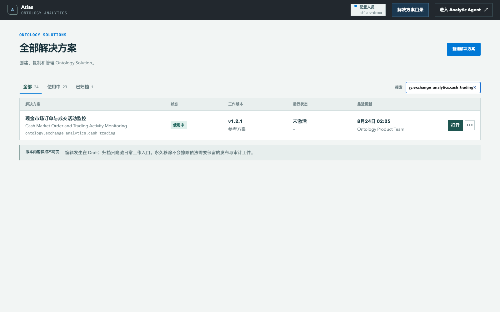
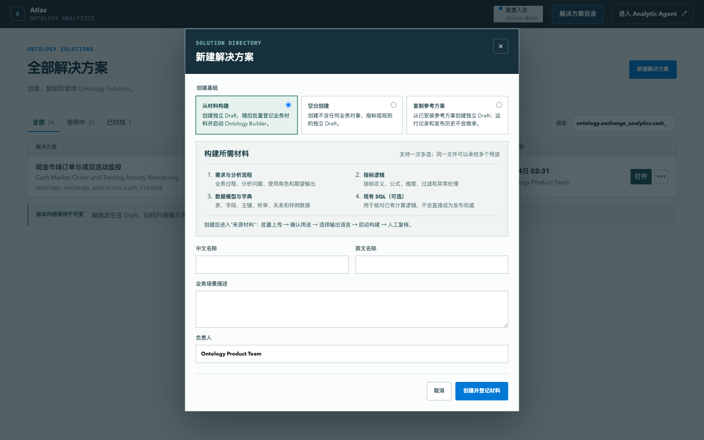
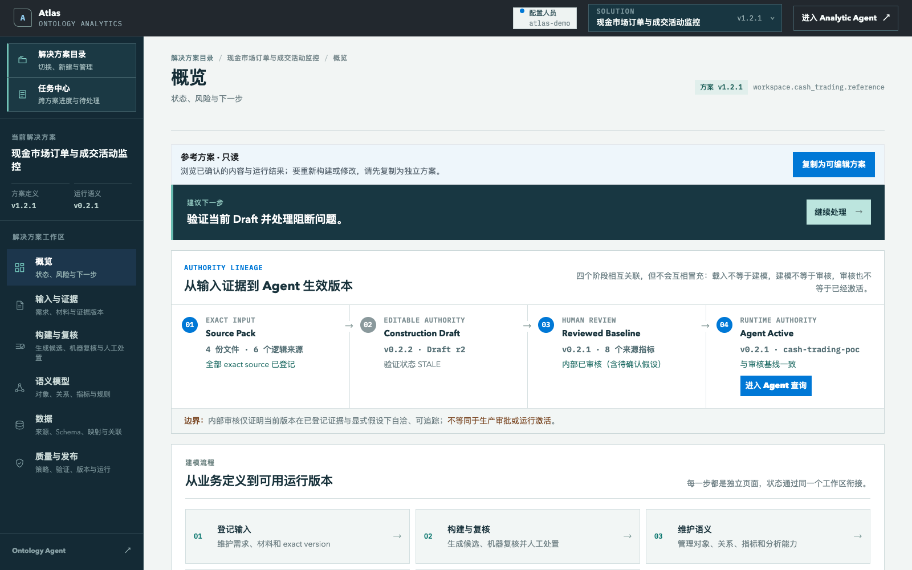
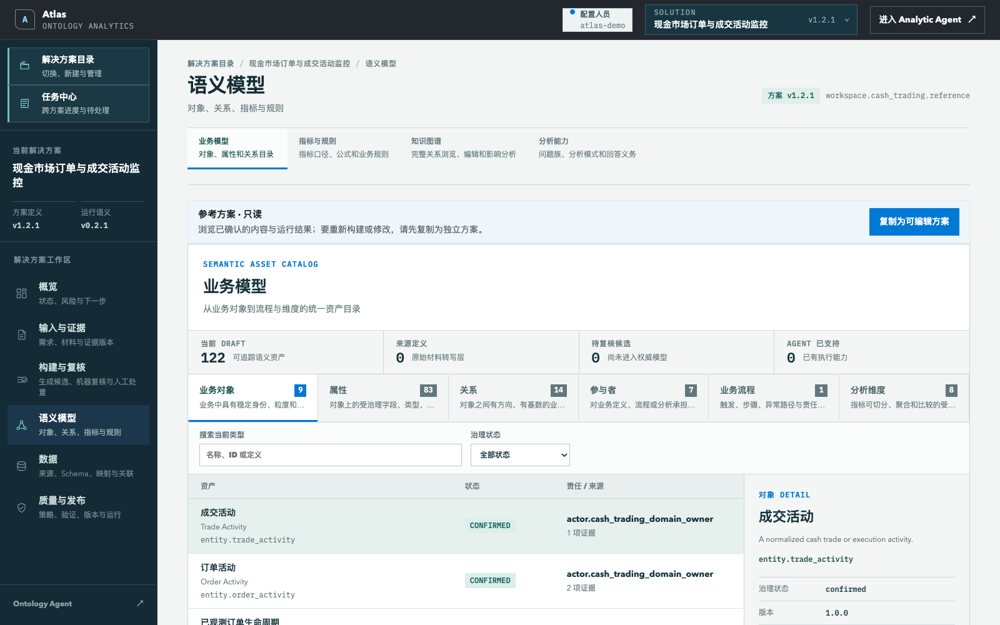
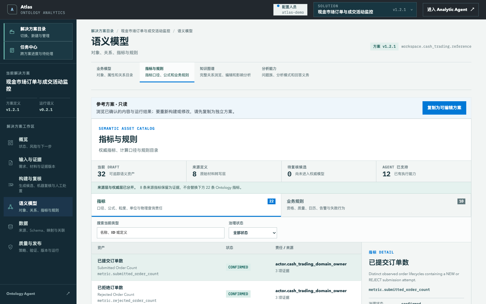
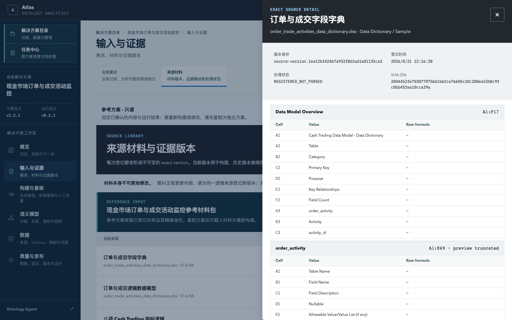
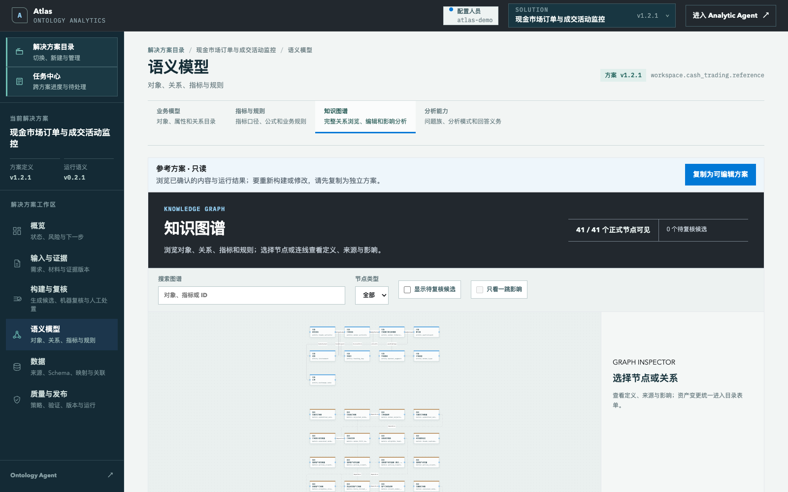
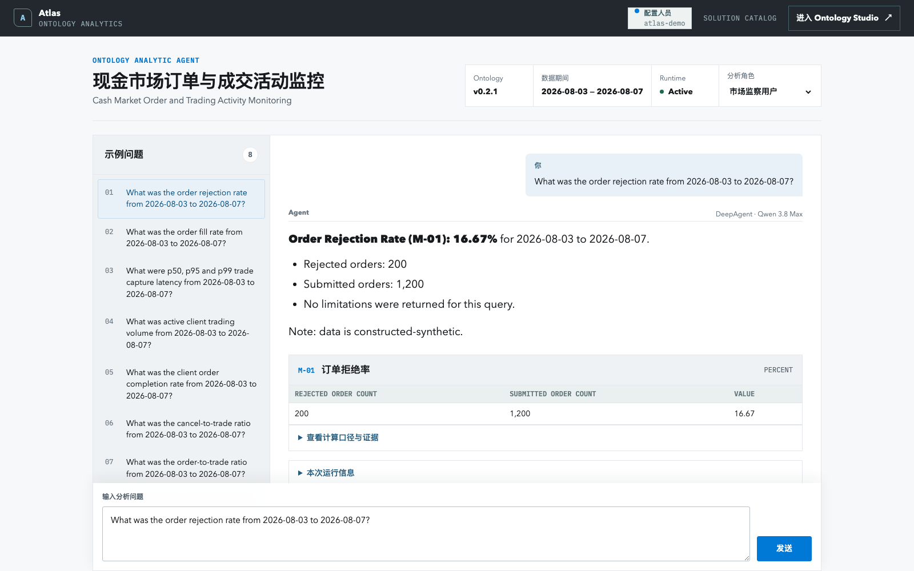

# 文档说明

本文档用于演示 Atlas Ontology Products 的 Cash Trading 案例。它覆盖产品定位、功能结构、演示材料、预构建 Ontology Package、知识图谱、Analytic Agent、推荐问题、操作步骤、限制与故障处理。

本手册对应本地验收版本。**在 Muyu 审批前，不部署 EC2。**

| 项目 | 内容 |
| --- | --- |
| Studio 入口 | `http://127.0.0.1:18083/ontology-studio/solutions/` |
| Agent 入口 | `http://127.0.0.1:18083/ontology-agent/?solution=ontology.exchange_analytics.cash_trading` |
| Demo Solution ID | `ontology.exchange_analytics.cash_trading` |
| Demo 数据期间 | 2026-08-03 至 2026-08-07；2026-08-05 为非交易日 |
| 数据性质 | 构造型样例数据，不是 HKEX 生产数据 |
| 推荐浏览器 | Chrome，桌面端，100% 缩放 |

# 1. 产品介绍

Atlas Ontology Products 是一个产品组，包含两个上下游独立产品：

1. **Ontology Studio**：接收需求、指标逻辑、数据模型、字段字典、SQL 等材料，形成可人工复核、可验证、可版本化发布的 Ontology Package。
2. **Ontology Analytic Agent**：消费已经激活的 Ontology Package 和受控数据工具，理解用户问题、选择分析路径、计算结果并返回证据。

两者共享同一套版本化语义资产，但承担不同职责。Studio 不负责聊天问数；Agent 不修改或发布 Ontology。

## 1.1 产品内核

完整链路为：

`来源材料 → LLM + Builder Tools 生成候选 → 机器验证 → 人工复核 → 发布版本 → Active Runtime Snapshot → DeepAgent 分析`

关键原则：

- LLM 可以理解材料、提出对象/关系/指标候选、规划工具调用和生成解释。
- LLM 生成的内容默认是 **Candidate**，不能自动升级为业务事实。
- 指标数值由 Ontology 定义的确定性查询工具计算，不能由模型凭空生成。
- 来源、标准化、推断、产品补充和待确认事项必须分别记录。
- 发布和运行激活是受控动作；Agent 只读取 Active Snapshot。

## 1.2 本次 Demo 的两条路径

本次演示刻意分成两条路径：

- **构建入口演示**：展示通用产品如何接收新案例材料。现场只展示入口、材料要求和后续步骤，不真正上传或等待自动构建。
- **结果与分析演示**：直接打开已准备好的 Cash Trading Ontology Package，浏览完整内容和知识图谱，然后进入 Agent 做真实查询。

这一区分避免把“上传入口可展示”错误表述为“任意文档都已经可以现场稳定构建完毕”。

# 2. 功能总览

## 2.1 Ontology Studio

| 功能 | 用途 | Cash Trading Demo 中的展示内容 |
| --- | --- | --- |
| 解决方案目录 | 新建、搜索、切换和管理 Solution | 选择 Cash Trading 参考方案 |
| 输入与证据 | 查看需求、分析问题、来源材料和 exact version | Deloitte HK 输入、样例数据、内部 Review Pack |
| 语义模型 | 浏览对象、属性、关系、指标、维度和规则 | 9 个实体、83 个属性、14 条关系、22 个指标资产、8 个维度 |
| 数据 | 查看数据源、Schema、字段映射与 Join | 9 个数据源、80 条 Binding、8 条 Join |
| 知识图谱 | 从图视角查看对象、关系、指标、维度和数据资产连接 | 41 个图节点与 41 条可视连接 |
| 质量与发布 | 查看来源、假设、验证结果、版本和运行状态 | 内部复核基线、显式限制、Active Runtime |

> 22 个指标资产包含 8 项 Deloitte HK 核心指标，以及用于分子、分母、延迟统计和分析支持的派生语义指标。现场讲解核心业务口径时以 M-01 至 M-08 为主。

## 2.2 Ontology Analytic Agent

| 功能 | 用途 |
| --- | --- |
| 示例问题 | 快速选择已登记并验证的问题 |
| 自然语言输入 | 直接输入 Cash Trading 分析问题 |
| DeepAgent 运行时 | 理解问题、选择 Ontology 工具、组织分析和解释 |
| 确定性指标工具 | 使用已登记 Metric ID、期间和维度计算结果 |
| 结果表格 | 展示数值、分子/分母、趋势或分位数 |
| 计算口径与证据 | 展开查看 Metric、期间、维度、来源、决策和 Query hash |
| 本次运行信息 | 查看 Package、Snapshot、Execution 和模型信息 |

# 3. 演示前准备

## 3.1 本地服务检查

1. 打开 `http://127.0.0.1:18083/ontology-studio/solutions/`。
2. 确认页面可以加载，顶部显示 Atlas 与“解决方案目录”。
3. 搜索 `ontology.exchange_analytics.cash_trading`。
4. 确认出现“现金市场订单与成交活动监控”。
5. 打开 Agent，确认 Runtime 为 `Active`。
6. 浏览器使用桌面端 100% 缩放。

## 3.2 准备的原始材料

材料位于本手册同级目录：

| 文件 | 来源 | 建议用途 | Demo 动作 |
| --- | --- | --- | --- |
| `01_Deloitte_HK_Input/HKEX_Analytics_Scenario_Input_Template_with_ADT_Reference_v20260819.xlsx` | Deloitte HK | 需求、分析流程和指标逻辑 | 展示文件与用途，不提交 |
| `01_Deloitte_HK_Input/order_trade_activities_data_dictionary.xlsx` | Deloitte HK | 数据模型、字段字典和枚举 | 展示文件与用途，不提交 |
| `01_Deloitte_HK_Input/cash_trading_sample_data.xlsx` | Deloitte HK | 构造型样例数据、粒度和计算验证 | 展示文件与用途，不提交 |
| `01_Deloitte_HK_Input/email screenshot.jpeg` | Deloitte HK | 材料来源和限制说明 | 只归档为证据 |
| `02_Product_Supplement/reference_controls.sql` | Atlas 产品团队 | SQL 证据和确定性计算合同 | 可选补充；不能说成客户原有 SQL |
| `03_Review_Reference/HKEX_Cash_Trading_Review_Pack_v0.2_EN_v20250823.xlsx` | Atlas 基于 Deloitte HK 输入整理 | 内部口径复核基线 | 不作为首次 Build 输入 |

Review Pack 的 Review Conclusion / Comments 仍为空，因此它不能被表述为 Deloitte HK 或 HKEX 已确认内容。

# 4. 展示通用 Build 入口

建议时长：2 分钟。

1. 在“解决方案目录”点击右上角 **新建解决方案**。
2. 保持默认入口 **从材料构建**。
3. 指出入口要求的四类材料：
   - 需求与端到端分析流程；
   - 指标定义与计算逻辑；
   - 数据模型、字段字典、枚举或样例数据；
   - 已有 SQL（可选）。
4. 解释该入口支持批量材料登记。创建后会进入文件用途确认、统一 Ontology 输出语言选择和 Builder 任务启动。
5. 现场到此停止，关闭窗口；**不实际创建、不上传、不触发构建。**

推荐讲解：

> 这是通用的新案例入口。原始文档可以是中文、英文或混合语言；构建时单独指定 Ontology 输出语言，避免最终资产中英文随机混排。Builder 使用 LLM 理解材料并调用受控工具形成 Candidate Package，最终发布仍需要人工复核。

# 5. 浏览预构建 Cash Trading Ontology Package

建议时长：5 分钟。

## 5.1 打开方案与 Package 总览

1. 返回解决方案目录。
2. 搜索 `ontology.exchange_analytics.cash_trading`。
3. 点击 **打开**。
4. 默认进入“概览”，查看 Package 身份、状态、资产分类、数据语义、证据和下一步。

参考方案会同时展示一个较新的工作草稿和一个已复核运行基线：`Construction Draft v0.2.2` 用于说明后续变更仍可继续复核；`Reviewed Baseline / Agent Active v0.2.1` 是当前 Agent 实际消费的版本。两者并存是版本治理状态，不是版本串错。

总览中应能看到：

- 业务对象、属性和关系；
- 指标、维度、规则和分析问题；
- 数据源、字段映射、Join 和语义关联；
- 来源、决策、假设和待确认项；
- 发布版本与运行状态。

## 5.2 浏览业务对象、属性和关系

1. 左侧进入 **语义模型**。
2. 在顶部分类切换对象、属性、关系、指标、维度、规则等资产。
3. 左侧选择资产，右侧查看定义、稳定 ID、粒度、Owner、属性和关联。

核心对象包括：

- Order Activity：订单活动；
- Trade Activity：成交活动；
- Order Lifecycle：订单生命周期；
- Participant：参与者；
- Instrument：证券；
- Trading Day：交易日；
- Order Type：订单类型；
- FX Rate：汇率；
- Market Segment：市场板块。

## 5.3 浏览指标、维度与规则

切换到“指标”，重点展示 M-01 至 M-08：

| 编号 | 指标 |
| --- | --- |
| M-01 | Order Rejection Rate |
| M-02 | Order Fill Rate |
| M-03 | Trade Capture Latency |
| M-04 | Active Client Trading Volume |
| M-05 | Client Order Completion Rate |
| M-06 | Cancel-to-Trade Ratio |
| M-07 | Order-to-Trade Ratio |
| M-08 | Potential Self-Trade Rate |

查看每项指标时，重点解释：业务定义、公式、分子/分母、资格规则、允许维度、单位、时间边界、来源和限制。

## 5.4 浏览数据语义与 Semantic Mapping

1. 左侧进入 **数据**。
2. 查看数据源和 Schema：物理表、字段、类型、主键和粒度。
3. 查看字段映射：物理字段如何绑定到 Ontology Property。
4. 查看 Join 和语义关联：数据资产如何支持对象关系和指标计算。

Cash Trading Package 当前包含 9 个数据源、80 条字段 Binding 和 8 条 Join。映射是 Agent 能把业务问题落到物理数据的关键，不是独立的装饰性页面。

## 5.5 浏览来源材料与 exact version

1. 左侧进入 **输入与证据**。
2. 切换到 **来源材料**。
3. 点击任意材料行，右侧打开材料详情。
4. 检查版本身份、登记时间、处理状态、SHA-256，以及 Excel Sheet/Cell 或文本行预览。

每次登记形成不可变 exact version。更新材料时应登记新版本，而不是原地修改旧版本。

## 5.6 浏览知识图谱

1. 在语义模型中进入 **知识图谱**。
2. 使用类型筛选查看对象、关系、指标、维度和数据资产。
3. 点击节点查看定义和关联资产。
4. 通过关系追踪某个指标依赖的对象、字段和数据源。

知识图谱是 Ontology Package 的图形化浏览方式。它不替代指标公式、SQL、验证规则或发布控制。

# 6. 使用 Ontology Analytic Agent

建议时长：5 分钟。

## 6.1 进入 Agent

1. 点击页面顶部 **进入 Analytic Agent**；也可以直接打开本手册首页的 Agent 地址。
2. 确认标题为“现金市场订单与成交活动监控”。
3. 确认 Ontology 版本、数据期间和 Runtime `Active` 可见。
4. 保持分析角色为“市场监察用户”。

## 6.2 提问

1. 从左侧选择一个示例问题，或在底部输入问题。
2. 点击 **发送**。
3. DeepAgent 读取 Active Ontology Package，选择 Cash Trading 指标工具，并组织解释。
4. 数值由确定性工具计算；LLM 不直接创造指标结果。

## 6.3 查看证据

在答案下方展开：

- **查看计算口径与证据**：Metric ID、期间、维度、来源、口径决策和 Query hash；
- **本次运行信息**：Package、Snapshot、Execution 和模型信息。

推荐讲解：

> DeepAgent 负责理解问题、选工具和组织解释；数值由 Ontology 定义的确定性查询工具计算。这样既保留 LLM 的开放理解能力，又避免让模型凭空编造业务数字。

# 7. 推荐问题与期望答案

## 7.1 现场优先问题

建议按以下顺序展示：

1. `What was the order rejection rate from 2026-08-03 to 2026-08-07?`
2. `What were p50, p95 and p99 trade capture latency from 2026-08-03 to 2026-08-07?`
3. `Show the daily potential self-trade rate from 2026-08-03 to 2026-08-07.`

## 7.2 八项基线结果

| 指标 | 样例结果 | 必须说明的边界 |
| --- | --- | --- |
| M-01 Order Rejection Rate | 200 / 1,200 = 16.666667% | 构造数据 |
| M-02 Order Fill Rate | 0 / 5,064,000 = 0% | EXECUTE 无法可靠关联 NEW 生命周期，不能解释为没有成交 |
| M-03 Trade Capture Latency | p50 9 ms；p95 15 ms；p99 15 ms | 只使用非负 latency 记录 |
| M-04 Active Client Trading Volume | HKD 52,235；0.052235 HKD million；3 个 active clients | HKD 与 USD pre-haircut 必须分开 |
| M-05 Client Order Completion Rate | 0 / 150 = 0% | 与 M-02 相同的生命周期关联缺口 |
| M-06 Cancel-to-Trade Ratio | 300 / 200 = 150% | numerator 为 distinct canceled lifecycles |
| M-07 Order-to-Trade Ratio | 1,200 / (2 × 200) = 300% | 公式显式包含 2 × trades |
| M-08 Potential Self-Trade Rate | 每个交易日 10%；全期间 20 / 200 = 10% | 只能称 candidate / potential / triage，不是违规结论 |

更完整的问题、期望数值和开放问题见 `Cash_Trading_Demo_问题与期望答案.md`。

# 8. 12–15 分钟现场演示脚本

| 时间 | 动作 | 目标 |
| ---: | --- | --- |
| 0–2 分钟 | 打开解决方案目录和“新建解决方案” | 说明通用 Build 入口与所需材料 |
| 2–4 分钟 | 打开预构建 Cash Trading Package 总览 | 说明 Package 不是一张图或一段 Prompt |
| 4–7 分钟 | 浏览对象、关系、指标、维度、字段映射 | 展示业务语义与数据语义已连接 |
| 7–9 分钟 | 打开来源预览和知识图谱 | 展示 exact version、证据和关系图 |
| 9–14 分钟 | 进入 Agent，运行 2–3 个问题 | 展示 DeepAgent + 确定性工具 + 证据 |
| 14–15 分钟 | 主动说明限制与下一步 | 避免把内部假设讲成客户事实 |

完整逐步话术见 `Cash_Trading_E2E_Demo_操作流程.md`。

# 9. 来源、假设与 Deloitte HK Feedback

预构建 Package 已把 Deloitte HK 的材料和 Review Pack 中的复核问题纳入以下内部基线：

1. 订单生命周期暂按 `venue + business date + order id` 组合识别。
2. Submitted population 暂按 NEW / REJECT 事件；Cancel numerator 按包含 CANCEL 的 distinct lifecycle。
3. Order-to-trade ratio 使用 `submitted orders / (2 × eligible trades)`。
4. Active client 暂按 `participant_type = CLIENT`；生产化需要有效期可追溯分类。
5. HKD 原币名义金额和 USD pre-haircut 名义金额分开。
6. Latency 使用非负记录和 nearest-rank percentile。
7. Buy participant 等于 sell participant 只形成 potential self-trade 候选。
8. 时间边界使用香港时区与 HK 交易日历。

以上是为了形成自洽 Demo 而采用的显式假设，不是 Deloitte HK/HKEX 已确认事实。完整记录见 `假设与补充记录.md`。

# 10. 已知限制

- 数据为构造型样例，不代表真实市场活动。
- Build 页面本次只用于展示入口，不在现场真实执行任意文档到发布版本的自动构建。
- Review Pack 是内部复核基线，空白确认栏不构成外部确认。
- M-02 和 M-05 的 0% 受 EXECUTE-to-NEW 关联缺口影响。
- Potential self-trade 只用于排查候选，不能表述为 misconduct、market abuse 或违规事实。
- 当前不覆盖 HKEX 数据接入、IAM、网络、环境审批、Knowledge Center 集成或 EC2 发布。

# 11. 故障处理

| 现象 | 处理方式 |
| --- | --- |
| 页面无法打开 | 检查本地容器是否健康；不要改用旧 EC2 版本 |
| Solution 太多 | 搜索完整 ID `ontology.exchange_analytics.cash_trading` |
| 材料预览仍在加载 | 等待右侧 Drawer 完成 exact version 校验；刷新后重新点击材料 |
| Agent 问题超时 | 优先改用 M-01、M-03、M-06、M-07 或 M-08 登记问题 |
| LLM 暂时失败 | 系统可使用同一 Ontology Semantic Engine 返回 fallback 结果；页面会明确标注 |
| 图谱渲染缓慢 | 先筛选一种节点类型，再切回“全部” |
| 结果与期望不一致 | 停止演示并记录问题，不临时修改 Ontology 或样例数据 |

# 12. Demo 前最终检查表

- [ ] Studio 本地地址可访问。
- [ ] 搜索完整 Solution ID 后只显示 Cash Trading 参考方案。
- [ ] Package 总览、语义模型、指标、知识图谱和来源预览可打开。
- [ ] Agent 显示 Cash Trading、数据期间和 Active Runtime。
- [ ] 至少运行 M-01、M-03、M-08 各一次并核对结果。
- [ ] Agent 答案中的标题、列表、表格和证据展开显示正常。
- [ ] Finder 中的四份 Deloitte HK 输入可以打开。
- [ ] 主动说明构造数据、内部 Review Pack 和 M-02/M-05 限制。
- [ ] 不实际触发现场 Build，不部署 EC2。

# 附录 A：Package 验收基线

| 资产 | 数量 |
| --- | ---: |
| Entities | 9 |
| Properties | 83 |
| Relationships | 14 |
| Dimensions | 8 |
| Metric assets | 22 |
| Data sources | 9 |
| Semantic bindings | 80 |
| Joins | 8 |

本地验收同时验证三项真实 DeepAgent 问题：M-01、M-03、M-08。三项均由 Qwen 3.8 Max 通过 DeepAgent 调用 Ontology 工具返回 `GROUNDED`，未进入 fallback。

# 附录 B：相关文件

- `README.md`：Demo Pack 说明与范围。
- `Cash_Trading_E2E_Demo_操作流程.md`：现场演示脚本。
- `Cash_Trading_Demo_问题与期望答案.md`：问题与回归基线。
- `假设与补充记录.md`：标准化、构造内容、限制和待确认项。
- `source-manifest.json`：来源文件身份、用途、校验和与限制。
- `screenshots/`：本地验收截图。
