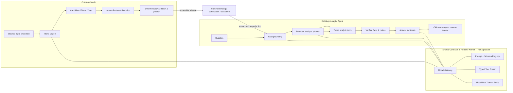

# LLM-enabled Ontology Studio & Analytic Agent 架构候选 v0.1

状态：Superseded Draft Candidate — 已由 `13_llm_enabled_products_reviewed_candidate.md` 取代  
日期：2026-08-19  
范围：可公开演示的 constructed-synthetic ADT Demo Edition；不声称 HKEX 业务验证或生产就绪

> 本文件保留为 Round 1 输入与审计记录，不再作为当前方案。两轮 critic review 后的收敛版本见 [`13_llm_enabled_products_reviewed_candidate.md`](13_llm_enabled_products_reviewed_candidate.md)。

## 1. 结论

当前确定性 ADT backend 不是错误方向，但它只是可信分析的“承重结构”，不是完整的 ontology-based product。

完整产品必须同时具备两类能力：

1. **LLM 处理开放世界问题**：理解转写材料、提出 ontology candidate、理解自然语言问题、规划分析、迭代探索、生成归因假设与组织答案；
2. **Ontology + deterministic runtime 处理受治理事实**：定义可用概念和关系、约束指标口径、绑定数据、编译查询、计算数字、执行政策、验证 claim、固化 evidence 和放行结果。

因此本方案的核心不是“用不用 LLM”，而是：

> LLM 是 proposal、planning 与 explanation engine；Ontology 是 semantic contract；deterministic runtime 是 execution、validation 与 evidence authority。

Studio 和 Agent 仍是两个独立 Product Domain。它们共享一个 LLM Runtime Kernel，但该 Kernel 是基础设施和合同底座，不是第三个用户产品，也不拥有跨产品的自由记忆或权限。

## 2. 第一性原理

### 2.1 为什么必须使用 LLM

企业材料与分析问题都不是封闭枚举：

- 同一指标会以业务描述、字段、SQL、报告标题和口头表达出现；
- 材料经人工安全转写后会不完整、含糊、冲突或缺少统一结构；
- 用户不会只问预先写好的四种句式，而会追问“为什么”“还有什么异常”“哪个板块贡献最大”“换个角度看”；
- 有价值的分析通常需要在第一轮结果后选择下一步，而不是一次固定查询。

这些任务依赖语言理解、候选生成、语义匹配与搜索策略，纯正则或固定模板无法长期承担。

### 2.2 为什么不能让 LLM 成为 authority

LLM 输出具有概率性，可能遗漏、臆测、受 prompt injection 影响，也无法仅凭生成文本证明：

- 使用的是哪个版本的业务定义；
- population、calendar、join、unit 和 rounding 是否正确；
- 当前用户是否有权获得结果；
- 数字是否来自已批准数据版本；
- 叙述中的每一个事实是否有 evidence。

所以所有模型输出只能进入以下三种状态之一：

- `PROPOSED`：等待确定性检查或人工 Decision；
- `BOUND`：已绑定到 active ontology 中的 exact object/version；
- `REJECTED / NEEDS_CLARIFICATION`：无法安全绑定或验证。

模型不得直接产生 `CONFIRMED` ontology、authoritative SQL、authoritative number、publish/activate decision 或 released answer。

### 2.3 产品价值来自“组合”而不是替代

```text
开放输入的理解与探索                         受治理事实与执行
─────────────────────────────────────────────────────────
LLM proposes                             Ontology constrains
LLM plans                                Policy authorizes
LLM explores through typed tools         Runtime calculates
LLM drafts explanations                  Evidence validates
```

去掉左边，产品退化成固定报表；去掉右边，产品退化成无法证明正确性的 ChatBI。

## 3. 产品边界

### 3.1 Ontology Studio

用户目标：把获准的业务转写和获准附件，变成可追溯、可审查、可发布的 semantic release。

Studio 可以读取 Draft、Candidate、Gap、Conflict、Decision 和 Cleared Input projection；它不能因此获得事实数据或 Agent execution 的通配访问权。

### 3.2 Ontology Analytic Agent

用户目标：基于已激活的 runtime snapshot，用业务语言进行查询、比较、归因和受约束探索，并获得有 evidence 的答案。

Agent 只消费 active runtime projection；不读 Studio draft、原始材料、review comment，也不能修改 ontology。

### 3.3 Shared LLM Runtime Kernel

共同复用：

- provider adapter 与 model registry；
- prompt/schema registry；
- structured-output validation；
- context pack builder；
- typed tool broker；
- timeout、retry、budget、circuit breaker；
- model-run trace 与 evaluation harness。

必须隔离：

- Studio 与 Agent 使用不同 prompt、tool allowlist、context projection 和 retention policy；
- Agent conversation memory 不进入 Studio truth；
- Studio candidate 不在 publish/activate 前进入 Agent runtime；
- API Key 只存在于 server-side secret，不进入浏览器、artifact、prompt trace 或日志。

## 4. 总体架构



模型不连接数据库。模型只调用 Tool Broker 中按产品、principal、active snapshot 和 purpose allowlist 后的 typed tools。

## 5. Ontology Studio 中的 LLM

### 5.1 Intake Copilot

输入：经 Disclosure 审批后的安全转写或获准内容 projection；不是原始 HKEX 材料。  
输出：受 closed schema 约束的 `IntakeObservation[]`。

可做：

- 识别业务目标、参与者、端到端流程、问题、期望输出；
- 从指标逻辑转写中提取 metric、维度、period、population、排除项、单位、rounding 候选；
- 对获准的数据字典 projection 提取 entity、property、enum 和 relationship 候选；
- 把 SQL 解析器提供的 AST/summary 解释为“当前实现观察”，识别 filter、join、aggregation 与业务描述的差异。

不可做：

- 把没有来源的字段补成 confirmed；
- 把现有 SQL 自动提升为业务定义；
- 把 `Missing / Withheld / Unconfirmed` 改写成推测值；
- 访问未经批准的 locator 或附件。

每条 observation 必须携带 `source_ref + source_anchor + extraction_schema_version + model_run_ref + confidence + status=PROPOSED`。

### 5.2 Candidate Builder

LLM 将 observation 组织为候选的：

- Object / Event / Actor；
- Metric / Dimension / Rule / Calendar；
- Link / Join candidate；
- Process / Action / Interface；
- question-to-analysis-pattern；
- alias、同义词和用户表达。

随后由确定性 normalizer 完成 ID、类型、unit、reference closure、DAG、enum、formula AST 和 schema 验证。任何无法规范化的项进入 Gap，而不是由模型重试到“看起来正确”。

### 5.3 Reconciliation Copilot

针对同一概念的多来源描述，模型可以：

- 聚类可能的同义项；
- 展示一致点与冲突点；
- 提出 2–3 个明确 Decision option；
- 生成业务人员能回答的澄清问题；
- 评估某个 Decision 对 metric、mapping、question 和 report 的影响范围。

它不能选择最终 reference truth。选择由明确的人类角色完成，并产生 versioned Decision。

### 5.4 Review Copilot

Reviewer 看到的不是“模型已经构建完成”，而是：

- 候选对象及来源覆盖；
- 缺失、冲突与风险排序；
- 机器建议与理由；
- human-editable correction；
- publish blockers 与下游影响。

### 5.5 Change Impact Assistant

对两个 draft/release 做 semantic diff，解释：

- 哪些定义、映射、问题模式和 runtime capability 变化；
- 哪些现有 Agent 问题可能需要重新 certification；
- 哪些变化只是文案，哪些改变计算语义。

最终 release impact classification 仍由确定性 diff rules 与 reviewer Decision 确认。

## 6. Analytic Agent 中的 LLM

### 6.1 Conversation & Goal Understanding

模型把自然语言问题转换为 `GoalDraft`，至少包含：

- requested metric / entity / dimensions；
- period / comparison / population；
- requested analytical intent；
- ambiguity candidates；
- user-visible clarification proposal。

Deterministic Binder 只允许它绑定 active runtime projection 中存在且当前 principal 可用的概念。未绑定项不得靠近似名称自动放行。

### 6.2 Bounded Analysis Planner

模型可基于已绑定 Goal 选择分析策略，例如：

- metric fact；
- period comparison；
- dimension slice；
- contribution ranking；
- calendar / volume / value decomposition；
- anomaly scan；
- reconciliation；
- evidence audit。

模型输出的是受 schema 约束的 `AnalysisPlanCandidate`，不是 SQL 或自由 DAG。Plan Gate 检查：

- 工具和参数都在 active capability registry；
- 所有 metric/dimension/operator 均已绑定；
- 最大步骤、查询、行数、token、wall time 和 iteration budget；
- 无重复循环、无未经批准的 causal/forecast capability；
- principal、purpose、scope 与 policy 允许。

### 6.3 Iterative Exploration

为了避免退化为固定报表，Agent 允许模型在每一步 verified result 后决定下一步，但只可使用 typed tools：

```text
resolve_semantics
get_metric_fact
compare_periods
slice_dimension
rank_contributors
decompose_change
reconcile_totals
scan_anomalies
test_approved_hypothesis
get_claim_evidence
finish_analysis
```

每个 tool 内部执行确定性 semantic DSL → compiler/operator → query engine；模型拿不到 DB credential，也不能提交任意 SQL、Python、shell 或文件路径。

### 6.4 Attribution & Hypothesis

模型可以提出“成交金额下降可能来自交易量、价格/规模结构、交易日、板块 mix”等候选解释，并调用批准的 decomposition/reconciliation tools 验证。

必须区分：

- `descriptive contribution`：由加总、分解或 reconciliation 支持；
- `correlation`：由批准统计工具支持；
- `causal claim`：只有 active ontology 中存在获批 causal model/assumption 时才允许。

没有 causal capability 时，模型必须使用“伴随、贡献、与……一致”等非因果措辞，不能写“导致”。

### 6.5 Answer Synthesis

模型只消费 verified `Claim[]`、limitations 和 user-safe evidence projection，输出：

- direct answer；
- 关键数字与变化；
- 有意义的 driver / contribution；
- limitation；
- 可选 follow-up。

输出中的每个事实句必须绑定一个或多个 `claim_ref`。Claim Coverage Validator 校验：

- 数字、方向、排名、期间、单位均与 claim 一致；
- 没有超出 evidence 的新事实；
- 没有内部 SQL、表列、path、prompt、policy reason 或 credential；
- limitation 未被模型删除或弱化。

失败时可以再生成一次；仍失败则回退确定性 renderer，或返回 `UNAVAILABLE`，绝不释放未验证草稿。

### 6.6 Feedback to Studio

Agent 可以把稳定出现的 `UNKNOWN_CONCEPT`、alias gap 或 unsupported analysis pattern 形成 typed Semantic Change Request proposal。它必须最小披露、异步、经过 disclosure/triage，且永远不会自动修改 ontology。

## 7. 端到端运行流程

### 7.1 Studio build flow

```text
Cleared Input registration
→ safe context projection
→ LLM structured extraction
→ deterministic normalization / source-anchor verification
→ Candidate + Gap + Conflict
→ human review / Decision
→ deterministic semantic validation
→ immutable release
```

### 7.2 Agent analysis flow

```text
User question
→ LLM GoalDraft
→ deterministic semantic binding + policy
→ LLM AnalysisPlanCandidate
→ deterministic Plan Gate
→ typed tool execution
→ verified facts / claims / evidence
→ LLM chooses next bounded step or finish
→ LLM answer draft with claim refs
→ claim coverage + disclosure + final eligibility
→ durable release commit
→ user-visible answer
```

### 7.3 Failure and fallback

| Failure | Product behavior |
|---|---|
| Model timeout/rate limit | supported ADT intent uses deterministic resolver/renderer; otherwise `UNAVAILABLE` |
| Invalid JSON/schema | one constrained repair attempt, then fallback/fail closed |
| Unknown semantic term | clarify or refuse; never fuzzy-bind as confirmed |
| Tool budget exceeded | stop with partial verified findings and explicit limitation, or unavailable |
| Unsupported factual sentence | regenerate once; then deterministic answer |
| Prompt injection in input | treat content as data, not instruction; tool/context allowlist unchanged |
| Provider unavailable | circuit breaker; deterministic closed-path remains usable |

## 8. Qwen 接入方案

### 8.1 PoC default

- Provider：Alibaba Cloud Model Studio / DashScope OpenAI-compatible API；
- Model ID：`qwen3.8-max`；
- Secret：使用 operator 已提供并已验证的 Qwen API Key；仅以 server-side secret 注入；
- Browser：永远不接触 API Key，也不直连模型；
- Scope：只允许 constructed-synthetic ADT demo content。真实 HKEX content 必须经过单独的数据出境、部署区域和安全审批。

建议的项目配置：

```text
ONTOLOGY_LLM_PROVIDER=qwen
ONTOLOGY_LLM_MODEL=qwen3.8-max
ONTOLOGY_LLM_BASE_URL=<approved regional OpenAI-compatible endpoint>
ONTOLOGY_LLM_API_KEY=<server-side secret>
ONTOLOGY_LLM_MODE=off|shadow|active
```

Key 不从其他项目文件做 runtime dependency；部署时复制到本项目权限为 `0600` 的 secret/env，且不提交仓库。

### 8.2 Task routing

PoC 先使用同一 model，不做过早的多模型路由：

| Task | Thinking | Output | Temperature |
|---|---:|---|---:|
| Studio extraction / classification | off | strict JSON schema | 0–0.1 |
| Agent goal grounding | off | strict JSON schema | 0 |
| Analysis planning / exploration | on，受 token budget 限制 | strict tool calls / plan schema | 0–0.2 |
| Attribution synthesis | on | claim-referenced JSON | 0–0.2 |
| Final answer wording | off | claim-referenced JSON | 0–0.2 |

不依赖 provider 返回的 hidden chain-of-thought，也不持久化它。

### 8.3 Model identity and drift

每次 ModelRun 至少记录：

- provider 与 requested model；
- provider response model / request ID；
- prompt template、output schema、tool registry 和 context pack digest；
- temperature/thinking/timeout/budget；
- input/output token、latency、outcome；
- validated structured output digest；
-关联的 draft/release/snapshot/execution ref。

模型 alias 或服务端行为可能变化，因此同一 requested model 不等于永远相同的 runtime。任何 model/prompt/schema 升级先跑固定 evaluation，再从 `shadow` promotion 到 `active`。

## 9. Context engineering

模型不应每次读取整个 ontology 或所有数据。ContextPackBuilder 按任务生成最小 projection：

### Studio pack

- exact Cleared Input projection；
- source anchor index；
- relevant candidate subset；
- allowed type/schema/registry；
- Missing/Withheld slots；
- task-specific instructions。

### Agent pack

- active runtime version/checksum；
- principal/purpose 下可见的 business vocabulary；
- approved metric/dimension/analysis pattern summaries；
- typed tool definitions；
- current verified claim summaries；
- budget and limitations。

不得进入普通 Agent model context：raw SQL、credential、unrestricted physical schema、raw rows、Studio draft/review comments、未经批准材料。

## 10. Security and trust controls

1. **Prompt injection boundary**：所有企业内容标为 untrusted data；系统指令和 tool policy 不从材料生成。
2. **No direct execution**：模型没有 DB、shell、Python、filesystem 或 HTTP arbitrary tool。
3. **Closed tool schemas**：extra field、unknown enum、unknown ref 直接拒绝。
4. **Least-data projection**：仅提供完成当前任务所需 ontology 与聚合 evidence。
5. **Egress boundary**：synthetic ADT 可发外部 Qwen；真实 HKEX 内容默认禁止，直到部署区域/专有网络/私有化方案获批。
6. **Secret hygiene**：Key 仅 server secret；日志、trace、错误、浏览器和 evidence 全部脱敏。
7. **No model authority**：模型不能签 gate、publish、activate、approve Decision 或 release answer。
8. **Fail closed**：模型出错不触发 legacy/browser evaluator 或未经验证的自由回答。

## 11. Product experience

### 11.1 Agent

ADT Demo Edition 采用“问数工作区 + 小型分析 dashboard”的混合，而不是二选一：

- dashboard 负责展示当前指标状态、period compare、driver/contribution 和 evidence coverage；
- chat 负责自然语言追问、分析计划、迭代探索与解释；
- dashboard card 可作为 follow-up context，chat 结果可 pin 回 dashboard。

### 11.2 Studio

Studio 不需要业务数据 dashboard。它需要治理/构建 dashboard：

- intake completeness；
- Candidate / Gap / Conflict；
- source coverage；
- review/publish blockers；
- active/published version 与 Agent compatibility。

### 11.3 两产品互跳

同一个 product shell 顶栏提供显式 `Ontology Studio` / `Ontology Agent` 切换：

- 在两个 canonical path 间跳转：`/ontology-studio/`、`/ontology-agent/`；
- 当前产品有 active state 和 `aria-current=page`；
- 共享已登录 session，但不共享 draft state 或越权数据；
- Demo Edition 只把 desktop browser 作为发布验收，移动端不构成当前 gate。

## 12. Evaluation

### 12.1 Studio evaluation

- field/object extraction precision、recall；
- source-anchor correctness；
- Missing/Withheld preservation = 100%；
- conflict recall；
- unsupported candidate rate；
- candidate-to-human-decision correction rate；
- same input/model/prompt 的 schema validity 与 stability。

### 12.2 Agent evaluation

- intent / metric / period grounding accuracy；
- clarify/refuse boundary accuracy；
- plan schema 与 tool-call validity；
- loop termination / budget compliance；
- deterministic answer correctness；
- contribution reconciliation；
- unsupported claim rate = 0；
- claim/evidence coverage = 100%；
- model-off/provider-failure fallback；
- prompt injection、secret/data leakage 和 direct execution attempts = 0。

### 12.3 允许变化与不允许变化

允许：模型选择不同但都被批准的探索顺序、措辞或 follow-up。  
不允许：相同 active snapshot 和同一确定性 query 的数字、unit、direction、period、reconciliation 或 evidence identity 变化。

## 13. Delivery slices and ROM

ROM 为同一位熟悉现有工程的工程师人日，不含真实 HKEX 安全审批和企业部署。

| Slice | 结果 | 验收 | ROM |
|---|---|---|---:|
| L0 Model Gateway | Qwen adapter、secret、structured output、trace、timeout/budget、off/shadow/active | `qwen3.8-max` live probe；key不进前端/日志；invalid schema/failure fallback | 2–3 pd |
| L1 Agent Grounding | 自然语言 GoalDraft + deterministic Binder | ADT paraphrase set 提升；现有 5 boundary outcomes 不回归；model-off仍可运行 | 2–3 pd |
| L2 Agent Tool Loop | bounded planner、typed analytic tools、迭代 exploration | ADT compare/driver/contribution 多步路径；无 arbitrary SQL/tool；预算终止 | 4–6 pd |
| L3 Claim-safe Answer | attribution + answer synthesis + coverage validator | 所有事实句有 claim_ref；mutation/prompt injection/leak tests；deterministic fallback | 3–4 pd |
| L4 Studio Extraction | fixed ADT safe transcription → observations/candidates/gaps/anchors | 可由 checked-in ADT input 重建 review candidate；Missing/Withheld 不被填补 | 4–6 pd |
| L5 Studio Copilot | reconciliation、review questions、SQL observed-logic explanation、impact summary | 至少一个冲突走 human Decision；SQL 不覆盖 definition；publish仍 deterministic | 3–5 pd |
| L6 Integrated Demo | 双产品 UI、互跳、model trace、shadow/rollback、desktop deploy smoke | 端到端 scripted demo；LLM off 一键回退；公开 synthetic label；0 browser fallback | 3–4 pd |

合计约 **21–31 person-days**。若先发布 Agent-first L0–L3 + L6，可在 **14–20 person-days** 得到有真实 LLM 探索能力的 ADT Demo；Studio L4–L5 随后补齐。该估算必须在 L0 spike 后根据真实 latency、schema-validity 和现有代码改造量重估。

## 14. Rollout and rollback

1. `off`：保持当前 deterministic baseline；
2. `shadow`：真实调用模型并记录候选，但用户仍看到 deterministic path；比较 grounding、plan 和 answer；
3. `active-canary`：仅 allowlisted demo user / question family 使用 LLM，失败自动 fallback；
4. `active`：通过 eval 和 desktop deployment smoke 后成为 ADT Demo default；
5. rollback：配置切回 `off`，不需要重新发布 ontology 或回滚 active snapshot。

模型 prompt/schema/tool registry 都版本化；回滚必须 pin 到上一个已通过 evaluation 的组合，而不是只切 model name。

## 15. 明确不做

- 不让模型直接构建并发布 authoritative ontology；
- 不让模型生成或执行任意 SQL/Python；
- 不把外部 Qwen 用于未经批准的 HKEX 原始/转写材料；
- 不做跨场景通用 autonomous data scientist；
- 不做 enterprise Knowledge Center 总体架构；
- 不做 production IAM、private networking、SLA 或完整 audit platform；
- 不因共享 Model Gateway 把两产品合并或创造第三产品；
- 不把移动端适配作为当前 Demo 发布 gate。

## 16. 决策与验收门

本文件在对抗审查完成前是 Draft Candidate。审查必须至少回答：

1. LLM 是否真正增加开放分析能力，而不是换皮模板；
2. 哪些 deterministic invariants 会被新 loop 破坏；
3. 外部模型边界是否足够清楚，synthetic 与真实 HKEX 是否可能被混用；
4. L0–L6 是否形成最短可演示 tracer，ROM 是否可信；
5. Studio/Agent 的共享能力是否不小心形成第三产品或跨域记忆；
6. provider failure、model drift、prompt injection 和 unsupported claims 是否有可测试 fallback。

通过 adjudication 后，文档状态只能升为 `Reviewed Candidate`；仍需 Decision Owner 批准 exact version 才能成为 implementation baseline。
