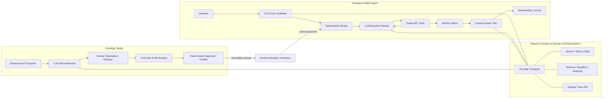

# LLM-enabled Ontology Studio & Analytic Agent — Reviewed Candidate v0.2

状态：`Reviewed Candidate` — 已完成两轮三视角 adversarial critic review；尚未成为 implementation baseline  
日期：2026-08-19  
首发范围：constructed-synthetic ADT `LLM Engineering Demo`，desktop-only release gate

关联裁决：[`reviews/llm-enabled-products-round-2-adjudication.md`](reviews/llm-enabled-products-round-2-adjudication.md)

## 1. 一句话方案

建立一个产品组、两个独立产品：

- **Ontology Studio** 把经允许的业务描述转成可追溯的 ontology observations/candidates，并通过人类 Decision 形成新 draft/release；
- **Ontology Analytic Agent** 消费已激活 ontology/runtime，用自然语言理解问题、选择受控分析工具、迭代探索并组织答案；
- **Shared Contracts & LLM Mechanisms** 只提供中性底座，不成为第三个产品。

LLM 的职责是理解、提出、规划、选择和组织；Ontology 的职责是定义可说什么；deterministic runtime 的职责是计算、验证、授权和放行。

## 2. 当前真实状态

### 已有

- 一套完整 constructed-synthetic ADT reference case；
- deterministic runtime、ADT ScenarioAdapter、8-case Agent flow、Dashboard、Evidence Audit；
- Studio intake/draft/revision/control surface；
- Agent 与 Studio 的独立 canonical paths：`/ontology-agent/`、`/ontology-studio/`；
- 同一顶部 product switch，可在两个产品间快速互跳；
- desktop EC2 deployment、HTTPS、共享 Demo 登录与 deployment smoke；
- provider-off 时完全可工作的 deterministic baseline。

### 尚未有

- 当前部署版 **没有 LLM runtime**；Ask/分析仍走 deterministic path；
- Qwen key 尚未注入 EC2，browser 与现有 containers 均拿不到 key；
- 尚无 ModelEgressDecision、model-safe projection、RunCapability、closed AnswerClause、LLM eval/promotion、in-flight rollback 或 demo response commit；
- Studio 目前没有 LLM Observation/Decision tracer。

### 已验证但未部署

- operator 提供的 Qwen API Key 已做一次不含业务数据的最小 capability probe；
- requested/returned model 均为 `qwen3.8-max`，OpenAI-compatible structured JSON 返回成功；
- 这只证明 endpoint/key/model 可用，不等于产品集成、安全门或发布完成。

## 3. 第一性原理

### 3.1 为什么一定要有 LLM

企业 ontology 的输入与分析问题都是开放语言：同一指标会出现在需求说明、指标逻辑、数据字典、SQL、报表标题和口头描述中；提问者也不会只使用预先写好的固定句式。Studio 需要处理不完整、含糊、冲突的安全转写；Agent 需要在看到第一轮结果后决定下一步分析。

纯正则、固定 intent 或报表模板只能覆盖封闭 demo，不能形成可迁移的 ontology product experience。

### 3.2 为什么 LLM 不能拥有事实 authority

LLM 无法仅凭生成文本证明：

- metric/population/calendar/join/unit/rounding 使用了哪个批准版本；
- 当前 principal 是否有权看到结果；
- 数字是否来自 exact active snapshot；
- 事实句是否真正被 claim/evidence 蕴含；
- 必须回答的 driver/limitation 是否被遗漏。

所以 LLM 输出只能是 `PROPOSED` 或已被 deterministic binder 绑定的 candidate，不能直接变成 confirmed ontology、authoritative SQL/number、publish/activate decision 或 released answer。

### 3.3 我们真正要证明什么

首发不是证明“Qwen 能聊天”，而是同时证明：

1. held-out 自然语言能被正确绑定；
2. 第一轮 verified result 不同，会引发不同的第二步工具或参数；
3. 同一 active snapshot 的数字、方向、unit、period、population、rank 和 evidence identity 不受模型变化影响；
4. 任一 gate 失败时，不释放部分答案或敏感数据。

允许的能力表述是：

> **Open-language, closed-semantics, bounded adaptive exploration.**

## 4. 产品组与 authority 边界



### Shared layer 可以拥有

- provider transport、server-side secret client；
- schema envelope、deadline/retry/circuit breaker、metering；
- opaque trace/ref port。

### Shared layer 不可以拥有

- Studio/Agent 的 prompt、context、tools、eval、retention、promotion；
- Draft、Goal、Claim 等领域工作流；
- 跨产品 conversation memory；
- ontology truth、result release 或 UI product authority。

这样 Studio 与 Agent 可以独立形成 PRD、backlog、权限、状态和发布节奏，同时复用底层机制。

## 5. 首发产品：Agent-first LLM Engineering Demo

### 5.1 为什么先做 Agent

Agent 有现成的 active ADT snapshot、确定性 calculator、claims/evidence 和 dashboard，最容易隔离并测量 LLM 的新增价值。Studio LLM 会同时引入 extraction completeness、source semantic support、human disposition 和 publish authority，放在同一首发会让两条未知链互相掩盖。

所以首发顺序不是因为 Studio 不重要，而是先验证“ontology 被 LLM agent 消费”的最小闭环，再验证“ontology 被 LLM 辅助构建”的闭环。

### 5.2 Product experience

- **Dashboard**：继续由 deterministic runtime 生成，展示 ADT status、period compare、contribution 与 evidence coverage；不依赖 Qwen；
- **Ask**：LLM 负责开放语言 grounding、受控规划与结果依赖的下一步选择；
- **Answer**：所有事实由 closed clauses + deterministic realizer 输出；
- **Studio link**：顶部 `BUILD Ontology Studio`；
- **Agent link**：顶部 `ANALYZE Ontology Agent`；
- 两产品共享登录 session，但不共享 draft state、model memory 或越权数据；
- 当前只以 desktop browser 为 release gate。

### 5.3 外部共享 Demo 的输入边界

第一版 active Qwen path 只接受服务端登记的 constructed-synthetic question-family / paraphrase fixtures。页面可以展示自然语言问题并允许选择/改写到已登记 case，但未命中 exact family 的任意文本：

- 不发送 Qwen；
- 若 deterministic resolver 支持，则走 off/baseline；
- 否则 `CLARIFY`、`REFUSED` 或 safe failure。

原因不是模型无法理解自由文本，而是共享账号下无法阻止访客粘贴真实 HKEX/客户材料；UI notice 或 classifier 不能构成外部数据授权。未来若要开放 arbitrary free text，必须新增明确的数据外发决定与受控身份边界。

## 6. Agent LLM runtime

### 6.1 Goal grounding

Qwen 把自然语言转换为 closed `GoalCandidate`：metric、period、comparison、dimension、population、intent、ambiguity。Deterministic Binder 只允许绑定 active runtime projection 中存在且当前 scope 可见的 exact IDs；不做 fuzzy auto-confirm。

### 6.2 Bounded adaptive planner

首发只有三个 snapshot-bound tools：

```text
compare_periods
rank_contributors
decompose_change
```

LLM 不能输出 SQL 或自由 DAG。每个 tool call 必须绑定：

- run/session/capability/profile/rollout refs；
- exact active snapshot 与 previous-state digest；
- metric、dimension、period、population、principal/purpose；
- 参数 schema、step/query/token/time budget；
- tool result digest 与新 state digest。

首发 eval 必须有 paired cases：第一步结果 A/B 不同，第二步 tool 或 exact parameter 也必须不同，借此排除“固定模板路由”。

### 6.3 Verified claims and answer obligations

Binder 在执行前冻结 `AnswerObligationManifest`，定义 direct answer、metric/period、comparison、dimension/population、driver、unit、limitation 与 cardinality 分母。

Tool 只产出 typed verified findings/claims。LLM 只能输出：

- selected clause/claim IDs；
- closed operators 与 typed slots；
- clause order/group；
- safe presentation/follow-up IDs。

Deterministic validator 检查 obligation completeness、unsupported fact、unit/cardinality、causal strength；deterministic realizer生成最终事实文本。任意 headline/connective 若含事实，也必须进入 clause schema。

`claim_ref` 本身不等于 entailment；另一个 LLM/NLI 不能成为唯一 release judge。

### 6.4 Five outcomes and no-partial

```text
ANSWERED
CLARIFY
REFUSED
FAILED_PRECONDITION
FAILED_EXECUTION
```

任何 provider、schema、tool、budget、reconcile、claim、profile 或 commit 失败，都丢弃 private answer buffer。UI 可以显示不含分析事实的阶段进度，但不能显示 partial numbers/findings。

Deterministic fallback 必须从原始 trusted request、当前 exact deterministic snapshot 与 policy 重新开始，不能复用 LLM Goal、scope、plan、tool 参数或 partial state。fallback 成功单列，不计 LLM success。

### 6.5 Engineering demo commit

请求开始时固定：snapshot、`EngineeringRunProfile`、task rollout epoch、question family、RunCapability、egress decision 与 absolute deadline。

答案先进入不可见 private buffer。release 时：

1. 在与 off/revocation/rollout/profile 切换同一顺序域中做 final CAS；
2. 检查当前 snapshot/profile/epoch/egress/eval 仍匹配；
3. 只提交 sanitized bytes/digest 与 outcome；
4. 原子形成 `EngineeringDemoResponseCommit`；
5. response handler 只读取已 commit 的 exact bytes。

旧 in-flight run 在 off、profile、snapshot 或 egress revoke 后 commit count 必须为 0。该对象不叫 `ResultReleaseCommit`，也不宣称完整 Core durability/exact replay。

## 7. Qwen integration

### 7.1 Exact model

- Provider：Alibaba Cloud Model Studio / DashScope OpenAI-compatible API；
- Model：`qwen3.8-max`；
- structured output 与 function/tool calling；
- key 仅注入专用 server-side model-calling service；
- browser、image、bootstrap、Studio、Agent-control、logs 与 traces 均不得出现 key；
- provider 默认 stateless，不使用跨请求 conversation memory。

官方能力参考：

- [Qwen3.8-Max model documentation](https://www.alibabacloud.com/help/en/model-studio/qwen3-8-max)
- [Qwen API reference](https://www.alibabacloud.com/help/en/model-studio/qwen-api-reference)
- [Structured output](https://www.alibabacloud.com/help/en/model-studio/qwen-structured-output)
- [Function calling](https://www.alibabacloud.com/help/en/model-studio/qwen-function-calling)

### 7.2 Exact execution profile

`EngineeringRunProfile` 至少绑定：

- provider/account/endpoint/region 与允许的 returned model identity；
- system/domain prompt digest；
- input/output schema digest；
- exact tool registry；
- context/projection serializer digest；
- token/tool/time/iteration budgets；
- fallback/outcome/renderer policy；
- frozen eval manifest、threshold、promotion TTL/lease。

requested model 名称不等于 immutable provider build。returned identity 不匹配、alias drift、TTL 过期或 eval trigger 失败时自动 `off`。

### 7.3 Egress and model-safe projection

每次真实 Qwen call，包括 shadow/retry/repair/eval，必须同时存在：

- exact `ModelEgressDecision`：product/task/principal/scope/purpose、provider/account/region、classification、allowed fields、retention、expiry、approver、ALLOW；
- closed `ModelQuestionProjection` 或 `ModelEvidenceProjection`；
- 最终 wire payload/projection digest receipt。

Projection 必须从 allowlisted canonical aliases、aggregated/bucketed values、claim IDs 与 mandatory limitations **正向构造**；禁止从普通 execution response/facts/evidence 做删字段投影。物理 table/column、SQL、mapping/source IDs、locator/path、policy detail、credential 默认全部不在 schema 中。

### 7.4 Deadline, retry and cancellation

Browser→server→provider→tools 共用一个 absolute deadline。Server deadline 必须早于 browser deadline；retry 消耗同一剩余预算。Timeout 后停止 retry/tool/commit并忽略 late provider response。

若 provider 不能证明远端 cancellation，只记录 `ABANDONED_REMOTE_UNKNOWN`，不能虚构“远端计算已停止”。

### 7.5 Secret and trace

- key 不写入 repo，不从其他工程形成 runtime dependency；
- 部署时复制到本项目专用 secret，最小权限并可轮换；
- raw prompt/response trace 默认 off；
- metadata trace 使用 allowlisted schema；
- Studio/Agent cache/trace/eval namespace、ACL、TTL 与 export 分离；
- SDK/proxy/exception/log/trace/browser 做全链 secret/leak canary。

## 8. Model evaluation and rollout

### 8.1 Frozen eval dimensions

- held-out 中英 paraphrase grounding；
- ambiguity/unsupported boundary；
- result-dependent branching；
- tool schema/scope/budget/termination；
- deterministic number/reconciliation equality；
- AnswerClause correctness、claim coverage、obligation completeness；
- direction/period/unit/population/rank/causal/limitation mutation；
- prompt injection、physical metadata、secret/path/SQL leak；
- provider timeout/rate/schema/repair/tool/commit faults；
- concurrent off/snapshot/profile/egress revoke；
- model-off baseline 与 deterministic fallback。

所有 success 指标必须报告 `provider_success=true, fallback=false`；fallback 另表报告。

### 8.2 Rollout

```text
off
→ shadow
→ active-question-family-canary
→ Engineering Demo default
```

Rollout 不是全局裸 env switch，而是 versioned task record，绑定 exact profile、question family、eval manifest、threshold、lease、owner 与 automatic-off trigger。首发不宣称 user canary，因为共享 Demo 账号没有可作为 authority 的 individual principal。

### 8.3 Release label

LLM Ask 区域与回答必须邻接显示：

> **LLM Engineering Demo — constructed-synthetic ADT; bounded engineering controls; not Stage 1 governed-evidence conformant; not HKEX validated; not production-ready.**

## 9. Ontology Studio LLM — second stage

Studio 的 LLM 不是聊天侧栏，而是受审查的 observation workflow：

```text
exact ClearedInput projection
→ immutable ModelRun / ObservationSet
→ accept | edit | reject each observation
→ one Conflict / human Decision
→ CAS creates a new draft revision
```

### Hard boundaries

- 运行前冻结 `SemanticSlotManifest`，作为 extraction completeness 分母；
- 每条 observation 绑定 exact source anchor、run/profile/input/base revision；
- deterministic code 只证明 anchor integrity，不把“anchor 存在”冒充“语义支持”；
- Missing/Withheld 不得由模型补齐；
- reject 不改 draft，accept/edit 只作用于 exact base revision；
- stale/wrong-subject/self-approval 拒绝；
- LLM 永不直接 publish。

首个 Studio LLM 页面必须邻接显示：`PROPOSED draft; not published ontology`。如果要演示 GSR/publish，必须增加完整 Decision、Semantic Approval、PUBLISH AuthorityDecision 与 subject digest chain。

## 10. Delivery plan

### Phase A — Agent-first Engineering Demo

| Slice | 结果 | ROM |
|---|---|---:|
| D0 | demo class/outcomes/profile/rollout/label contracts | 1–2 pd |
| T-1 | egress/projection/RunCapability/secret/private buffer/final CAS/atomic commit | 5–8 pd |
| T0 | Qwen gateway/structured output/deadline/target probe/off independence | 2–3 pd |
| T1 | one three-tool adaptive tracer/closed answer/Ask UI | 5–7 pd |
| T2 | frozen eval/shadow/fault/mutation/leak suites | 3–4 pd |
| T3 | question-family canary/automatic off/concurrent rollback/desktop GO | 4–6 pd |
| **Total** |  | **20–30 pd** |

T-1 完成后强制重估。

### Phase B — Studio Observation/Decision tracer

Planning band：**8–13 pd**，不包含 publish/GSR authority extension。

### Phase C — Product Target / Stage 1

把 Agent LLM profile 纳入 VRS，采用完整 Core eligibility/revocation/ResultReleaseCommit，补 Studio publish authority，并用新 manifest 重跑 V0–V5 与 Delivery Readiness。当前先做 gap estimate，不提供虚假的开发 ROM。

## 11. 明确不做

- 不把 Qwen key 直接塞进现有 shared backend/container anchor；
- 不让 browser 直连模型；
- 不让模型读未经批准的 HKEX 原始/转写材料；
- 不让模型执行任意 SQL/Python/shell/filesystem/HTTP；
- 不返回 streaming/partial analytic answer；
- 不让模型或另一个模型成为 truth/release authority；
- 不做 generic ontology DSL、autonomous data scientist 或完整 Knowledge Center；
- 不把移动端作为当前发布 gate；
- 不因共用 model gateway 合并 Studio/Agent 或创造第三产品。

## 12. Approval and implementation gate

本文件已经完成 architecture、correctness/security、delivery/product 三视角两轮 critic review，并吸收主审裁决，状态为 `Reviewed Candidate`。

它尚未授权把 key 注入 EC2 或开放真实 Qwen traffic。进入实现需要 Decision Owner 批准 exact v0.2，并按顺序先做 D0/T-1；T-1 的 hard gates 未关闭前，不得用“先接 API 看效果”绕过外发、projection、no-partial 与 rollback 边界。

