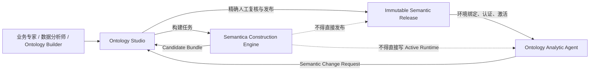
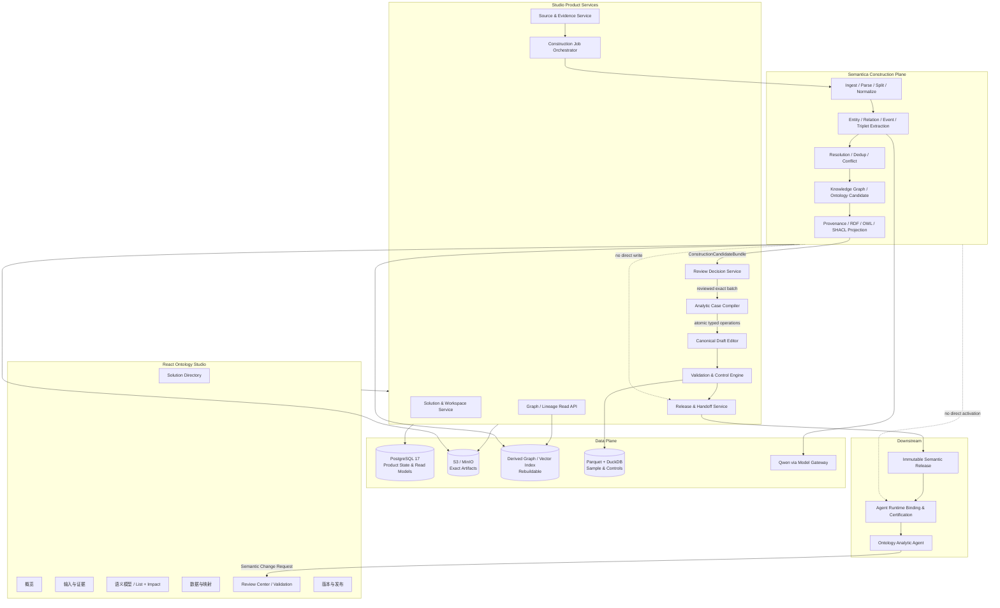
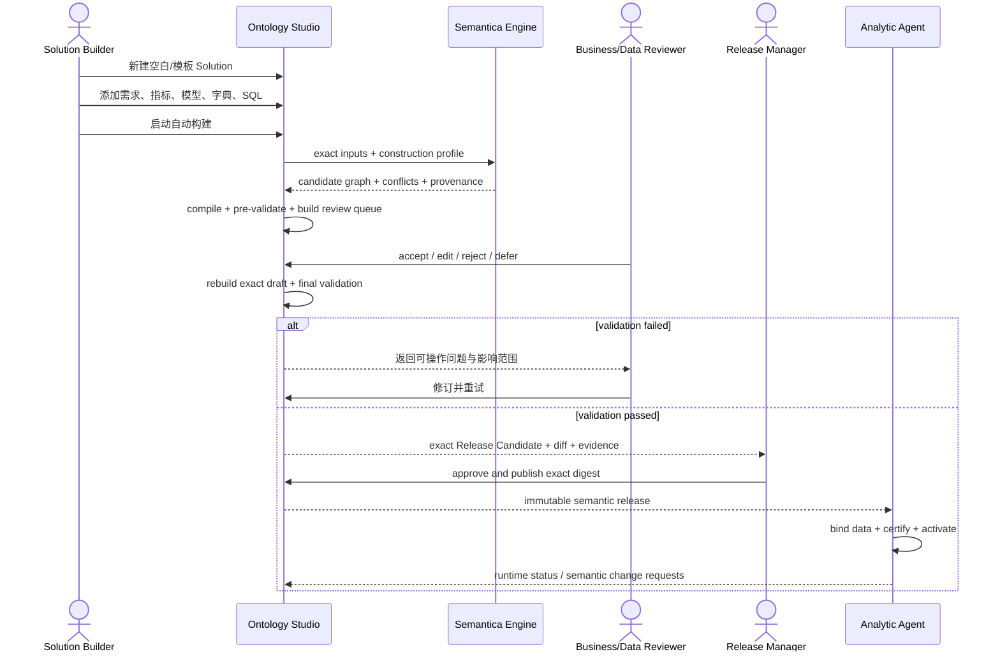
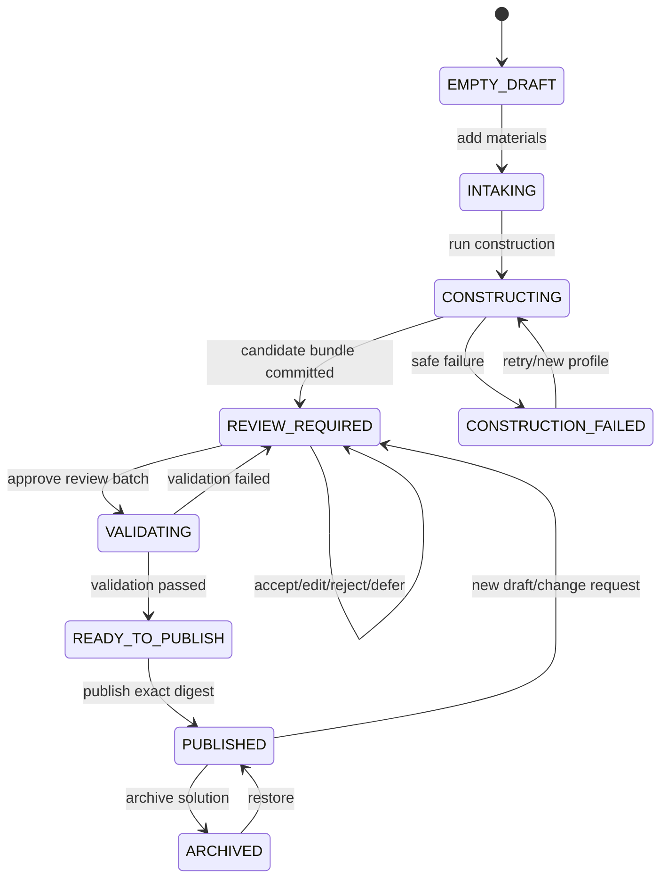
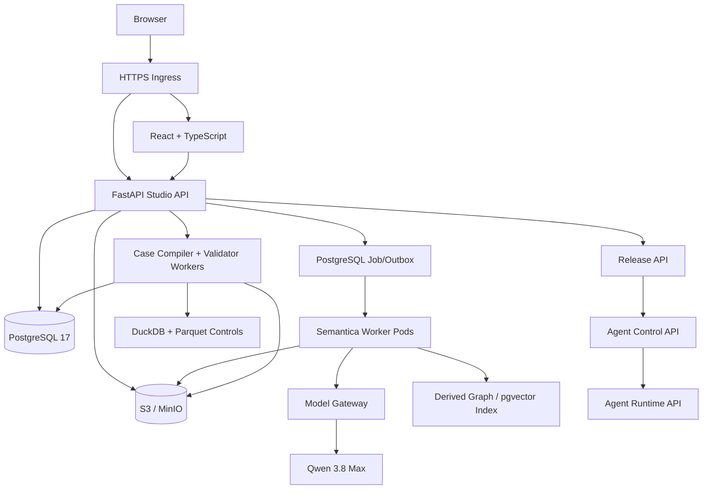

# Semantica 融合后的 Ontology Studio 产品架构 v0.3

> 状态：Approved Implementation Baseline — 已完成一轮 adversarial review，并记录 2026-08-21 Product Decision Owner 的 Graph scope override。精确的实施顺序、前端交互与验收以 `plans/semantica-integrated-ontology-studio-iteration.md` 及 `ontology-product-group/reviews/semantica-studio-iteration-adjudication.md` 为准；发生冲突时以后两者为准。
>
> 核心结论：Semantica 成为 Studio 内部的 **Case Construction Engine**，可以从输入材料端到端生成候选 Case；Studio 继续拥有结构化人工复核、确定性编译与验证、版本及发布权威。Ontology Agent 只消费 Studio 已发布的精确版本。

## 1. 产品定义

Ontology Studio 的目标不是“画一张知识图谱”，而是：

> 把不完整、非结构化、可能互相矛盾的企业材料，加工成一套可理解、可修改、可验证、可发布，并可供 Analytic Agent 执行的 Ontology Solution。

在用户视角，一套可执行的 Ontology Solution 至少呈现五类合同；它们不等于一个 compound authority：

1. **Semantic Contract**：对象、事件、关系、术语、指标和业务规则；
2. **Data Contract**：数据源、Schema、字段、枚举、映射、Join 和数据边界；
3. **Analytic Contract**：问题族、分析步骤、确定性工具、回答义务和 Dashboard 配置；
4. **Control Contract**：样例数据、测试案例、预期结果、容差和拒答边界；
5. **Evidence Contract**：来源锚点、推断方式、假设、缺口、冲突和人工决定。

Semantica 可以帮助生成这些合同的候选内容，并为 Evidence 提供加工过程 provenance。Semantic Release、Agent Experience、frozen Reference/Control/Suite refs 与 Deployment Binding 各自版本化；它生成的是 Candidate，不是其中任何权威版本。

## 2. 第一性原理与产品原则

1. **尽量自动加工，最终才赋予权威。** 自动解析、提取、去重、建图和生成 Ontology 都可以在人工之前完成；只有人审阅的精确候选版本可以被发布。
2. **正式 HITL 只有一个阶段。** 人工不需要穿过多层审批；所有冲突、假设、低置信度内容和高风险业务定义集中到 Review Center 处理。
3. **HITL 必须可执行。** Reviewer 必须能看到 exact source anchor、候选值、冲突值、影响范围和系统建议，并能接受、编辑、拒绝或标记待确认，不能只看摘要后点 Approve。
4. **异常优先，但不自动赋权。** 系统可以自动检查、折叠和排序结构一致且来源明确的低风险候选；所有候选仍默认 `UNREVIEWED`，任何 `ACCEPT/EDIT` 必须来自明确的人类 disposition。
5. **没有材料支持的内容必须显式标记。** `INFERRED`、`ASSUMED`、`SYNTHETIC`、`UNCONFIRMED` 与 `MISSING` 不得伪装成已确认业务事实。
6. **发布版本不可被后台重写。** Semantica、LLM 和人工后续修改只能形成新 Draft/New Revision，不能修改已发布 bytes。
7. **产品权威与图存储分离。** Canonical typed package 是产品权威；RDF、OWL、JSON-LD、向量索引和图数据库都是可重建投影。
8. **Agent 不读取构建过程。** Agent 不读取原始材料、Semantica raw graph、review comment 或未发布 Draft，只读取已发布版本经过环境绑定形成的 Runtime Snapshot。

## 3. 产品边界



### 3.1 Semantica 的职责

- 文档/表格/现有 Ontology 的 ingest、parse、split 和 normalize；
- 实体、关系、事件、triplet 和候选规则提取；
- entity resolution、deduplication、coreference 和 conflict detection 的候选/proposal；原 occurrence、alternatives 与 endpoints 在人工决定前不得被破坏性合并；
- 构建候选知识图谱和候选 Ontology；
- 生成 source provenance、RDF/OWL/JSON-LD/SHACL 等投影；
- 为图谱浏览、影响分析和候选解释提供 derived graph。

### 3.2 Studio 自有能力

- Solution、Workspace、Revision 和用户操作状态；
- Source Material、Cleared Input、用途及 source anchor；
- `ConstructionCandidateBundle` 的封装和准入；
- Analytic Case Compiler；
- 指标、公式、字段映射、SQL/算子，以及 Agent Experience/Control Suite 的候选与编辑投影；后两者保持独立 component authority；
- Review Center、人工 disposition 与 exact revision CAS；
- 确定性 validation、control/golden tests 和 projection fidelity；
- diff、approval、immutable release、Agent handoff 和 change request；
- 权限、审计、保留策略及公开产品 API。

### 3.3 人的职责

- 确认系统无法从材料本身证明的业务意义；
- 处理冲突、假设、缺口和高风险定义；
- 修改候选 Case；
- 对 exact Release Candidate 作最终批准或拒绝。

## 4. 产品信息架构

`Solution Directory` 是工作区外的全局入口；打开某个 Solution 后，保持六个稳定的一级菜单。Semantica 是后台能力，不作为一个让用户理解内部技术的独立菜单。

```text
Solution Directory
├── 搜索 / 筛选 / 切换 Solution
├── 新建：空白、模板复制、导入 Package
├── 编辑基本信息
├── 归档 / 恢复
└── 删除尚未发布的 Solution；已发布工件按保留策略处理

Solution Workspace
├── 1. 概览
├── 2. 输入与证据
├── 3. 语义模型
├── 4. 数据
├── 5. 复核与验证
└── 6. 版本与发布
```

### 4.1 六个一级功能区

| 一级菜单 | 二级页面 | 用户要完成的任务 | Semantica 参与方式 |
|---|---|---|---|
| 概览 | 工作区概览 | 看到完成度、当前 Draft、待复核项、阻塞问题、最近发布和下一步 | 展示最近 Construction Run 和候选质量摘要 |
| 输入与证据 | 需求与指标、来源材料、加工任务 | 添加/转写材料，标识来源、用途和材料类型，启动或重跑构建 | ingest、parse、split、normalize，返回可定位 source anchors |
| 语义模型 | 业务模型、指标与规则、Agent 体验 | 用 List/Table、完整 Graph Editor 与结构化 Inspector 维护对象、事件、关系、指标、规则、问题族、工具和 Dashboard；两种视图提交相同 typed operations | 生成候选图谱/Ontology；提供 Candidate overlay 与 derived relationship/impact read model |
| 数据 | 数据源与 Schema、映射与关联、样例与枚举 | 维护表字段、类型、枚举、逻辑映射、Join、计算来源和测试数据 | 从数据字典、DDL、SQL 中抽取候选结构和映射；识别冲突/重复 |
| 复核与验证 | Review Center、验证结果、问题与变更 | 集中处理候选、冲突、假设和缺口；运行全部检查；处理 Agent 反馈 | 提供候选、置信排序和 provenance；不得直接改写已接受内容 |
| 版本与发布 | 版本与 Diff、批准与发布、Agent 交付 | 比较版本、批准精确候选、发布不可变版本、查看下游交付状态 | 提供 RDF/OWL/PROV 等发布投影；不拥有产品发布版本和 Active 状态 |

### 4.2 Review Center 的队列设计

Review Center 不按“AI 生成了多少条”平铺，而按业务风险组织：

1. **阻塞发布**：定义冲突、公式冲突、映射不唯一、控制结果不一致；
2. **高风险确认**：指标公式、统计口径、时间边界、单位、分母、字段映射、Join；
3. **假设与补齐**：系统自行补齐的 synthetic/assumed 内容；
4. **缺失信息**：无法构建但不一定阻止演示的内容；
5. **普通候选**：对象、关系、描述、同义词和分类；
6. **自动检查通过但尚未决定**：默认折叠；仅符合产品规则的低风险项可由人显式选择后批量处理。

每个 Review Item 至少显示：候选值、来源片段、来源位置、生成方法、冲突值、影响对象、风险类别和建议动作。动作是 `ACCEPT / EDIT / REJECT / DEFER`；`DEFER` 必须同时声明是否阻塞发布。

## 5. 功能架构



## 6. 数据链路

```mermaid
flowchart LR
    A[原始/转写材料] --> B[Source Artifact\nexact version + checksum]
    B --> C[Cleared Processing Projection]
    C --> D[Semantica Construction Run]
    D --> E[Raw entities / relations / graph / conflicts / provenance]
    E --> F[ConstructionCandidateBundle]
    F --> G[Admission checks + Review Queue]
    G --> H{HITL disposition}
    H -->|Accept / Edit / Reject / Defer| I[Reviewed exact batch]
    I --> J[Analytic Case Compiler]
    J -->|atomic CAS| K[Canonical Draft Revision + Decision]
    K --> V[Final deterministic validation]
    V -->|FAIL| G
    V -->|PASS| L[Release Candidate]
    L --> M{Human publish}
    M -->|Approve exact digest| N[Immutable Semantic Release]
    N --> O[Agent binding / certification / activation]
```



### 6.1 ConstructionCandidateBundle

Semantica 的输出不能以“任意 graph object”直接进入 Studio。适配器必须生成一个闭合的候选包，至少包含：

- logical construction run ID、winning attempt/lease、Semantica stage build/version、配置和模型 profile；
- 输入 artifact refs 和 exact checksums；
- candidate objects、events、relations、metrics、rules 和 synonyms；
- candidate schemas、fields、mappings、joins 和 SQL observations；
- candidate question families、analysis patterns 和 presentation suggestions；
- format-specific exact source anchors 与 snippet digest；
- conflict sets 和 dedup/merge proposals；
- assumptions、missing items 和 unsupported items；
- per-item stable occurrence key、revision digest、support class、generation method/stage receipt、confidence、compile eligibility 和 provenance；
- raw/derived graph artifact refs；
- bundle checksum。

Confidence 只决定 Review Center 排序，不能自动变成业务真相。Semantica 的 merged/resolved graph 不能作为候选包的唯一输入；bundle 必须保留 raw occurrences、pairwise proposal、alternatives 与原 relationship endpoints。

### 6.2 Canonical Draft

Case Compiler 只将已完成人工 disposition 的 exact batch 编译成 Studio 自有的 typed operations/contracts。任何无法映射的字段必须进入 `UnsupportedObservation`，不能静默丢弃；任何缺少来源或由系统编造的内容必须保留状态标签。

Review Batch/Decision、candidate terminal state、typed draft operations、新 workspace revision/head 在同一 PostgreSQL authority transaction/CAS 中提交。Reviewer 不直接修改 Semantica raw graph；derived graph 随 revision 重建。

## 7. 业务流程



### 7.1 Solution 状态



一个 Solution 可以同时拥有一个 Active/Published Version 和一个后续 Draft；新 Draft 不影响 Agent 当前运行版本。

## 8. 编译与验证架构

### 8.1 Analytic Case Compiler

Compiler 不是另一个用户产品，而是 Studio 内核。它完成：

- candidate graph → typed Object/Link/Event；
- metric prose/SQL observation → Formula AST 与确定性 operator specification；
- logical fields → physical mapping candidates；
- business questions → bounded question families 和 answer obligations；
- analysis patterns → typed tool plans；
- labels/units/charts → presentation descriptors；
- samples、questions 与 expected values → Control Suite candidates；expected truth 只能由独立 frozen Reference/Control/Suite refs 获得权威；
- all items → evidence and lineage refs。

LLM 可以提出候选结构，但公式执行、SQL 生成、数据映射验证和控制结果必须由确定性组件完成。

### 8.2 Validation 分层

| 层级 | 检查内容 | 失败结果 |
|---|---|---|
| Package | Schema、closed enum、ID、引用、canonical serialization | 阻止发布 |
| Semantic | 对象/关系约束、术语冲突、单位、指标依赖、循环 | 阻止或形成 review issue |
| Data | 字段存在、类型、枚举、Join、mapping 唯一性、sample identity | 阻止相关分析能力发布 |
| Computation | Formula AST、SQL safety、operator input/output、rounding/null/time rules | 阻止相关指标发布 |
| Control | exact frozen Reference/Control/Suite refs、expected outcomes、容差、boundary cases | 阻止发布或明确降低 capability；同一实现生成的 expected 不得自证正确 |
| Projection | canonical package 与 RDF/OWL/JSON-LD/SHACL projection fidelity | 所声明投影不可发布 |
| Experience | question family、tool coverage、Dashboard binding、answer obligation | 阻止相关 Agent capability |

Semantica 的 SHACL/ontology validation 可以作为其中一组 checker；Studio Validator 负责汇总、适用性和最终发布判断。

## 9. 数据与存储架构

| 数据类别 | 权威存储 | 查询/投影 | 说明 |
|---|---|---|---|
| Solution、Workspace、Revision、Run/Attempt/lease、Review Batch/Decision、Release Intent/Index | PostgreSQL 17 | Studio API/read model | mutable 产品状态与 terminal outcome 权威 |
| 原始材料、解析结果、Candidate Bundle、canonical package、release、validation report | S3/MinIO exact version | checksum/ref | 不可变工件和大对象 |
| Candidate/Published Graph | canonical package/S3 是权威 | PostgreSQL node-edge read model；未来可切 Neo4j/Neptune | 图查询层可重建，不拥有发布权威 |
| RDF/OWL/JSON-LD/SHACL/PROV-O | S3 derived artifacts | RDFLib/专用 adapter | 标准交换与图验证投影 |
| Semantic retrieval | source/canonical artifacts 是权威 | pgvector derived index | 搜索和候选召回，不决定业务事实 |
| Sample/control facts | content-addressed Parquet | sandboxed DuckDB | 预览、控制和回归，不进入产品事务库 |
| Enterprise facts | 客户数据平台 | QueryEnginePort | 不复制进 Studio 产品库 |
| LLM request/response | private bounded buffer + approved evidence | Model Gateway telemetry | 失败不得产生部分候选提交 |

第一版不要求新建权威图数据库。若 node/edge read model 的规模和查询需求证明不足，再通过 `GraphReadModelPort` 接 Neo4j 或 Neptune；不改变 canonical package 和 release identity。

## 10. Studio 与 Agent 的连接

### 下行

Studio 发布：

```text
Immutable Semantic Release
  ├── Semantic Contract
  ├── Data requirements（环境无关逻辑层）
  ├── Evidence / limitations refs
  └── Optional RDF/OWL/PROV projections
```

Agent 交付时再组合独立版本化的 Agent Experience profile、frozen Reference/Control/Suite refs、环境数据 binding、runtime capability、policy、secrets 和 certification，形成可激活 Runtime Snapshot。Studio 可以提供这些 component 的编辑视图，但不会把它们并进 Semantic Release，也不直接修改 Agent active pointer。

### 上行

Agent 只能回传结构化反馈：

- `SemanticChangeRequest`：定义、指标、映射或问题族需要变化；
- `ProductFeedback`：体验问题；
- `OperationalIncident`：运行故障；
- `UsageEvidence`：哪些问题族/指标被真实使用。

只有 SemanticChangeRequest 可以在 Studio 中生成新的候选变更，而且仍需走 Draft → Review → Validation → Publish。

产品 UI 中，Studio 与 Agent 顶部保留互相跳转；版本与发布页面展示 Agent 交付状态和深链，但运行控制调用独立 Agent Control API。

## 11. 技术与部署架构



### 11.1 技术栈

- Frontend：React 19、TypeScript、Vite、TanStack Query、React Router；
- Product API：FastAPI、Pydantic、SQLAlchemy 2、Alembic；
- Construction Engine：隔离的 Python worker，pin exact Semantica version；
- LLM：Qwen 3.8 Max，经 product-owned Model Gateway；
- Product State：PostgreSQL 17；
- Artifact Store：AWS S3 / local MinIO，exact version + SHA-256；
- Derived Search：PostgreSQL FTS/pgvector；图 read model 先使用 PostgreSQL materialization；
- Sample/Control：Parquet + sandboxed DuckDB；
- Async Execution：PostgreSQL durable job/outbox + Kubernetes worker；
- Deployment：Docker、Kubernetes/k3s、Ingress HTTPS；
- Observability：structured logs、OpenTelemetry traces/metrics、construction/review/release audit events。

### 11.2 为什么隔离 Semantica Worker

Semantica 的依赖面和能力面较大。将它作为独立 worker 可以：

- 不把 Torch、Transformers、图计算等依赖带入 Studio API 和 Agent runtime；
- 对不同 case 选择明确启用的模块；
- 固定 build、资源、网络和模型访问；
- 升级时进行 old/new shadow diff；
- worker 失败不影响现有 Studio 浏览和 Agent active version；
- 未来替换部分 Semantica 模块而不改变产品合同。

## 12. 降级与失败处理

| 故障 | 产品行为 |
|---|---|
| Semantica worker 不可用 | 已有 Solution、人工编辑、验证、发布和 Agent 不受影响；新 Construction Run 进入可重试失败状态 |
| Qwen 不可用/超时 | 使用确定性 parser/import 能力或转人工；不提交半个 Candidate Bundle |
| 不支持的文件格式 | 原始材料保留，形成 `MANUAL_TRANSCRIPTION_REQUIRED` 问题 |
| Candidate graph/derived index 不可用 | 回退到 canonical list/table editor；图索引可重建 |
| SHACL/OWL projection 失败 | 如果该投影为本版本必需则阻止发布；否则不宣称该 capability |
| 人工 Review 未完成 | Draft 可保存，不能发布 exact candidate |
| Final validation 失败 | 回到同一个 Review Center，不创建第二套审批流程 |
| 新发布版本下游认证失败 | 旧 Agent active version 继续服务，新 release 保持未激活 |
| Semantica 升级输出变化 | pin 旧版；先运行 ADT shadow comparison 和 mutation suite，再提升新 build |

## 13. 复用决策

### 13.1 优先作为 Semantica Adapter 启用

- ingest / parse / split / normalize；
- entity / relation / event / triplet extraction；
- entity linking、coreference、dedup 和 conflict detection；
- candidate KG/Ontology generation；
- provenance/source trace；
- RDF/OWL/JSON-LD/SHACL export；
- derived graph analytics/visualization data。

### 13.2 需要我们补齐或重写

- `ConstructionCandidateBundle` typed boundary；
- 指标与 SQL observation 到 Formula AST/operator 的 compiler；
- Data Mapping/Join compiler；
- question family、tool、answer obligation 和 Dashboard compiler；
- Review Center 与 exact revision operations；
- final validation/control suite；
- immutable release、Agent handoff 和 change loop；
- 产品权限、审计、错误和降级体验。

### 13.3 不直接采用

- 用 Semantica raw graph 作为 canonical product state；
- 用其通用 validator 的单一结果决定发布；
- 用 Semantica version manager 代替 Studio revision/release；
- 直接嵌入完整 Explorer 代替 Studio 信息架构；
- 让 ContextGraph 或 LLM 直接回答业务数字；
- 将完整 Semantica 依赖安装进 Agent runtime。

## 14. 建议的首条开发序列

精确 slice、ROM 和验收以 reviewed iteration plan 为准。顺序固定为：

1. Phase 0 在目标 ARM/K8s 上验证 explicit Semantica stages、Qwen Gateway、当前 XLSX anchor 与资源边界，不写权威；
2. A1 用已有 ADT exact sources 形成 durable mixed-risk shadow Candidate Bundle；
3. A2 用默认 UNREVIEWED 的 Review Center 完成 atomic Decision + Draft CAS + validation/diff；
4. 在公共 compiler factorization 前运行预登记的 materially-different 第二案例 Gate A，允许 `MissingCapability`；
5. 只对双案例共同证明的 primitive 做完整 ADT analytic capability、coverage、publish/handoff 与最终 onboarding。

首条链的价值不是“Semantica 自动建了多少节点”，而是 source evidence、human decision、deterministic correctness、exact publish 和 old-active safety 是否真正闭合。

## 15. 本轮需要确认的产品决策

1. 是否确认 Semantica 是 Studio 内部的 Construction Engine，而不是第三个产品或独立一级菜单？
2. 是否确认正式人工流程收敛为一个 Review Center 阶段，最终 publish 是唯一权威动作？
3. 是否接受六个一级菜单：概览、输入与证据、语义模型、数据、复核与验证、版本与发布？
4. 是否接受“问题族、分析工具和 Dashboard 定义”在语义模型下使用“Agent 体验”视图，但其权威 component 与 Semantic Release 分离？
5. 是否接受 canonical package 继续作为权威，Semantica graph/RDF/OWL/向量索引全部为可重建投影？
6. 是否接受第一版不新增权威图数据库，先用 PostgreSQL read model；达到明确规模/查询阈值后再接 Neo4j/Neptune？
7. 是否接受 Studio 展示 Agent 交付状态和深链，但运行准备、激活与回滚仍由 Agent Control API 拥有？
8. 是否同意先用 ADT 做 mixed-risk tracer，但在公共 factorization 前运行 materially-different 第二案例 Gate A，而不是把第二案例推到所有通用模块完成之后？
9. 已确认 full Graph editor 本轮交付：是否始终保持 canonical typed-operation 写入边界、Candidate overlay 与 List/Table 完整降级路径？
