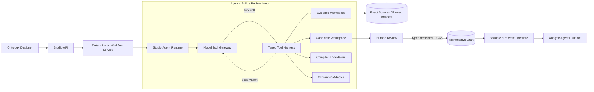

# Ontology Studio Agentic Core v4 — 候选技术基线

状态：Candidate，必须通过两轮独立 Critic Review 后才能进入实现  
日期：2026-08-23  
Decision Owner：Muyu（Product Owner）  
Supersedes：`ontology-studio-product-reset-v3.md` 中第 7 节 AI 构建内核及其实现切片；其余已确认的产品边界继续有效

## 1. 结论

Ontology Studio 的产品内核必须是：

> **确定性外壳 + Agentic 内核。约束副作用，不约束思考；约束写入边界，不约束探索过程；确定性系统负责守门，不负责替 LLM 建 Ontology。**

这意味着：

- LLM 必须像一个真正的 Ontology 工程代理一样，能够查看工作区、搜索和按需读取完整材料、制定和调整计划、调用建模与校验工具、观察失败、修复候选，直到完成或明确报告阻断项。
- LLM、Semantica 和 Reviewer 可以自由探索和提出内容，但都不能直接修改权威 Draft、发布 Release 或激活 Runtime。
- 确定性代码负责精确来源版本、工具权限、类型化写入、并发控制、预算、审计、校验、人工审批和发布生命周期。
- Cash Trading 与 ADT 只作为输入包、参考 Solution 和验收案例存在；通用内核不得识别它们的名称、字段或指标 ID。

## 2. 为什么上一版失败

上一版文档写了 ReAct、Skill 和 Tool Harness，但实现不是 Agentic Runtime：

1. `BoundedBuilderOrchestrator` 固定执行 `SEMANTIC → SEMANTIC → DATA → ANALYTICS`。
2. 每一阶段把一批预先截断的 Evidence 塞给模型，调用一次 `/model/v1/ontology-build`，要求返回闭合 JSON。
3. Skill Manifest 虽然声明了 `evidence.read`、`candidate.propose`、`gap.record`、`semantica.propose`，模型却没有真实的工具调用通道。
4. Evidence Bundle 默认只保留 256 个片段；每阶段再按类型取前 160 个。一个物理 Excel 被登记成多个逻辑角色时，重复片段继续占预算。
5. 模型无法发现遗漏后回到工作区搜索字段，只能把没有看到的字段报告为 Gap。
6. Semantica 是工作流固定阶段，不是 Builder 可按需要调用的工具。

真实 Cash Trading Run 已证明这个失配：Run 能产出大量 Candidate，也能显示 `REVIEW_READY_WITH_WARNINGS`，但八个正式 Metric 只是不可编译的来源投影，实际可发布 Metric 为零；Builder 报缺的多个字段在 Deloitte 数据字典中真实存在。

所以根因不是 Prompt 小问题，也不是模型不够聪明，而是执行环境让模型在“开卷考试”中只能看一叠被截断的复印件。

## 3. 第一性原理与不可变约束

### 3.1 LLM 拥有的自由

Builder 可以：

- 查看本次 Run 的 Source Catalog、Draft 摘要和已有 Candidate；
- 自主决定先看需求、指标、Schema、SQL，或在它们之间来回核对；
- 检索任意已选 Exact Source Version；
- 按页、Sheet、行、单元格范围和 SQL 结构读取材料；
- 调用 Semantica、Schema/SQL Inspector、Candidate Compiler 和 Validator；
- 创建、修改、删除 Candidate Workspace 内的候选；
- 根据工具错误和校验反馈重复修复；
- 记录 Gap、冲突、假设和澄清问题；
- 在满足停止条件时请求完成，在证据不足时请求阻断完成。

Reviewer 使用独立上下文，可以重新检索来源、查看 Candidate/Draft Diff、调用校验工具并形成 Finding。

### 3.2 LLM 永远没有的权限

- 直接写权威 Draft；
- 接受自己的 Candidate 或自己的 Review Finding；
- 把模型推断登记为 Exact Evidence；
- 更改 Source Version、来源校验和或 Evidence Locator；
- 绕过类型合同、CAS、发布校验或人工审批；
- 创建 Release、切换 Active Runtime；
- 访问任意 Shell、任意文件路径、数据库管理接口或未授权 Solution。

### 3.3 确定性系统只守这些门

- Run 输入、Exact Source Version、Skill/Model/Tool 版本和预算冻结；
- Tool allowlist、参数和返回合同；
- Candidate Workspace 的强类型写入和不可伪造 Provenance；
- 每一步 checkpoint、receipt、token/tool/time budget 和取消/重试；
- Candidate → Human Decision → Draft 的原子 CAS；
- Draft → Validation → Release → Runtime Snapshot → Activation 的权威生命周期。

确定性系统不规定“先建对象再建指标”，也不替 LLM 推断业务含义。

## 4. 目标架构



信任边界：

- `Evidence Workspace` 是 Exact Source 的可检索只读投影。
- `Candidate Workspace` 是 Agent 可写但非权威的隔离工作区。
- `Authoritative Draft` 只能由人工处置形成的类型化操作通过 CAS 修改。
- Analytic Agent 只消费 Active Runtime Snapshot。

## 5. 运行时合同

### 5.1 外层任务状态机

```text
QUEUED
  → PREPARING_WORKSPACE
  → RUNNING_AGENT
  → CHECKING_COMPLETION
  → REVIEW_READY | BLOCKED | TECHNICAL_FAILURE | CANCELLED | STALE
  → HUMAN_REVIEW
  → DRAFT_APPLIED
  → VALIDATED
  → RELEASED
  → ACTIVE
```

关键语义：

- `REVIEW_READY`：存在可复核 Candidate，Run 的确定性完整性检查通过；不代表业务正确。
- `BLOCKED`：Agent 正常结束，但明确缺少足以继续的证据或存在需人工决策的冲突。
- `TECHNICAL_FAILURE`：模型、工具、存储或运行时故障；不能冒充业务 Gap。
- Candidate 与工具轨迹即使在 `BLOCKED` 或 `TECHNICAL_FAILURE` 时也保留，便于恢复和复盘。

### 5.2 内层 Agent 循环

```text
Observe workspace
→ Plan next useful action
→ Call one or more allowed tools
→ Observe exact results/errors
→ Add or repair candidates/findings
→ Run closure checks
→ Continue, Complete, or Block
```

这不是固定 Phase 列表。唯一固定的是工具边界、预算和完成门禁。

### 5.3 预算与停止

首版默认上限：40 个 Agent step、80 次 Tool Call、20 分钟墙钟时间，以及模型配置的 Token Budget。限额是防失控的安全阀，不是正常业务流程。

Builder 只能通过 `run.request_completion` 请求结束。Workflow Service 随后执行：

1. Candidate schema 和引用闭合检查；
2. 每个正式 Requirement 已映射到 Candidate 或显式 Gap；
3. 每个正式 Metric 已形成可编译 Metric operation，或存在阻断 Gap；
4. 所有 Candidate 的 Evidence Receipt 指向本 Run 锁定的 Exact Source Version；
5. 没有未处理的 P0 结构问题。

不满足时，检查结果作为 observation 返回 Agent；预算未尽则继续修复，预算耗尽则以 `BLOCKED` 或 `TECHNICAL_FAILURE` 结束，不能伪装成功。

## 6. Agent Runtime 与框架选择

### 6.1 产品接口

稳定以下产品级接口：

- `StudioAgentRuntime.run(run_context, tool_registry, checkpoint_store)`；
- `ModelToolGateway.next(messages, tool_schemas, budget)`；
- `StudioTool.execute(tool_call, authority_context)`；
- `AgentCheckpointStore.append(step)`。

业务代码只依赖这些接口，不依赖 DeepAgents、LangGraph、Pi 或某个模型 SDK。

### 6.2 首个实现

首个实现采用一个**薄的、产品自有的 Tool-Calling Loop**：

- 使用 Qwen 的 OpenAI-compatible tool calling；
- 保存标准化 message、tool call、tool result 和 checkpoint；
- 支持取消、恢复、预算、错误分类和幂等 Tool Call；
- 不实现通用多 Agent 框架、长期记忆、任意代码执行或自动子 Agent。

这不是重新发明 DeepAgent，而是把我们必须掌握的产品控制面写成约两三个明确模块。DeepAgents 可作为后续 `StudioAgentRuntime` Adapter 做对照实验；只有在 Cash Trading 和未知小样例上显著提高成功率或恢复能力，才进入默认运行时。

理由：当前缺口不是缺一套庞大 Agent 框架，而是根本没有真实工具循环。先把最小正确内核做实，可以避免把 Workflow/CAS/审计权威交给第三方框架，也避免再做一次架构表演。

## 7. Tool Harness

### 7.1 Evidence 工具

| Tool | 能力 | 关键约束 |
|---|---|---|
| `workspace.describe` | 返回 Solution 边界、语言、Draft/Candidate 摘要 | 不返回全量材料 |
| `source.list` | 列出 Exact Source Version、物理身份、逻辑角色、解析状态 | 同一物理版本去重展示，保留多角色元数据 |
| `evidence.search` | 按关键词、字段名、Sheet、来源类型搜索完整索引 | 分页、有上限、返回 locator 与 snippet |
| `evidence.read` | 按 source version + locator/range 读取原始规范化内容 | 只能读取本 Run 选定来源 |
| `spreadsheet.list_sheets` | 查看 Workbook 结构、行列数和表头 | 不把整个 Workbook 塞进上下文 |
| `spreadsheet.read_range` | 精确读取 Sheet/Range | 返回 cell coordinates 和 checksum |
| `spreadsheet.find` | 在 Workbook 中搜索字段、枚举和值 | 返回所有匹配的分页结果 |
| `sql.inspect` | 解析 SQL 的表、字段、Join、过滤、聚合、表达式 | SQL 解析失败要显式返回，不推断等价 |

Evidence Service 必须索引完整的已支持解析产物，不再创建一个供模型直接消费的全局截断 Bundle。上下文只放 Source Catalog；具体内容由 Agent 按需检索。

### 7.2 Candidate 工具

| Tool | 能力 | 权威性 |
|---|---|---|
| `candidate.upsert` | 新建或修复一个类型化 Candidate | Candidate-only |
| `candidate.get/list/search` | 查看当前 Candidate Workspace | 只读 |
| `candidate.remove` | 删除错误或重复 Candidate | Candidate-only |
| `candidate.diff` | 对比 Candidate 与当前 Draft | 只读 |
| `candidate.validate` | 运行单项或全量 schema/reference/formula/mapping 检查 | 返回诊断，不批准 |
| `gap.record/update` | 记录证据缺口、冲突、假设和澄清问题 | Candidate-only |

`candidate.upsert` 的关键行为：

- Pydantic/JSON Schema 立即验证；
- Evidence ID 由 Harness 解析为 Exact Source Receipt，模型不能自行填写来源权威；
- 失败以结构化错误返回 Agent，由 Agent 修复；
- 每次成功写入形成 immutable Candidate Revision；
- 绝不调用 `apply_package_operations` 修改 Draft。

### 7.3 专项工具

- `schema.inspect`：从数据字典、DDL、样例数据提取表、字段、类型、枚举、主键候选；
- `graph.propose`：调用 Semantica 做概念归一、重复检测和关系建议；
- `graph.inspect_impact`：基于 Candidate + Draft 的可重建图查看影响；
- `compiler.check_closure`：检查 Candidate 集是否能形成闭合的强类型变更；
- `validator.run`：运行确定性结构、引用、单位、粒度、公式、映射和 SQL 合同检查；
- `run.request_completion`：由 Agent 声明完成或阻断原因，最终状态由 Workflow Service 决定。

Semantica 是可选 Tool。Agent 不调用时不影响 Run；不可用时返回可恢复 Tool Error，不创建假 Proposal。

## 8. Skill 设计

### 8.1 Build Skill

Build Skill 是简洁、版本化的方法说明，不是固定 Phase 程序，也不要求一次生成一个巨型 JSON。内容包括：

- 产品目标、资产模型与建模原则；
- 如何从 Requirement 反向追踪到 Metric、Rule、Property、Mapping、Join 和 Source；
- 直接证据、确定性派生、模型推断和 Gap 的区分；
- 命名、语言、ID、粒度、单位和生命周期规则；
- 何时搜索、何时读更多材料、何时调用 Semantica/Validator；
- 完成条件和禁止越权事项；
- 少量领域无关示例和 Eval。

Skill 不包含 Cash Trading 指标清单、不限制固定文件数、不规定固定 Tool 顺序。

### 8.2 Review Skill

Reviewer 使用独立 Run、独立上下文和只读 Candidate/Draft 权限。它可以检索 Exact Evidence，并仅通过 `finding.upsert` 写入：

- 缺失证据；
- 前后冲突；
- 业务口径、公式、字段、Join 或 SQL 不一致；
- 重复、孤立、循环依赖和引用断裂；
- 风险级别、阻断性和建议人工动作。

Reviewer 不能修改 Candidate，也不能接受或拒绝 Candidate。

## 9. 数据与持久化

### 9.1 PostgreSQL

新增或演进：

- `studio_agent_runs`：Run 目标、输入冻结、状态、预算和结果；
- `studio_agent_steps`：模型 turn、tool call/result、耗用、错误类别和 checkpoint；
- `studio_candidates` / `studio_candidate_revisions`：Candidate Workspace；
- `studio_review_findings`：独立 Reviewer 产物；
- Evidence 检索索引和 Source Version 元数据。

继续保留：Solution 目录、Construction Job lease、Workspace revision/CAS、Human Disposition、Validation、Release 和 Activation authority。

### 9.2 S3-compatible Storage

继续保存 Exact Source bytes、完整解析产物、Agent transcript artifact、Candidate Bundle、Review Bundle、Validation Report、Governance Release 和 Runtime Snapshot。

数据库保存可查询索引；大对象和不可变完整产物保存在 S3。

## 10. 现有模块处置

### 10.1 直接复用

- Solution Directory 与 Blank Solution；
- Source Library、Exact Version、checksum、preview 和上传能力；
- PostgreSQL/S3 authority；
- Construction Job 的 queue/lease/cancel/retry/stale fencing；
- `PackageDraftOperation` 强类型边界；
- Candidate/HITL/CAS Draft；
- Validator、Release、Runtime Snapshot、Activation/Rollback；
- Semantica 独立 Worker 进程边界；
- EIX Design Token 和已稳定 UI 基础组件。

### 10.2 重构

- `BoundedBuilderOrchestrator` → `StudioAgentRuntime` + `ToolRegistry`；
- `BuilderPhaseRequest/Response` → provider-neutral Agent turn/tool-call contract；
- `normalize_evidence` 的“模型输入 Bundle” → 完整 Evidence Index + 按需读取；
- `HttpBuilderModel.generate` → `ModelToolGateway.next`；
- fixed Semantica stage → `graph.propose` Tool；
- Reviewer 的一次性闭合请求 → 独立 Reviewer Agent loop；
- `StudioConstructionService.start` 的串行大函数 → 确定性 workflow steps 与 checkpointed Agent invocation；
- Build UI 的固定六阶段进度 → 真实任务状态、活动摘要、Tool trace 摘要和可恢复错误。

### 10.3 移出新主链

- 固定 `SEMANTIC/DATA/ANALYTICS` phase plan；
- 全量材料预截断后一次塞进模型；
- 把 manifest 中未真实暴露的工具当成已实现；
- successful model run 后的 packaged-case fallback；
- 从 reviewed baseline 反向生成 Candidate；
- Cash/ADT workspace、字段或指标分支；
- 仅看 Candidate 数量就宣称 E2E 成功的门禁。

旧 Run 保持只读可查看。新建 Blank Solution 默认只走新 Runtime；Reference Solution 可在迁移期通过显式 feature flag 使用旧兼容读取路径，但不能写入新 Run。

## 11. 产品流程与 UI 调整

用户只看到一个全局一级入口：`任务中心`；Solution 左侧一级菜单使用 `构建与复核`，不再出现两个“构建任务”。

- **任务中心**：跨 Solution 的进行中、待处理、已完成和失败任务清单。
- **构建与复核 / 构建**：选择来源与目标语言，启动构建，查看当前 Run 的真实活动、材料使用、Candidate/Gap 计数和错误。
- **构建与复核 / 复核**：机器 Finding、Candidate、Evidence、Diff、图和人工处置。
- 完成任务跳转到对应 Solution 的复核页；失败任务跳转到可恢复详情。

前端不展示 DeepAgents、ReAct、Qwen、Semantica phase 或内部 Tool ID；只显示用户能理解的“正在读取数据字典”“正在检查指标依赖”“发现 3 个待确认缺口”等活动摘要。

## 12. 纵向实施切片

每个 Slice 必须同时交付后端、持久化、最小 UI、自动化测试和可运行结果；通过后自动进入下一 Slice。

### Slice 0：可证伪的最小 Agent Loop

- 新建 `StudioAgentRuntime`、`ModelToolGateway`、`ToolRegistry` 和 Checkpoint contract；
- 用一个无业务名称的微型 fixture 证明模型能 `search → read → upsert → validate → repair → complete`；
- 证明模型不能调用未授权工具或修改 Draft；
- 不接 Semantica，不改发布链。

### Slice 1：完整 Evidence Workspace

- 将已支持文本/XLSX/CSV/SQL 的完整解析结果建立可检索索引；
- 实现 source/search/read/spreadsheet/sql 工具；
- 相同物理文件的多逻辑角色不重复占据内容索引；
- 证明 Agent 能搜索到当前固定 Bundle 漏掉的 Cash Trading 字段。

### Slice 2：Candidate Workspace 与修复闭环

- 实现 candidate/gap/compiler/validator 工具；
- 逐项强类型写入、错误反馈、Candidate revision 和 transcript；
- completion checker 将不闭合结果返回 Agent 修复；
- 保留现有 HITL/CAS Draft 边界。

### Slice 3：Cash Trading Builder E2E

- 使用 Deloitte HK 四份原始材料 + 明确标注的产品 SQL 补充；
- 目标语言由用户选择，所有人类可读 Ontology 内容统一输出；
- 从 Blank Solution 构建完整可复核 Candidate Set；
- 八个正式指标必须成为实际强类型 Metric Candidate，并闭合其 Property/Mapping/Rule/Data Source 依赖；
- 不允许 Case ID/字段/指标硬编码进入通用代码。

### Slice 4：Reviewer Agent + HITL

- 独立 Reviewer Loop 重新核验来源和 Candidate；
- UI 展示 Finding、Evidence、Diff、影响图和人工处置；
- 保存/离开使用 EIX Modal，消除错误的未保存提示；
- 人工接受后通过 CAS 写 Draft。

### Slice 5：发布、Agent 消费与产品体验

- Validate → Release → Runtime Snapshot → Activate；
- Analytic Agent 对 Cash Trading 支持问题执行真实查询，对缺口问题澄清或拒答；
- 任务中心、导航命名、来源预览、100/125/150% 缩放和全局 Typography 回归；
- 本地 E2E 和用户手册通过后，再按已批准部署流程发布 EC2。

## 13. 验收与评测

### 13.1 架构门禁

- 通用 Builder 代码中不存在 `cash_trading`、`ADT`、八个指标 ID 或业务字段名分支；
- 模型真实产生并执行 Tool Call，至少一次 Run 包含搜索、精确读取、候选写入、校验和修复；
- manifest 中声明的每个 Tool 都有可调用实现和权限测试；
- Builder/Reviewer/Semantica 在 HITL 前对 Draft 的写入次数为 0；
- 相同 Run 输入、来源、Skill、Model、Tool 版本和 Candidate revision 可完整审计。

### 13.2 Cash Trading 严格门禁

- 5 个物理文件、7 个逻辑角色精确登记；Deloitte 原始材料与产品补充来源明确区分；
- 八个正式 Metric ID 全部为未阻断、`compile_eligible=true` 的类型化 Metric operation；
- Requirement、Object、Property、Link、Rule、Dimension、Data Source、Mapping、Join/SQL Contract 形成可验证闭包；
- 正式 Metric 不能以 `Metric projection + Gap` 冒充完成；
- 至少 3 次 Real-Qwen Run 中 2 次达到严格 `REVIEW_READY`，且至少 1 次完成人工处置、Validation PASS、Release、Activation 和 Agent 查询；
- 重复 Run 在 HITL 前不修改 Draft；旧 Active 在发布或激活失败时保持可用。

### 13.3 通用性回归

- 使用两个未命名微型 fixture：一个完整、一个有矛盾/缺失；不增加 case adapter 即可分别到达 `REVIEW_READY` 和 `BLOCKED`；
- ADT 与 Cash Reference Solution 继续可读；
- 第三个真实业务案例留作后续产品泛化证据，但不阻塞当前 Cash Trading Slice。

### 13.4 质量指标分开计算

- **Coverage**：正式 Requirement/Metric/Field 的覆盖率；
- **Grounding**：Candidate 的精确来源覆盖和错误引用率；
- **Correctness**：人工确认的口径、公式、字段和关系正确率；
- **Repairability**：Validator 报错后 Agent 修复成功率；
- **Safety**：越权工具、Draft 直写、伪造来源和过期 CAS 成功数必须为 0；
- **Product usability**：从 Blank 到 Active 的完成率、耗时和人工操作数。

## 14. Rollout、降级与回退

- 新 Runtime 使用 `agentic_builder_v2` feature flag；先对新 Blank Solution 开启。
- 旧 Construction Run 与旧 Candidate 只读保留，不迁移其内部轨迹。
- Model 不可用：任务进入可重试 `TECHNICAL_FAILURE`，不自动降级成假成功。
- Semantica 不可用：Tool 返回错误，Builder 可继续其他工作并记录非阻断能力缺失。
- Evidence parser 不支持：Exact Source 仍登记，Run 记录 Unsupported Source；不得假装读取。
- 新 Runtime 失败时可关闭 flag，现有 Draft/Release/Active 不受影响；不恢复 packaged-case fallback 作为通用构建主链。

## 15. 开发前必须通过的 Critic Review 门槛

- 三个独立视角均完成第一轮与交叉质询；
- 所有 P0 清零；
- 所有 P1 已修复，或由 Decision Owner 明确接受并设置时限；
- 方案明确回答：为什么这个 Runtime 真的是 Agentic、为什么不会越权、为什么不是 Cash Trading 定制、如何失败、如何恢复、如何证明构建正确；
- 评审裁决和被替代文档写入最终技术基线。

