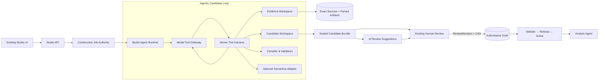

# Ontology Studio Agentic Core v4 — 最终技术基线

状态：`APPROVED FOR IMPLEMENTATION`  
日期：2026-08-23  
产品内核：`Deterministic Shell + Agentic Core`  
评审记录：`ontology-studio-agentic-core-v4-adjudication.md`  
替代：`ontology-studio-agentic-core-v4-candidate.md`；以及 `ontology-studio-product-reset-v3.md` 中 AI 构建内核、固定 phase 与对应实现切片

## 1. 不可变产品原则

> **约束副作用，不约束思考；约束写入边界，不约束探索过程；确定性系统负责守门，不负责替 LLM 建 Ontology。**

因此：

- Builder LLM 自己决定查看什么材料、先做什么、何时回查、何时修复；
- Builder 通过真实 Tool Call 搜索、读取、建模、校验和修复，不执行固定 phase，也不一次性提交巨型 JSON；
- Builder、Reviewer、Semantica 永远只能产生非权威 Candidate/Finding；
- Exact Evidence、权限、预算、幂等、候选 seal、HITL、CAS、Validation、Release 和 Activation 由确定性外壳控制；
- Cash Trading 与 ADT 是 input package、reference solution 和 eval case，不是内核分支。

## 2. 本轮产品目标与非目标

目标：

1. 从 Blank Solution 和用户选定材料启动真实 Agentic Build；
2. 让模型按需读取完整支持范围内的材料并形成可复核 Candidate Bundle；
3. 用确定性门禁阻止漏项、伪引用和合法 JSON 形式的错误指标；
4. 使用现有 Review/CAS/Release/Activation 主链完成 Cash Trading E2E；
5. 为后续案例保留稳定 Runtime、Tool、Candidate 和 Evidence 合同。

非目标：

- 通用全文/向量检索平台；
- 任意 PDF/JPEG OCR 与任意大文件处理；
- DeepAgents/LangGraph 默认引入；
- subagent、长期记忆、任意 Shell/网络/文件系统或代码执行；
- 通用 SQL 与自然语言形式等价证明；
- Semantica 作为正确性或发布依赖；
- 本轮证明任意行业案例的业务泛化。

## 3. 目标架构



权威边界：

- Evidence Workspace：Exact Sources 的只读、run-scoped 投影；
- Candidate Workspace：Agent 可写、非权威、attempt-scoped；
- Candidate Bundle：一次 seal 后 immutable，是 Reviewer/UI/HITL 的唯一 Candidate truth；
- Draft：只有 ReviewDecision 形成的 typed operations 能通过 CAS 修改；
- Analytic Agent：只读取 Active Runtime Snapshot。

## 4. 单一身份与状态拓扑

```text
ConstructionJob
  ├─ mutable task state / queue / lease / cancel / retry
  ├─ immutable EngineContract + BuildObjective
  └─ 0..N AgentAttempt, 最多一个 terminal ConstructionRun

AgentAttempt
  ├─ append-only Step Journal
  ├─ Tool Invocation Receipts
  └─ mutable CandidateWorkspace projection

ConstructionRun
  ├─ outcome = REVIEW_READY | BLOCKED
  ├─ immutable CandidateBundle checksum/ref
  ├─ immutable ObligationLedger result
  └─ immutable warnings/blockers

ReviewDecision → DraftHead → Validation → Release → ActivePointer
```

状态规则：

- Job 技术终态包括 failed、cancelled、stale；技术失败不生成失败业务 Run；
- Run 只表达稳定业务结果 `REVIEW_READY` 或 `BLOCKED`；
- Job succeeded 仅表示 immutable Run 已持久化，不表示人工复核或发布成功；
- Review、Release、Activation 永不反向修改 Job/Run；
- Task Center 展示执行、构建结果、人工复核、治理状态四维投影，不再伪装成单线状态。

## 5. 冻结的 Engine Contract

Job enqueue 时冻结 `EngineContractV2`：

- `engine_id/version`；
- Runtime implementation digest；
- model provider、requested model、配置 digest；
- Skill package checksum；
- Tool Registry 和 policy digest；
- parser/index contract digest；
- Source Set digest；
- budget；
- output language；
- BuildObjective checksum。

Feature flag 只决定新 Job 是否可 enqueue 为 v2。in-flight Job 永远使用冻结 engine；v2 故障不能自动回退 v1。旧 v1 Run 只读可见，重新构建必须显式创建 v2 Job。

## 6. Agent Runtime 与 Tool Invocation 合同

稳定端口：

```text
StudioAgentRuntime.run(run_context, tool_registry, checkpoint_store)
ModelToolGateway.next(AgentTurnRequestV1) -> AgentTurnResultV1
StudioTool.execute(ToolInvocationV1, RunAuthorityContext)
AgentCheckpointStore.load/append_cas(...)
```

`AgentTurnResultV1` 至少保存：assistant content、0..N structured tool calls、tool-call IDs、arguments、finish reason、provider/model/request ID、token usage、Tool Registry digest 和协议错误。

首版约束：

- `parallel_tool_calls=false`；
- 只执行 provider `message.tool_calls`；
- 普通 content 或 finish 不能代表完成；
- 只有 `run.request_completion` 能触发 Completion Checker；
- 单 Agent、串行 Tool、无 subagent/memory/arbitrary filesystem/code execution。

### 6.1 RunAuthorityContext

由服务端构造并注入：

- job/run/attempt IDs；
- current lease epoch；
- solution/workspace/source-set scope；
- principal/service identity；
- Tool Registry/policy digest；
- Candidate head、Step head；
- budget remainder。

模型不能在参数中覆盖这些字段。

### 6.2 幂等、事务与恢复

Tool 调用身份：

```text
(job_id, run_id, attempt_id, lease_epoch, tool_call_id, args_digest)
```

规则：

- 同 ID + 同 digest 重放返回原 Receipt；
- 同 ID + 不同 digest 返回 conflict；
- Candidate mutation、Candidate revision、Tool receipt、Step head 在同一 PG transaction 提交；
- `candidate.remove` 形成 tombstone revision；
- mutation 要求 `expected_candidate_revision`；
- 每次 model/tool 调用前后检查 lease 与 cancel；旧 epoch 的延迟结果不得落库；
- worker reclaim 从同一 durable checkpoint 恢复并累计原 budget；
- terminal retry 创建新 Job/Attempt lineage，不覆盖旧 Candidate；
- 外部只读调用保存 request/result digest 和 durable receipt，不伪造分布式事务。

## 7. BuildObjective、ObligationLedger 与 Completion

`BuildObjectiveV1` 冻结：

- selected source set；
- capability profile：semantic / analytics / data mapping；
- output language；
- formal obligations；
- required validators；
- expected terminal criteria；
- objective checksum。

`ObligationLedgerV1` 的 obligation 来自：

- 标准需求/指标模板的确定性投影；
- 用户选定的来源与 parser coverage；
- 已存在 Draft 的变更目标；
- capability profile 要求的闭包。

每项状态仅可为：`UNRESOLVED | CANDIDATE | GAP | UNSUPPORTED | NOOP`。模型可以建议新增发现，但不能删除或降低预冻结义务。

Completion Checker 固定检查：

1. 每项 obligation 有终态处置；
2. Candidate schema、identity、reference closure 和 prospective package materialization 通过；
3. capability profile 要求的 deterministic validators 通过；
4. Candidate claim 的 Receipt 均来自本 Run exact source set；
5. 没有 deterministic blocker；
6. exact Candidate head 成功 seal。

结果真值表：

- 证据缺失、业务冲突、必需来源 partial/unsupported → sealed partial Bundle + `BLOCKED Run`；
- model/tool/store/lease/schema protocol/budget failure → Job failed，无 Run；
- 可选 Semantica 失败 → warning；
- 完整闭包 → sealed Bundle + `REVIEW_READY Run`。

## 8. Evidence Workspace

### 8.1 支持范围

本轮生产支持：

- XLSX：Sheet/list/range/find，公式只读不求值；
- CSV/text/标准转写：按行/section search/read；
- SQL：只读 parser/AST inspect；
- 已登记结构化来源摘要。

JPEG 可登记 Exact Source，但除非另有人工转写，不进入可解析 evidence。PDF/OCR/向量搜索后置。

### 8.2 Index Completeness Receipt

每个 physical source version 生成：

- bytes checksum；
- parser ID/version/options digest；
- parsed artifact checksum；
- `COMPLETE | PARTIAL | UNSUPPORTED`；
- total/indexed sheets、ranges、lines 或 statements；
- warnings/truncation reason；
- index checksum。

同一物理版本只索引一次内容，多逻辑角色另存映射。资源安全上限继续存在，但超过上限必须是 PARTIAL，不能静默完整。

### 8.3 EvidenceReceiptV2

Search 只返回非权威 Hit。`evidence.read`、`spreadsheet.read_range`、`sql.inspect` 才签发 Receipt：

- run/solution/workspace/source-set；
- source version 和 physical bytes checksum；
- parsed artifact checksum、parser/version；
- canonical locator：line/range/sheet/cell/SQL AST node；
- exact returned content checksum；
- logical role IDs；
- authority-context digest；
- receipt checksum。

Candidate 使用 claim-level provenance：formula、unit、filter、mapping 等关键路径分别引用 Receipt/support class。模型不能自行制造 Receipt 或把 search snippet 当证据。

## 9. Candidate Workspace 与 Bundle

正式 Tool：

- `candidate.upsert/get/list/search/remove/diff`；
- `gap.record/update`；
- `candidate.validate`；
- `compiler.check_closure`；
- `validator.run`；
- `run.request_completion`。

`candidate.upsert`：

- server-generated Candidate ID；
- 业务 target 为 `(collection, object_id)`；
- closed typed payload；
- expected revision；
- claim-level Evidence Receipts；
- immediate shape validation；
- unresolved cross-reference 可暂存，但必须在 completion 前闭合；
- 绝不调用 Draft apply。

Completion 通过时 Materializer 对 exact Candidate head 生成一次 immutable `CandidateBundleV2`。Bundle 绑定 Objective、Ledger、Candidate revisions、Evidence receipts、prospective-package checksum、validator reports 和 result checksum。seal 后任何 Candidate write 返回 conflict。

PG Step Journal/Candidate Workspace 是运行恢复权威；S3 保存 read-back-verified final transcript 和 Bundle export。Run 保存 artifact refs/checksum，不内嵌第二份可变化 Candidate。

## 10. 最小语义正确性门禁

`compile_eligible` 不再等于“存在 typed operation”。它表示：

> typed operation + deterministic prospective-package materialization + reference/type/unit/grain/mapping/SQL checks PASS。

Metric Semantic Signature 至少包含：

- formula AST、aggregation、operand/result type；
- declared/result unit；
- base entity/source/measure property；
- grain、time basis、dimensions；
- population/filter/rule；
- physical binding 和 required joins；
- SQL contract/lineage；
- null、zero denominator 和 boundary policy。

首版验证：

- `SUM` 只接受 numeric；
- `COUNT_DISTINCT` 结果类型固定；
- add/subtract 单位兼容；multiply/divide 使用有限规范化规则；
- final type/unit 与 Metric 声明一致；
- base formula leaf 与 query measure 一致；
- derived metric 不伪造物理 query；
- period/date property 类型兼容；
- source/table/column 与 mapping 存在；
- join key 存在且类型兼容；
- SQL 仅支持只读单 SELECT，table/column/join/filter/aggregate/output lineage 与合同一致；
- Cash mock data 执行结果与固定 oracle 一致。

无法确定性证明的自然语言业务等价、生产 cardinality 或政策含义进入 assumption/Gap，由 HITL 确认。

必须失败的负向 mutation：`SUM(string)`、错误单位、错误日期字段、漏 cancelled/status filter、未映射 column、join key 类型不一致、DDL/DML、SQL aggregate/filter 与 Metric 不一致。

## 11. Builder Skill、Reviewer 与 Semantica

### Builder Skill v2

- 是版本化方法与建模原则，不是固定 phase 程序；
- 指导 Requirement → Metric/Rule → Property/Mapping/Join/Source 的证据追踪；
- 区分 Exact、deterministic derived、model inferred、assumption 和 Gap；
- 规定命名、语言、ID、粒度、单位和 completion 方法；
- 不包含 Cash/ADT 字段、指标清单或固定 Tool 顺序；
- manifest 声明与 Tool Registry 必须精确匹配。

旧 immutable Skill v1 保留给旧 Run 读取，新 Runtime 使用新的 skill contract/version，不重解释 v1 语义。

### Reviewer

- 复用同一 `StudioAgentRuntime`；
- fresh context，不读取 Builder scratch rationale；
- 绑定 sealed Candidate Bundle；
- Candidate/Evidence 只读，唯一写工具 `finding.upsert`；
- ModelFinding 明确标为“AI 复核建议”，永远 advisory；
- deterministic validator/policy 才能 hard block；
- Human Review principal 由服务端派生，ReviewDecision 绑定 Bundle checksum。

### Semantica

Semantica 后置为可选 `graph.propose/normalize` Tool。输出只能进入 Candidate 建议；不可用时不伪造成功，也不阻塞不要求图能力的 Run；不能成为 Evidence、Draft、ReviewDecision 或 Runtime authority。

## 12. 数据、迁移与回退

PostgreSQL additive schema：

- Construction Job v2 engine/objective refs；
- AgentAttempt 与 append-only Step Journal；
- Tool Invocation receipts；
- ObligationLedger；
- Candidate Workspace/revisions/seal state；
- Evidence index/receipts；
- immutable ConstructionRun artifact refs；
- advisory Review Findings。

S3-compatible storage：Exact source bytes、parsed artifacts、sealed transcript、Candidate Bundle、Review Bundle、Validation Report、Release 和 Runtime Snapshot。

迁移：

- v1 Job/Run/Candidate 只读 adapter；
- v1/v2 artifact 不混装；
- v2 Job enqueue 时冻结 engine；
- rollback previous image 不能领取不兼容 v2 Job；
- 关闭 feature flag 只停止新 v2 enqueue；
- 绝不恢复 packaged-case fallback、baseline replay 或 Draft 反向填充。

## 13. 产品 UI

复用现有一级入口：

- 全局 `任务中心`；
- Solution 内 `构建与复核`；
- 现有 Source、Semantic、Data、Quality/Release 页面。

Task Center 显示四维状态：

- 执行：排队/运行/技术失败；
- 构建结果：待复核/材料阻断；
- 人工复核：未开始/处理中/已应用；
- 治理：Draft revision/Release/Active。

主动作按状态决定：安全步骤重试、查看缺口、进入复核、查看结果。主界面只显示 typed activity code 映射的业务摘要，不暴露 raw progress、Tool ID、Qwen、Semantica phase 或案例 compiler。

Build 页保留来源选择与输出语言，增加来源索引状态、obligation coverage、Candidate/Gap/blocker 数量和真实活动。

Review 页复用现有分页/筛选/保存/EIX Modal/CAS，增加 dependency bundle、Evidence Receipt、Metric semantic signature 和结构化编辑；JSON 退到专家模式。

## 14. 四个纵向实施 Slice

每片同时交付后端、持久化、最小 UI、自动化测试和可恢复结果；门禁通过后自动进入下一片。

### Slice A — Production Tracer

交付：

- 单一 Job/Attempt/Run 身份合同；
- EngineContract、BuildObjective、最小 ObligationLedger；
- provider-neutral turn/tool/result 与真实 Qwen adapter；
- 最小正式 Evidence search/read；
- 最小正式 Candidate upsert/validate/seal；
- PG Step Journal、幂等、lease fencing、cancel/resume；
- Task Center typed activity；
- Build Skill v2 最小版本。

Tracer：无业务名称的单文本 fixture，模型必须真实完成：

```text
search → read → candidate.upsert → validate FAIL
       → repair → run.request_completion → sealed Bundle
```

门禁：

- Real Qwen 真实 tool_calls，而非 JSON 模拟；
- 同一 mutation Tool Call 重放 10 次只产生 1 个 Candidate revision；
- stale lease/cancel 后有效写入为 0；
- Tool write 成功、checkpoint 前 crash 后恢复无重复；
- 未授权 Tool/source/solution scope 全部拒绝；
- ordinary finish 不能完成；
- Builder 对 Draft 写入为 0；
- 无 fake production runtime 或第二 Job authority。

### Slice B — Cash Builder Correctness

输入：Deloitte HK Cash Trading 四份 exact 原始材料 + 明确标记的产品 SQL supplement；不得使用其他自由发挥案例替代。

交付：

- Cash 所需 XLSX/SQL parser/index 和 EvidenceReceiptV2；
- 相同物理文件多逻辑角色去重；
- 完整 Candidate 类型、materializer、closure checker；
- Metric semantic validator 和 Cash test-fixture-only signature oracle；
- Task Center/Build 页 coverage、Gap 与索引状态；
- 输出语言统一。

门禁：

- 当前旧 256/160 cap 漏掉的字段均能得到 exact locator；
- 5 个物理来源、7 个逻辑角色精确登记；
- 八个正式 Metric obligation 全部形成未阻断、semantic-eligible typed Candidate；
- Object/Property/Rule/Mapping/Join/Source/SQL 闭包通过；
- 所有负向 mutation 失败；
- Cash mock oracle 覆盖取消、空值、零分母、日期边界、重复 join；
- 三次固定输入/config Real-Qwen Run 全部入账，至少 2 次通过同一语义签名；Safety 3/3；
- HITL 前 Draft checksum 不变；
- 通用代码不存在 Cash/ADT/八指标/业务字段分支。

### Slice C — Reviewer + HITL Product

交付：

- fresh-context Reviewer Attempt；
- read-only Candidate/Evidence registry 与 `finding.upsert`；
- ModelFinding advisory-only；
- 在现有 Review UI 上展示 evidence/diff/signature/dependency bundle；
- 常见 Metric 结构化编辑；
- server principal、ReviewDecisionV2、CAS、response-loss idempotency；
- 自动浏览器 E2E。

门禁：

- Reviewer 修改 Candidate/Ledger/Draft 成功数为 0；
- malicious ModelFinding 不能独立阻止合法人工接受；
- deterministic invalid Candidate 无法被人工越过；
- 旧 Bundle digest、并发 Draft revision 均触发 conflict；
- refresh 后复核进度恢复；
- 一次完整 UI 流程完成 ACCEPT/EDIT/DEFER、保存、离开保护、CAS apply 和 result deep-link；
- 自动脚本不冒充人工确认；发布前完成一次具名内部操作者演练。

### Slice D — Governed Demo Exit

交付：

- ReviewDecision → Validate → Release → Runtime Snapshot → Activate；
- Analytic Agent 对支持问题执行真实查询，对缺口问题澄清/拒答；
- 本地 E2E、100/125/150% UI 回归、操作手册；
- 通过后 EC2 部署、previous-image rollback 演练。

门禁：

- Validation/Release/Activation 任一步失败时旧 Active 保持可用；
- Cash 支持问题的查询结果与 deterministic/mock oracle 一致；
- 缺口问题不编造答案；
- 本地严格 E2E 通过后才部署 EC2；
- EC2 smoke 与 rollback 通过；
- Demo 对外表述为“通用 Agentic kernel + Cash validated case”，不提前宣称第三案例泛化。

## 15. 评测与发布真值

分开报告：

- Coverage：正式 obligations 覆盖；
- Grounding：claim-level exact Receipt 覆盖与错误引用；
- Static correctness：type/unit/grain/mapping/join/SQL；
- Execution correctness：mock/golden output；
- Repairability：Validator 失败后的修复成功率；
- Safety：越权、跨 scope、Draft direct write、stale lease、伪 Receipt 均为 0；
- Stability：固定输入 3 Run / 2 pass；
- Usability：Blank → Draft → Active 操作成功率、耗时、人工动作。

Real-Qwen 2/3 只证明运行稳定性，不证明业务正确。业务正确性由 deterministic semantic/golden gate 与人工确认共同给出。

## 16. 开发 Stop/Go 规则

- Slice A 通过前：不得称“Agentic Builder 已完成”；
- Slice B 通过前：不得称“Cash Ontology 构建成功”；
- Slice C 通过前：不得称“可用 Ontology Studio”；
- Slice D 本地通过前：不得部署 EC2；
- 任一 Slice 出现第二权威、case hardcode、Draft 直写、semantic false-positive 或不可恢复副作用，停止后续 Slice，先修内核；
- 非上述核心问题不扩大范围，不以产品完整性为名添加无证据功能。

