# Ontology Studio 下一轮开发技术方案 v1

状态：已完成开发、真实模型门槛和本地产品验收；待 Product Owner 本地验收，尚未部署 EC2

日期：2026-08-22（实施记录更新于 2026-08-23）

基线：`feature/generic-ontology-v3` @ `2cd002b`

实施分支：`feature/studio-build-e2e-v1`

上位方案：`ontology-studio-product-reset-v3.md`

## 1. 本轮结论

本轮不继续横向补“完整产品感”，只修复一条真实用户主链：

> 用户一次选择多份材料，确认每份材料在本次构建中的用途，启动一个可离开页面继续运行的构建任务；任务完成后进入人工复核，接受的内容真正进入 Draft，并能继续验证和创建 Release。

本轮只包含五项工作：

1. 批量材料接入与清晰的格式/用途引导；
2. 产品级构建任务中心与可信任务结果；
3. 复核保存状态和离开页面交互修复；
4. 复核结果确定性落入 Draft，并给出变更回执；
5. 一条使用 Cash Trading 材料的真实 Studio E2E 验收链。

语言一致性作为上述五项的横切验收标准，不另建“翻译中心”或第六个产品模块：界面语言由 UI locale 决定，Ontology 人类可读内容由 Solution authoring language 决定，两者可以不同。

这不是 v3 的再次重写，而是对当前候选实现的一个窄范围闭环。

## 2. 第一性原理与不可破坏边界

| 原则 | 本轮含义 |
|---|---|
| 用户上传的是物理文件，不是 Ontology 资产 | 一个文件只上传和保存一次，但可承担需求、指标、数据模型等多个逻辑用途。 |
| 后台执行成功不等于业务构建成功 | Worker 成功提交运行记录，与 Builder 是否产出可复核内容必须分开显示。 |
| LLM 只能提出 Candidate | 构建完成不能直接改 Draft；只有人工 ACCEPT/EDIT 后，确定性服务才能应用。 |
| 人工不应为同一决定确认两次 | “完成复核并应用”已经是对 exact Candidate 的授权；服务端应据此生成确认回执，不能再要求用户逐资产重复 CONFIRM。 |
| 证据不支持就不能伪装成已解析 | 本轮只让现有 allowlist parser 的结果进入 Builder；其他文件可登记、预览元数据并明确标成“不参与自动构建”。 |
| 界面语言与知识语言不是一回事 | 用户可以用中文界面构建英文 Ontology；UI locale 不能偷偷改变 Ontology 内容，Build 语言也不能翻译原始证据。 |
| 语言属于 Solution，不属于某次随意 Prompt | 首次构建选择 primary authoring language，进入 Draft 后后续构建继承该策略，避免同一 package 被增量构建成中英混合物。 |
| 进度不是聊天记录 | 产品展示阶段、工具调用回执、输入/输出数量、耗时和错误；不展示或持久化模型隐藏思维链。 |
| 先证明 Studio 主链，再扩 Agent | 本轮新 Solution 的验收终点是 immutable Release；新 Solution 的运行时数据绑定和问数不在本轮。现有 Cash Reference Agent 仅做回归。 |

## 3. 明确不做

- 不增加 PDF、DOCX、图片 OCR 或任意格式解析；
- 不建设通用机器翻译平台、术语管理产品或多语言内容运营工作流；
- 不翻译技术 ID、SQL、公式、物理表/字段名、枚举 code、文件名或 exact source excerpt；
- 不建设通用通知中心、邮件通知、WebSocket/SSE 或工作流平台；
- 不更换 Qwen、Deep Agents、Semantica 或重写 Builder/Reviewer 框架；
- 不扩展 Analytic Agent、Runtime Binding、企业 Knowledge Center、IAM、移动端；
- 不部署 EC2，不调整 K8s/ARM 基础设施；
- 不重做六个一级菜单和全站视觉系统；只增加必要入口和 EIX 组件；
- 不为 ADT/Cash 增加产品内核分支；Cash Trading 只作为验收材料包。

## 4. 当前证据与根因

### 4.1 材料接入

- `StudioProductViews.tsx` 当前使用单文件 `<input type="file">`；每次必须人工选择一种类型并填写标题。
- `StudioSourceVersionV1` 把逻辑用途、标题和物理 artifact 放在同一版本记录中；Reference Pack 已经证明“一份物理文件承担多个逻辑来源”是现实需求。
- 当前可靠能力只有两类：UTF-8 行级抽取和有边界的 XLSX sheet/cell 抽取。CSV、JSON、YAML、SQL 目前没有结构解析；未支持文件会登记为 `REGISTERED_NOT_PARSED`。
- 当前 `processing_mode` 部分由逻辑 `kind` 推导，而 preview 又按 media type/扩展名选 parser，造成两套“能否参与构建”的判断，必须收敛为一次服务端 capability detection。

### 4.2 构建任务

- 当前 durable job 已具备 queue、lease、retry、cancel 和 terminal state，可复用。
- 任务列表只按 workspace 查询，用户离开当前 Solution 后没有全局恢复入口。
- 2026-08-22 的真实自定义 Solution 运行出现：Job=`SUCCEEDED`，Run engine=`FAILED`，15 个 Candidate 中 0 个可编译。说明 `SUCCEEDED` 只能表示“Worker 已保存运行结果”，不能作为用户看到的“构建成功”。

### 4.3 复核状态

- `useUnsavedReviewGuard()` 对内部链接直接调用 `window.confirm()`。
- 最终应用后 `activeReviewRunId` 和 `reviewDraft` 变为 `null`，本地 disposition 尚在，当前 JSON 对比会再次把页面判定为 dirty，造成“已保存仍提示未保存”。
- 浏览器刷新/关闭标签页只能使用原生 `beforeunload`；应用内部导航应使用 EIX Modal。

### 4.4 Draft 应用

- `StudioConstructionService.review()` 已能把 ACCEPT/EDIT 的 typed operation 通过 CAS 应用到 Draft，可复用。
- 但当前第三案例测试在应用后又逐资产构造 `CONFIRM` operation，形成重复人工步骤；真实 UI 没有把这条路径闭合。
- 当前返回结果没有用户可读的应用摘要和目标页面 deep link。
- 现有 operation 合同禁止同一 target 在一次公开请求中同时 `UPSERT` 和 `CONFIRM`，所以“应用并确认”必须由服务端内部 compound finalization 完成，不能拼两条浏览器 operation。

### 4.5 语言一致性

- 当前 `LocalizedName` 强制每个资产同时提供 `en` 和 `zh`，而 `definition` 等字段又是没有语言标签的单字符串；这会诱导 Builder 生成两套名称、单套混合描述。
- Studio 组件存在大量直接写死的中英文文案和直接访问 `name.en/name.zh` 的代码；Build Prompt 增加一句语言要求不能解决显示和存储混杂。
- 当前 Construction Job/Run/Builder Request 没有冻结 authoring language；即使单次模型碰巧输出统一，下次增量构建仍可能切换语言。

## 5. 目标数据链路

```mermaid
flowchart LR
    A[浏览器批量选择文件] --> B[本地清单与服务端预检]
    B --> C[确认逻辑用途与 Ontology 语言]
    C --> D[一次批量登记]
    D --> E[不可变 Source Versions]
    E --> F[启动 Durable Build Job]
    F --> G[Task Center]
    G --> H[Candidate + Findings + Outcome]
    H --> I[HITL ACCEPT / EDIT / REJECT / DEFER]
    I --> J[Server Apply + Confirmation Receipt]
    J --> K[Draft Revision + Change Receipt]
    K --> L[Validate]
    L --> M[Immutable Release]
```



权威边界：

- 批量上传的 UI 状态不是证据权威；服务端 checksum、artifact version 和 Source Version 才是。
- Task Center 是已有 Construction Job/Run 的产品投影，不成为第二套任务状态机。
- Review 页面提交的是人工意图；服务端重算阻断项、执行 CAS、签发回执。
- Draft 变更只能来自 typed operations；LLM 输出不能绕过 materializer。

## 6. 技术设计

### 6.0 横切能力：界面语言与 Ontology 编写语言

#### 两个独立设置

1. **界面语言 `ui_locale`**：`zh-Hans | en`。只影响 Studio 的菜单、按钮、状态、帮助、校验提示和错误文案，默认跟随用户上次选择；不进入 Ontology checksum。
2. **Ontology 编写语言 `authoring_language`**：`zh | en`。决定资产名称、定义、业务规则描述、指标口径、问题与分析说明等人类可读内容，属于 Solution/Draft 权威配置，并进入 Build/Run/Release checksum。

首次从 Blank Solution 启动 Build 时必须选择 `authoring_language`，界面给出清晰示例并默认取当前 UI locale，但用户可以改成另一种语言。第一次 ACCEPT/EDIT 落入 Draft 后，该设置锁定；后续增量 Build 只能继承。已有资产的整包换语言属于独立的、需要 HITL 的 language migration，不伪装成普通增量构建，本轮不做。

#### Ontology 存储合同

当前强制 `{en, zh}` 的 `LocalizedName` 改为向后兼容的可选 language map：已有双语 package 继续可读，新 package 只强制存在 `authoring_language` 对应的名称。`OntologyPackage` 增加：

```text
OntologyAuthoringPolicyV1
  authoring_language = zh | en
  allowed_verbatim_terms[]
  policy_digest

OntologyPackage
  authoring_policy
  name.{zh?, en?}
  governed assets[].name.{zh?, en?}
```

- package validator 要求所有 GovernedObject 都具备 primary language 名称；额外 translation 可存在，但不是本轮 Builder 的必产物，也不在主界面并排展示；
- `definition`、业务描述等现有单字符串按 package primary language 解释，并由 language validator 检查；
- 所有直接读取 `name.en/name.zh` 的产品代码收敛到共享 `primaryText(name, authoring_language)`；技术详情可展开查看其他 translation；
- 现有 ADT/Cash Reference package 通过一次兼容 migration 显式补上 authoring policy，不重写其证据或历史 Release。

#### Build 与 Review 约束

`authoring_language + language_policy_digest` 进入 `ConstructionJobInput`、immutable Construction Run、每个 Builder phase request 和 Reviewer request。Semantica 可以从原语言材料提取候选事实，但 Builder 必须在 typed Candidate 边界前将人类可读字段规范到目标语言。

语言策略适用范围：

- **必须统一**：业务名称、定义、描述、规则说明、指标口径、Candidate rationale、Gap/clarification、分析问题和预期答案；
- **必须原样保留**：内部 ID、predicate/key、SQL、公式 AST、物理表/字段、枚举 code、文件名、模型/Skill 名称、缩写和 proper noun allowlist；
- **证据永不翻译**：source excerpt、cell/line anchor 和附件保持原文；如模型提供目标语言解释，必须作为 `interpretation` 单独展示，不能冒充 exact evidence。

服务端增加 `LanguagePolicyValidator`，在 Candidate 编译、finalization prospective package 和 Release validation 三处使用同一规则。短标签允许 allowlist 技术词；长文本检测明显 code switching。违规项形成可定位的 machine finding：用户可以 EDIT 修正，但未解决时不能形成 confirmed application 或 Release。不能仅依赖 LLM 自报“已经翻译”。

#### Studio UI locale

- 建立轻量 `StudioLocaleProvider` 和 `zh-Hans/en` message catalog，不引入新的国际化平台；
- Solution 页面、目录、任务、上传、复核、语义模型、数据和发布页的用户文案全部从 catalog 获取；
- 后端返回稳定 `reason_code/status_code`，前端本地化显示；原始 code 仅在审计详情以等宽字体出现；
- UI 语言切换不刷新或修改 Draft，也不改变 Build `authoring_language`；
- 本轮只治理 Ontology Studio。Analytic Agent 的完整双语交互随 Agent 迭代处理，不借此扩大范围。

### 6.1 Slice A：批量材料接入

#### 前端

把“登记材料版本”抽屉改为三步批量流程：

1. **选择文件**：拖放或多选；显示支持范围、20 MB/文件限制和“可登记但不参与构建”的格式说明。
2. **确认用途**：每个文件一行，自动带出标题和用途建议；用户可为同一文件选择多个用途，并只处理低置信或冲突项。
3. **登记结果**：逐文件显示成功、失败、可重试和生成的逻辑 Source Version 数量。

本轮不再用扩展名笼统宣称“支持解析”，而是展示服务端基于实际字节给出的能力：

| Capability | 本轮真实含义 | 是否可进入 Builder |
|---|---|---|
| `TEXT_EXTRACTED` | UTF-8 行级抽取；可用于 `.md/.txt/.csv/.json/.yaml/.yml/.sql`，但不承诺 CSV/JSON/YAML/SQL 语法解析 | 是，且展示实际选取的行范围 |
| `XLSX_TABULAR_EXTRACTED` | 有边界的 sheet/cell 抽取，并明确截断情况 | 是，且展示实际选取的 sheet/cell 范围 |
| `ARCHIVED_ONLY` | 已登记和保留 checksum，但没有可供 Builder 使用的内容 | 否 |
| `REJECTED` | 空文件、超限、签名异常或不满足登记要求 | 否，必须修正后重试 |

PDF、DOCX、图片和其他无现成 parser 的格式可登记为 `ARCHIVED_ONLY`，但 UI 必须明确显示“仅存档，不参与本次自动构建”。本轮不承诺其内容预览或 OCR。

用途建议优先使用确定性规则：扩展名、文件名和 XLSX sheet 名。建议只是默认值，用户可以批量修改；本轮不为上传分类增加新的 LLM 调用。

#### 后端

新增 additive contract。文件始终是 multipart binary part，manifest 只通过 `client_file_id` 引用文件，不能把 body/base64 塞进 JSON：

```text
SourceIntakeBatchV1
  workspace_id
  idempotency_key
  items[]
    client_file_id
    original_name
    declared_media_type
    registrations[]
      kind
      title

SourceIntakeBatchReceiptV1
  batch_id
  request_digest
  physical_files[] {
    client_file_id, checksum, artifact_ref,
    declared_media_type, detected_media_type,
    parser_id, parser_version, capability, reason_code,
    selected_ranges, truncated
  }
  registrations[] { client_file_id, source_version_id, kind, capability }
  failures[] { client_file_id, reason_code, retryable }
```

新增 `POST /control/workspaces/{workspace_id}/source-intake/batches`。服务端根据实际字节统一完成文件签名、MIME 和 parser capability detection；preview、登记结果和 Builder source selection 共用这一个 capability resolver，逻辑 `kind` 和客户端 MIME 不能决定“是否已解析”。

边界与幂等规则：

- 最多 20 个物理文件、100 MB/批次、20 MB/文件、6 个用途/文件、64 个逻辑 Source Version/批次；
- `(workspace_id, idempotency_key)` 唯一，并保存 canonical request digest；相同 key + 相同 digest 返回原 durable receipt，相同 key + 不同 digest 返回 409；
- 单个文件预检失败可以形成 `4/5 成功`的批次结果，但同一物理文件及其全部逻辑用途是一个不可拆分单元；不能出现同一文件只登记了一半用途；
- 所有通过校验的物理文件、Source Version、Head 和 Batch Receipt 在一个 PostgreSQL transaction 中提交；DB/S3 技术失败时全部有效 metadata 回滚；
- 允许留下无引用的 content-addressed S3 blob，但它不是 Source 权威，可由后台清理；
- 失败文件在结果页保留原配置并可单项重试，不要求用户重填全部材料。

物理与逻辑身份规则：

- 同一物理文件只向 role-independent 的 `studio/source/{workspace_id}/physical` content-addressed namespace 发布一次；
- 多个逻辑用途创建不同 Source Version，但共享同一 exact artifact ref；
- 保留现有单文件 endpoint，供兼容和失败重试使用。

不增加新的 `sample_data` SourceKind。样例工作簿本轮登记为现有 `data_dictionary` 用途，并用标题“数据字典与样例数据”保留业务含义。也不新增“上传临时区”和两阶段文件事务；用户目标是批量、省操作和可重试，不是跨 S3/PG 的假原子事务。

### 6.2 Slice B：构建任务中心与可信结果

#### 复用

复用现有 `ConstructionJobV1`、PostgreSQL job store、lease/retry/cancel、Construction Run 和 stage receipts，不另建通用工作流引擎。

#### 新合同

在兼容 V1 的前提下增加 query-time 任务投影。它由现有 Job + Run + ReviewDecision 计算，不建立第二张任务权威表：

```text
StudioBuildTaskSummaryV1
  task_id
  solution_id / solution_name / workspace_id
  authoring_language / language_policy_digest
  execution_status
  attempt_id / lease_epoch
  current_stage / completed_stages / total_stages
  result_outcome
  outcome_policy_version / reason_codes[]
  run_id / run_checksum / review_status / decision_id
  candidate_count / compilable_count / blocker_count
  created_at / updated_at / completed_at
  destination { type, solution_id, run_id, decision_id? }
```

`ConstructionJobInputV2` 和 `ConstructionRunV2` 同样冻结 `authoring_language/language_policy_digest`。Worker claim/retry 必须沿用原 Job 值，不能根据 Worker 环境、用户 UI locale 或 source language 重算。

`execution_status` 沿用技术执行状态；非 terminal 时 `result_outcome=null`。`CANCELLED/STALE` 只表达执行终止，不伪造业务 Outcome。terminal Outcome 的唯一服务端映射为：

| Outcome | 判定 |
|---|---|
| `TECHNICAL_FAILURE` | required Builder/model/schema/tool timeout、exception 或协议失败，未形成可信构建结果 |
| `BLOCKED` | 技术执行完整结束，但证据不支持、材料不足、只有 Gap/不可编译 Candidate，无法进入有效复核 |
| `REVIEW_READY_WITH_WARNINGS` | 已有可用 Candidate；可选 Semantica/Reviewer 失败或存在非阻断警告 |
| `REVIEW_READY` | 已有可用 Candidate，required stages 成功且没有非阻断警告 |
| `NO_APPLICABLE_CHANGES` | Builder 明确返回 `NO_CHANGE`/零 diff，且没有 blocker；不能把失败或证据不足映射到这里 |

特别是 Job=`SUCCEEDED`、Builder=`FAILED` 时必须是 `TECHNICAL_FAILURE`；只有 Builder 完整执行后因证据/语义不足导致 0 个可编译 Candidate，才是 `BLOCKED`。Job 的 `SUCCEEDED` 仅表示 Worker 已提交结果。

新增：

- `GET /control/construction-tasks?status=&solution_id=&cursor=`；
- `GET /control/construction-tasks/{job_id}`；
- Construction Job 增加一个非权威 progress snapshot：`attempt_id`、`lease_epoch`、`lease_owner`、`current_stage`、`completed_stages`、`total_stages`、`progress_message`、`updated_at`；
- snapshot 更新必须同时匹配 attempt/lease fencing，旧 attempt 不能覆盖新 attempt；最终证据仍以 immutable run receipts 为准。

#### UI

- 顶部产品栏增加“任务”入口和“需处理 N”，覆盖运行中、待复核、阻断和失败，不作为第七个 Solution 模块；
- `/ontology-studio/tasks` 和 `/ontology-studio/tasks/{task_id}` 只展示构建任务；
- 启动首次 Build 时显示必选的“Ontology 输出语言：简体中文 / English”；锁定后显示“本 Solution 使用 English”，不在每次任务中诱导用户切换；
- 根据 Outcome 提供明确动作：取消、重试、补充材料、进入复核、查看结果；从任务到下一动作不超过两次点击；
- 轮询沿用 React Query；运行中 1–2 秒、页面后台降频，不引入 SSE/WebSocket；
- 主页面只展示阶段、材料/Candidate/Gap 数、耗时、Outcome 和下一动作；模型/Skill/tool receipts 收进“审计详情”，不展示模型 CoT，也不伪造百分比。

### 6.3 Slice C：复核保存与内部导航

#### 状态模型

把 dirty 判定从“当前数组和可能为空的 query JSON 是否相等”改为明确状态：

```text
reviewSession
  run_id
  server_review_revision
  saved_batch_checksum
  saved_canonical_disposition_digest
  local_canonical_disposition_digest
  phase = EDITING | SAVING | SAVED | APPLYING | APPLIED
```

- 保存成功后直接采用 mutation 返回的 exact review draft 作为新 baseline；
- 最终 apply 成功后 phase=`APPLIED`，清空 dirty，并以 decision/resulting Draft 为页面状态；
- disposition canonicalization 由共享规则保证顺序稳定，不能依赖裸 `JSON.stringify` 的数组顺序；
- 页面显示“未保存 / 保存中 / 已保存于 HH:mm / 已应用到 Draft rN”。

#### 导航

- 当前应用使用 `<BrowserRouter>`，而 `useBlocker` 需要 Data Router。本 Slice 做一次窄迁移：改为 `createBrowserRouter + RouterProvider`，其余 route table 和页面组件不重构；
- 使用 React Router blocker + EIX Confirm Modal 处理应用内部跳转；
- 仅在真实 dirty 时阻断；保存后继续、放弃后继续、取消三条路径明确；
- 浏览器刷新、关闭标签页保留原生 `beforeunload`，因为浏览器不允许替换为自定义 Modal；
- 删除 document 级 click capture 和 `window.confirm()`。

复核和结果必须可精确寻址，不能依赖“第一个未决 run”：

- `/ontology-studio/solutions/{solution_id}/builds/{run_id}/review`；
- `/ontology-studio/solutions/{solution_id}/builds/{run_id}/results/{decision_id}`；
- 服务端返回 typed destination，前端负责生成 React route；后端不持久化前端 URL。

保存请求携带 `server_review_revision + canonical_disposition_digest`。若响应丢失，客户端先 refetch；服务端已存在相同 digest 时视为已保存，不再次制造 revision。双标签页用 stale revision 触发 409，并提示重新载入。

本轮保留显式“保存复核进度”，不引入 autosave，以避免同时改变保存语义和错误恢复方式。

### 6.4 Slice D：人工复核后落入 Draft

#### 服务端应用

扩展现有 `StudioConstructionService.review()`，不新建平行 finalization service。保留 typed `PackageDraftOperation` 和 CAS apply，补齐一个服务端内部 compound command：

1. 校验 exact run、run checksum、candidate set、review batch digest 和 base Draft digest；
2. 服务端重算 machine blocker 和 disposition 完整性，不信任客户端 `blocks_release`；
3. 将 ACCEPT 的 proposed operation 与 EDIT 的 edited operation 编译到 prospective package，并使用 exact authoring policy 执行语言校验；
4. 计算 `reviewed_content_digest`，再形成最终 confirmed asset 并计算 `final_confirmed_asset_digest`；
5. 在一次 Draft CAS 中 materialize 最终资产；不向浏览器暴露同一 target 的 `UPSERT + CONFIRM` 两条冲突 operation；
6. 在同一个 PostgreSQL transaction 中提交 Draft Head/Revision、immutable `ReviewDecisionV2` 和 Review=`FINAL`；任何一步失败则三者都不变化。

浏览器只提交人工 disposition 和 EDIT 内容，不能提交 confirmation、reviewer/time 或 blocker authority。权威 principal/time 取服务器认证上下文；当前 Nginx 已向 `/control/` 转发 `X-Atlas-User/X-Atlas-Role`，PoC 可继续使用 shared demo principal，但不能让浏览器自签权威字段。

资产随后被编辑时，digest 改变，旧 confirmation 自然失效，需要再次确认；这保留治理正确性，同时避免同一轮复核后的重复确认。

#### 返回合同

不新增第二个 Receipt 权威。`ReviewDecisionV2` 是唯一不可变事实，API 可把其中的 application 部分投影成用户回执：

```text
ReviewDecisionV2
  decision_id / run_id / run_checksum / review_batch_digest
  reviewer_principal / decided_at
  from_revision / to_revision
  from_digest / to_digest
  applied[] {
    candidate_id, collection, object_id, change_type,
    changed_fields_or_summary, previous_asset_digest,
    reviewed_content_digest, final_confirmed_asset_digest,
    confirmation_status
  }
  deferred[] / rejected[]
  server_blockers[]
```

相同 run + review batch digest 的成功 POST 重试必须返回原 Decision；不同 digest 返回 409。现有实现要先检查已存在 Decision，再检查 batch 是否 FINAL，修复“响应丢失后重试只得到 already final”的问题。新增 `GET .../construction-runs/{run_id}/decisions/{decision_id}` 供结果页刷新恢复。

UI 在“完成本轮复核并应用”后展示：

- 新 Draft 版本；
- 新增/修改资产数量；
- 未应用的 DEFER/REJECT；
- “查看语义模型”“查看指标”“查看数据映射”“进入验证”的上下文链接。

如果没有 compile-eligible operation，结果必须显示 `REVIEWED_NO_CHANGE` 或 `BLOCKED`，不能伪装成 Draft 已构建。

Release validation 必须读取服务端 Decision 中的 blocker。未解决的 server blocker 或被 DEFER 的 critical gap 继续阻断 Release；前端不能通过隐藏/篡改 `blocks_release` 绕过。

### 6.5 Slice E：Cash Trading Studio E2E 验收

使用 5 个当前物理文件形成 7 个逻辑 Source Version，不加入产品硬编码：

- DTT 需求/指标 Excel：映射为两个逻辑用途；
- 数据字典 Excel：映射为数据模型和数据字典两个逻辑用途；
- sample data Excel：映射为现有 `data_dictionary`，标题为“数据字典与样例数据”；
- email screenshot：只登记为存档附件，不作为自动构建证据；
- `reference_controls.sql`：标记为内部合成参考 SQL，并保留 assumption/lineage。

Cash Trading 的演示 Build 选择 `English`，用于证明中文/英文混合来源不会把混合语言带入人类可读 Ontology；原始 Excel、截图、SQL、表名和字段名仍按原文展示。确定性测试另覆盖 `zh` Build，证明语言策略不是 Cash/English 硬编码。

验收链：

```text
Blank Solution
→ 批量登记材料
→ 选择 exact source versions
→ 启动 Build
→ 离开 Solution 后在 Task Center 恢复
→ 看到可信 Outcome
→ 复核并保存
→ 刷新/导航恢复
→ 完成复核并应用
→ 在语义模型和数据页面看到变更
→ Validate exact Draft
→ Create immutable Release
```

本轮不宣称这个新生成的 Solution 已具备通用生产数据连接和问数能力。现有 Cash Reference Agent 继续做问数回归；新 Solution 的 Runtime Binding 和 Agent 调优另立下一轮。

为避免“流程跑完但产出一堆垃圾”也算通过，验收分为两层：

1. **确定性 CI**：固定 Builder/Reviewer adapter，只证明事务、状态、权限和 UI 编排。
2. **Real Qwen 本地 Smoke**：固定 model/skill/tool/source digests 连续运行 3 次，完整记录每次 Outcome。至少 2/3 达到 `REVIEW_READY` 或 `REVIEW_READY_WITH_WARNINGS`，至少 1 次完成 Review → Validate → Release，且 3 次均不得在 HITL 前修改 Draft。

Real Qwen 的外部验收 oracle 不写入产品硬编码：至少产生可编译的对象、属性、关系、指标、数据源和映射；输入中的 8 条指标逻辑都必须成为 Candidate 或明确 Gap。这个门槛只证明 Cash Demo 稳定性，不证明通用 SLA。真实模型调优最多安排 2–4 人日；超过边界就记录失败证据并回到方案评审，不在本轮临时重写 Agent 框架。

## 7. 实施切片与验收门槛

实施顺序不是按页面从前往后，而是按权威依赖推进：L → A → B → D 后端 → C/D 前端 → E。语言策略先进入 package/build contract，后续页面才不会继续制造双语技术债；复核 UI 必须建立在已完成的服务端 finalization 合同上，不能再先做一个假交互。

| Slice | 可验证结果 | 依赖 | 估算 | 必须通过后才能进入下一项 |
|---|---|---|---:|---|
| L 语言一致性 | 中文/英文 UI 各自统一；混合语言来源可生成指定语言的 Ontology | 当前 Package/Studio copy | 4–6 人日 | UI locale 与 authoring language 独立；primary text 合同迁移；语言违规阻断 finalization/release |
| A 批量接入 | 一次选择 5 个物理文件，生成 7 个多用途 Source Version；失败文件可单项重试 | 当前 Source Library | 3–4 人日 | 物理文件只存一次；批次幂等；单文件用途原子；能力标签与实际 parser 一致 |
| B Outcome + 任务中心 | 离开 Solution 后仍能找到任务；技术状态和业务 Outcome 分离 | 当前 Job/Run | 2–3 人日 | Job 成功 + Builder 失败显示 `TECHNICAL_FAILURE`；证据不足显示 `BLOCKED`；旧 attempt 不能覆盖进度 |
| D 后端 Finalization | ACCEPT/EDIT 一次进入 confirmed Draft，并形成唯一 `ReviewDecisionV2` | 当前 review/CAS | 3–4 人日 | Draft/Decision/Review FINAL 同事务；同请求重试返回原 Decision；伪造权威字段无效 |
| C/D 前端闭环 | 保存后导航不误报；run/decision 可寻址；结果页有变更与下一步 | D 合同 + Data Router 窄迁移 | 1–2 人日 | save、lost response、refresh、双标签、apply、cancel navigation 全部有测试 |
| E Cash E2E | Cash 材料从 Blank 到 Release 的浏览器主链可重复完成 | A–D | 2–4 人日 | deterministic CI 通过；Real Qwen 3 次 gate 达标；HITL 前 Draft 始终不变 |

总计：约 15–23 工程人日。新增的 4–6 人日不是做翻译平台，而是清理当前强制双语 schema、直接语言字段访问和散落 UI 文案；估算仍包含 Real Qwen 的 2–4 人日封顶调优窗口，不包含新解析器、Agent Runtime Binding、EC2 或全站视觉重构。

## 8. 测试策略

### 8.1 合同与后端

- `authoring_language` 被 Solution/Draft、Job、Run、Builder request、Decision 和 Release checksum 精确绑定；retry 不得漂移；
- 中文源 → English Build、英文源 → 中文 Build 时，人类可读资产符合目标语言；ID、SQL、公式、物理字段和 exact excerpt 字节不变；
- primary language 缺失、明显 code switching 或伪造 language tag 形成可定位 blocker；allowlist 技术词不误报；
- 首次 confirmed asset 后尝试切换语言返回稳定 409；
- 同一 body 多用途只产生一个 artifact ref，多条逻辑 Source Version；
- 同一文件的全部 registrations 全成或全败；一个预检失败文件不阻断其他有效文件；有效集合 metadata 任一技术失败时 Head 全部不更新；
- 相同 idempotency key + digest 返回原 receipt，不同 digest 返回 409；并发重复提交只产生一份权威批次；
- 声明 MIME/扩展名不一致时以字节检测为准；UTF-8 行抽取、XLSX 有界抽取、archived、rejected 均有稳定 reason code 和 selected range；
- Job execution status 与 result outcome 的完整映射表全覆盖；required stage 失败、证据不足、optional stage 警告、显式无变化分别命中正确 Outcome；
- stage progress lease fencing，过期 attempt 不能更新新 attempt；
- 任务 projection 由 Job/Run/Decision 重建，不能出现第二套持久化状态漂移；
- final review 的 run/batch/draft/candidate checksum 任一不匹配即 409；
- failure injection 证明 Draft Revision、Head、ReviewDecisionV2、Review FINAL 全部提交或全部回滚；
- 成功响应丢失后的同 digest retry 返回原 Decision；不同 digest、stale revision 和双标签并发返回 409；
- ACCEPT/EDIT 产生 confirmed Draft application；REJECT/DEFER 不产生 mutation；
- 客户端伪造 reviewer、time、`blocks_release=false` 不改变服务端权威结论。
- unresolved server blocker 或 deferred critical gap 必须阻断 Release。

### 8.2 前端

- `zh-Hans` UI 不出现未批准的英文产品文案，`en` UI 不出现未批准的中文产品文案；技术 code/ID 和原始证据不计入此规则；
- UI locale 切换不改变 Draft、dirty 状态或 Build authoring language；
- Ontology 页面主视图只展示 primary language，其他 translation 仅在明确的技术详情中出现；
- 首次 Build 必选语言，后续 Build 显示锁定语言和原因；
- 多选、拖放、用途批量编辑、单项失败重试；
- supported/archival 状态和限制文案；
- Task Center 运行中、待复核、无变化、阻断、技术失败、取消和重试动作；
- 任务详情刷新后仍由 task id 恢复，复核/结果刷新后仍由 run id/decision id 恢复；
- review dirty 状态机、EIX Modal、原生 beforeunload 的边界；
- 保存响应丢失后 refetch 不误报 dirty；apply 成功后不再弹“未保存”；
- Decision 投影出的 deep link 指向正确 collection/object；
- 100% zoom 的 1280、1440、1920 桌面宽度无页面级横向溢出。

### 8.3 两种 E2E，不混淆证据

1. **CI deterministic E2E**：使用固定 Builder/Reviewer adapter，验证产品编排、合同和权限，避免模型波动导致回归测试不稳定。
2. **Real Qwen smoke**：在本地使用同一 Cash 材料包和固定 `authoring_language=en` 真实调用模型，固定并记录 source/model/skill/tool/language-policy digest、耗时、Candidate/Gap/compile-eligible 数和最终 Outcome；执行三次并应用 6.5 的 gate。它必须在 Demo 前通过，但不作为每次 CI 的稳定性假设。

如果 Real Qwen 没有产生可编译的语义和数据 Candidate，产品应正确显示 BLOCKED；同时该版本不具备演示“自动构建”的资格，不能用 deterministic fixture 冒充真实模型成功。

## 9. 发布与回滚

- 审批后从 `feature/generic-ontology-v3` @ `2cd002b` 新建 `feature/studio-build-e2e-v1`；每个 Slice 独立提交并通过自己的 gate 后自动进入下一 Slice；
- 最终只本地部署给 Product Owner 验收；批准前不部署 EC2；
- API additive，保留现有单文件上传和 workspace 内 job endpoints；
- 数据库 migration 只新增 authoring policy、Batch Receipt、Job progress 字段和 ReviewDecisionV2 兼容存储；已有双语 package 通过读取兼容层并在新 Draft revision 中显式设置 primary language，不原地改写历史 Run、Decision、Release；
- 前端保留旧单文件 endpoint 作为批量失败重试 fallback，但不保留两套主 UI；
- 回滚方式是切回上一镜像/commit；新记录保持不可变但旧代码忽略 additive 字段；
- 不设置运行时 feature flag。当前仍是未发布候选分支，额外 flag 只会增加双路径测试成本。

## 10. Review Packet

### Proposal

- Document/path: 本文档
- Status claimed by document: 候选，待审批
- Decision owner: Product Owner
- Review goal: 判断五项窄范围开发及其语言一致性约束是否足以诚实闭合 Studio 构建主链

### Current Baseline

- Branch/commit: `feature/generic-ontology-v3` @ `2cd002b`
- Released capabilities: 当前私有仓库已有 v3 候选；未获 Product Owner 发布批准
- Implemented but unreleased: Source Library、durable Construction Job、Builder/Reviewer、HITL、typed Draft operations、validate/release
- Paused/uncommitted assets: 代码基线 clean；当前只有本方案文档为未提交文件

### Invariants

| Invariant | Source | 本方案能否改变 |
|---|---|---|
| LLM/Semantica candidate-only | v3 产品方案 | 否 |
| exact Source Version 与 checksum 可追溯 | v3/当前实现 | 否 |
| Draft CAS、Release immutable | v3/当前实现 | 否 |
| ADT/Cash 不是内核前提 | Product Owner | 否 |
| 本地验收后才能 EC2 | Product Owner | 否 |

### Constraints

| Dimension | Constraint |
|---|---|
| Data | HKEX 原始材料不能离场；当前 Demo 使用转写和合成材料，并记录来源/假设 |
| Security/privacy | 不展示 CoT；模型无发布权；权威 reviewer/time 由服务端生成 |
| Model | Qwen 3.8 Max；真实运行具有非确定性 |
| Language | UI locale 与 Ontology authoring language 独立；source evidence 永远保留原文 |
| Runtime/deployment | PostgreSQL + S3 + React；本轮只本地，不改 K8s/EC2 |
| Team/time | 快速闭合一条主链，不建设横向平台 |
| Compatibility | 不改写已有 Source/Run/Release；API additive |

### Evidence

| Claim | Supporting evidence | Missing evidence |
|---|---|---|
| 当前上传不适合真实用户 | 单文件 input、每次手填类型和标题 | 尚无用户可用性测试 |
| 当前任务状态误导 | 真实 run：Job SUCCEEDED、engine FAILED、0 compile-eligible | Outcome 新映射尚未实现 |
| 当前保存提示有确定性 bug | reviewDraft 清空后 JSON baseline 变 `[]` | 修复后的路由测试尚未实现 |
| 当前 typed apply 可复用 | `StudioConstructionService.review()` 已 CAS 应用 operations | server-issued confirmation/receipt 尚未实现 |
| 当前第三案例不是 real-model UI 证明 | test 使用 fake Builder/Reviewer 并手工 CONFIRM | Real Qwen E2E 尚未通过 |
| 当前语言混杂是合同问题 | `LocalizedName` 强制 `en+zh`；Construction Run 无 language policy；前端大量直接语言字段访问 | 兼容迁移与语言 gate 尚未实现 |

### Decisions

| Decision | 状态 | 来源/日期 |
|---|---|---|
| 六模块 IA 保留 | 已批准 | Product reset v3 / 2026-08-22 |
| ADT/Cash 仅为 Reference | 已批准 | Product Owner / 2026-08-22 |
| 本轮 Agent 延后 | 已批准的当前工作顺序 | Product Owner / 2026-08-22 |
| 五项作为下一轮范围 | 提议 | 本文档 / 2026-08-22 |
| UI locale 与 Ontology language 分离 | 新增需求，方案已完成增量复核 | Product Owner request / 2026-08-22 |

## 11. Critic Review 与裁决

### 11.1 Review Record

评审只回答一个问题：这五个 Slice 是否足以诚实闭合主链。评审者不得提议新 parser、Agent Runtime、Knowledge Center、部署平台或全站改版。

| Reviewer | Lens | Round-one verdict | Round-two correction |
|---|---|---|---|
| Rawls | 架构与权威边界 | Conditional GO：发现 4 个 P0 | 接受 role-independent artifact、完整 Outcome、compound finalization、Data Router/可寻址结果后 GO |
| Pascal | 正确性、并发与失败恢复 | Conditional GO：发现 4 个 P0 | 接受批次幂等、parser authority、事务性 Decision 和 retry 语义后 GO |
| Leibniz | 产品链路与交付 | Conditional GO：发现 5 个 P0 | 接受部分批次语义、可行动任务、持久结果回执及依赖顺序后 GO |

### 11.2 Finding Decisions

| ID | Finding | Severity | Decision | Evidence/reasoning | Architecture impact | Task/owner |
|---|---|---:|---|---|---|---|
| R-01 | 物理文件存储路径含 `kind`，会把同一文件按用途重复保存 | P0 | accept | 物理身份应由 checksum 决定，用途属于 Source Version | 改为 role-independent artifact namespace | Slice A / Backend |
| R-02 | `processing_mode`、MIME、扩展名和 preview 各自判断解析能力 | P0 | accept | 会让 UI/Builder 对同一证据给出不同结论 | 统一 capability resolver 和 parser receipt | Slice A / Backend |
| R-03 | 批量登记缺少 idempotency 和明确的部分失败语义 | P0 | accept | 重试/并发可能重复 Head；用户也不应因 1 个坏文件重传全部 | durable Batch Receipt；文件单元原子、有效集合事务提交 | Slice A / Backend |
| R-04 | Job `SUCCEEDED` 会掩盖 Builder required-stage failure | P0 | accept | 已有真实失败记录证明该混淆会误导 Demo | 分离 execution status/outcome，固化完整真值表 | Slice B / Backend |
| R-05 | Task Center 若另存状态会形成第二权威 | P0 | modify | 需要产品入口，但不需要通用任务平台 | 用 Job/Run/Decision query projection，仅 Job 保存 fenced progress | Slice B / Full stack |
| R-06 | 当前公开 operation 不能对同一 target 同时 UPSERT/CONFIRM | P0 | accept | 浏览器拼 operation 会冲突，也会重复要求人工确认 | 扩展现有 review service 为内部 compound finalization | Slice D / Backend |
| R-07 | 独立 application receipt 会与 Review Decision 漂移 | P0 | modify | 用户需要回执，但只能有一份权威事实 | ReviewDecisionV2 内嵌完整 application/confirmation 数据 | Slice D / Backend |
| R-08 | 复核页依赖“第一个未决 run”，且当前 Router 不能可靠 block | P0 | accept | 刷新、旧任务、双标签和保存响应丢失都无法正确恢复 | Data Router 窄迁移；run/decision addressable；canonical digest | Slice C/D / Frontend |
| R-09 | 单次 fake adapter E2E 只能证明编排，不能证明真实构建可演示 | P1 | accept | 产品需要同时保证确定性回归与真实模型最低质量 | deterministic CI + 3-run Qwen gate + 外部 oracle | Slice E / QA |
| R-10 | 仅在 Prompt 增加“输出语言”无法消除当前强制双语 schema 和 UI 直读 | P0 | accept | 下一次增量构建、Review edit 和页面 projection 仍会重新混杂 | package-level authoring policy、primary text accessor、validator 和独立 UI locale | Slice L / Full stack |

### 11.3 Conflict Resolution

| Disagreement | Position A | Position B | Final decision | Reopen condition |
|---|---|---|---|---|
| Builder 失败应是 `BLOCKED` 还是 `TECHNICAL_FAILURE` | 0 个可编译即 BLOCKED | required stage 失败属于技术失败 | required stage timeout/exception/protocol failure=`TECHNICAL_FAILURE`；完整执行但证据不足=`BLOCKED` | required/optional stage 定义发生变化 |
| 批量登记应全批原子还是允许部分成功 | 任一文件失败全批回滚 | 每个文件独立成功 | 预检失败可形成 4/5；同一文件及用途全成全败；所有有效 metadata 技术提交仍是一个事务 | 引入真正的上传暂存区 |
| 回执是否单独建权威实体 | 独立 DraftApplicationReceipt | ReviewDecision 已是人工决定权威 | 只持久化 ReviewDecisionV2；回执是 API/UI 投影 | application 生命周期脱离 review |
| Task API 是否做通用 `/tasks` | 为未来任务类型抽象 | 本轮只有 Construction | 前端产品入口用 `/tasks`，后端只加 `/control/construction-tasks` | 第二种真实 durable task 出现 |
| 是否增加 `sample_data` kind | 样例数据语义更直观 | 会扩大 Source 合同和迁移面 | 本轮复用 `data_dictionary` 并保留清晰标题 | 第二个真实案例证明需要独立处理策略 |
| 输出语言按每个 Build 随意选择还是 Solution 级锁定 | 每次 Build 更灵活 | 会制造同一 Draft 混合语言 | 首次 Build 可选并写入 Solution；首个 confirmed asset 后锁定 | 有明确的整包 language migration 产品需求 |
| 是否翻译 source evidence | 便于目标语言用户阅读 | 会破坏 exact evidence | 原文永不改；解释可单列且不是证据 | 合规政策允许保留双轨签名译文 |

### 11.4 Delivery Slices

| ID | Slice | User-visible or verifiable outcome | Dependencies | Owner | Estimate | Acceptance criteria |
|---|---|---|---|---|---:|---|
| L | 语言一致性 | 用户可用中文/英文界面，并把混合来源构建成指定语言 Ontology | Package + Studio shell | Backend + Frontend | 4–6 人日 | policy checksum、schema compatibility、UI catalogs、language gate 通过 |
| A | 批量材料接入 | 一次选 5 文件、自动建议用途、明确可解析/存档、失败可重试 | Source Library | Backend + Frontend | 3–4 人日 | 6.1 和 8.1/8.2 的 A 项测试全部通过 |
| B | Outcome + Task Center | 用户离开后找得回任务，并看到真实结果和下一动作 | Job/Run | Backend + Frontend | 2–3 人日 | Outcome 真值表、lease fencing、task routes 通过 |
| D1 | Review Finalization | 一次 HITL 决定原子地产生 confirmed Draft 和 Decision | review/CAS | Backend | 3–4 人日 | 并发、重试、故障注入、权限测试通过 |
| C/D2 | 复核与结果 UI | 保存状态可信，精确恢复 run/decision，结果能跳到资产 | D1 + Data Router | Frontend | 1–2 人日 | lost response、refresh、双标签、EIX Modal 通过 |
| E | Cash E2E | 从 Blank Solution 到 immutable Release 的真实可演示路径 | A–D | Full stack + QA | 2–4 人日 | deterministic CI + Real Qwen gate 通过 |

### 11.5 Final Checks

- [x] 当前 branch、commit 和未发布实现状态已核对
- [x] ADT/Cash Reference 与通用产品内核已分开
- [x] 确定性流程正确性与 Real Qwen 产出覆盖度已分开
- [x] 回滚路径和“不增加 feature flag”的理由已定义
- [x] 唯一未决审批人为 Product Owner
- [x] 本文是 `ontology-studio-product-reset-v3.md` 下的执行方案，不替代上位产品方案
- [x] 语言要求约束在 Studio/package/build 主链内，没有扩成翻译平台或 Agent 国际化项目

### 11.6 Language Delta Review

新增语言要求按同一组第一性原则做了窄幅增量复核，没有重新打开已裁决范围：

- **反例 1：只在 Build Prompt 加选项。** 拒绝。它不能约束现有 `{en, zh}` schema、人工 EDIT、增量 Build 和 UI projection。
- **反例 2：UI 语言直接决定 Ontology 语言。** 拒绝。香港用户可能用英文 UI 阅读中文 Ontology，二者没有业务上的必然绑定。
- **反例 3：为了统一语言翻译字段名和证据。** 拒绝。它会破坏 SQL/Schema 绑定和 evidence exactness。
- **反例 4：允许每个 Build 任意换语言。** 拒绝。语言是 package invariant；整包换语言必须是独立、可复核的 migration。

裁决：增加一个 4–6 人日的横切 Slice L 是满足新要求的最小正确改动；不增加新产品模块、模型调用链或翻译基础设施。

### 11.7 Final Adjudication

**结论：APPROVE AFTER INTEGRATED MODIFICATIONS。上述修改均已回写本文，critic review 通过。**

方案没有扩大为新平台建设，也没有把 Cash Trading 逻辑写入产品内核。开发已按 L → A → B → D1 → C/D2 → E 的依赖顺序完成；实施证据见下节。

## 12. 实施与验收记录

### 12.1 已交付能力

| Slice | 实施结果 | 证据 |
|---|---|---|
| L | 首次 Build 可选择中文或英文作为 Solution authoring language；语言与 policy digest 进入 Workspace、Job、Run、Builder、Reviewer、Draft 和 Release 验证；后续 Build 不能漂移；技术 ID、SQL、公式、字段和 exact evidence 保持原样 | `language_policy.py`、authoring-language migration、Builder/Reviewer request tests、Real Qwen English Build |
| A | 支持一次多选文件、逐文件确认一个或多个用途、服务端按真实内容判定 capability、物理文件去重、多用途逻辑版本、批次幂等和逐文件结果 | `source-intake-batch/v1`、Source Library tests、批量上传 UI tests |
| B | 全局任务中心直接投影 Job/Run/Decision，区分 execution status 与 business outcome，支持 task/run/decision deep link | 任务投影测试；30 条历史任务接口由超时降至约 0.64 秒；20-route browser matrix |
| D1 | ACCEPT/EDIT 经服务端复算 blocker 后原子写入 confirmed Draft 和唯一 Decision；REJECT/DEFER 不产生 mutation；重试和 CAS fail closed | Construction/review/full-runtime tests |
| C/D2 | 保存后 dirty baseline 正确更新；应用内离开使用产品 Modal，浏览器关闭保留 `beforeunload`；review/result 可按 run/decision 恢复；结果页给出变更摘要和后续入口 | 13 个前端 test files、91 tests；浏览器 route matrix |
| E | Blank Solution → 5 个物理文件/7 个逻辑来源 → Real Qwen Build → HITL → Validate → immutable Release 已跑通 | Solution `ontology.custom.d9953606d49a`，Release `0.1.0`，validation `PASS` |

### 12.2 Real Qwen gate

固定 Cash Trading 输入和 `authoring_language=en` 连续执行 3 次：

- `construction-run.d15b116da20f4460bc376bdf39137c42`：技术失败；没有伪装成可复核结果；
- `construction-run.a3ade6d2ace74fcda4373bae17ab8836`：104 Candidates，43 compile-eligible，18 个 metric/gap，`PASS`；
- `construction-run.d966feb38f244b0794727124dc9944ed`：112 Candidates，49 compile-eligible，21 个 metric/gap，`PASS`。

结果为 2/3 达到可复核门槛，并从成功运行完成一次 HITL、验证和 Release。一次模型技术失败被如实保留为任务结果，未进入 Draft。

### 12.3 最终本地验证

- 后端全量 `pytest`：100% 通过；
- 前端 Vitest：13/13 test files、91/91 tests 通过；
- TypeScript + Vite production build：通过；
- Studio 浏览器矩阵：20/20 路由通过，无产品 API 4xx/5xx、浏览器异常或页面级横向溢出；
- Task Center：30 条历史任务响应约 0.64 秒；
- 本地运行地址：`http://127.0.0.1:18083/ontology-studio/`。

非阻断项只有 Vite 约 891 KB 的主 chunk 性能警告，以及测试依赖的 Starlette/httpx 弃用警告；二者不影响当前本地产品验收。

### 12.4 实施口径修正与仍未宣称的能力

- 用户本轮明确需要的是“构建时选择 Ontology 输出语言并确保 package 一致”，该能力已完成。没有为此扩建完整双语 UI 运营平台；当前 Studio 仍采用中文产品界面，技术合同、ID、模型名和 exact evidence 不翻译。完整 `zh-Hans/en` UI locale 切换留待出现真实英文界面需求后单独立项。
- 新生成 Solution 已形成可发布 Ontology package，但它自己的生产数据连接、Runtime Binding 和 Analytic Agent 调优仍不在本轮；不能把 Cash Reference Agent 回归冒充为任意新 Solution 已可问数。
- 当前只部署在本地 Docker 环境；遵照 Product Owner 要求，未部署 EC2。
