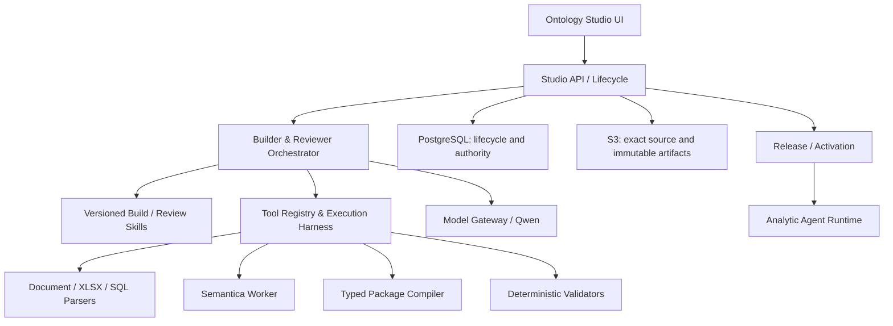

# Ontology Studio 通用产品重置方案 v2

状态：待产品评审  
日期：2026-08-22  
范围：Ontology Studio 产品及其向 Analytic Agent 交付的 Ontology Solution Package

## 1. 核心决策

Ontology Studio 不是 ADT/Cash Trading 的配置后台，也不是一个展示 Ontology 图谱的 Demo 页面。

它是一个通用的 Ontology Solution 生产系统：用户为任意业务场景创建空白 Solution，登记业务材料，启动受控的 AI 构建流程，复核候选语义资产，形成可验证、可发布、可被 Agent 消费的 Ontology Solution Package。

ADT 与 Cash Trading 只承担两种角色：

1. 可安装的参考 Solution Package；
2. 回归测试与演示数据集。

任何产品级代码不得以 ADT/Cash Trading 的 workspace ID、字段名、指标名或案例模板作为通用构建的必要条件。

产品组由两个独立产品组成：

- **Ontology Studio**：生产和治理 Ontology Solution Package。
- **Analytic Agent**：只消费已激活 Package，执行查询、分析、归因和探索。

二者通过稳定的 Package/Runtime Contract 连接，不共享页面状态，不让 Agent 读取 Studio Draft。

### 1.1 总体技术分层



模型只能通过 Orchestrator 获得工具结果；不能直接访问数据库、对象存储、文件路径、发布 API 或 Agent Runtime。

## 2. 第一性原理

企业输入不是 Ontology。输入通常只是需求描述、指标口径、数据模型、数据字典、样例数据和 SQL。产品的价值在于把这些不完整、相互矛盾、粒度不一的材料，转化为一套可复核的业务语义与执行契约。

因此主链必须同时满足：

1. **AI 负责构建候选，不负责创造权威**：所有模型产出都是 Candidate。
2. **工具负责约束能力边界**：解析、图构建、引用检查、公式检查、SQL 检查和 Package 编译由显式工具完成。
3. **证据与推断必须分开**：每个候选标记直接证据、确定性派生、模型推断、人工补充或缺失。
4. **完整不等于编造**：缺少材料时生成 Gap/Question，不得用貌似完整的字段掩盖缺口。
5. **发布的是可执行契约，不是好看的图**：图是编辑与理解视图，权威输出是版本化 Package。
6. **案例不进入内核**：案例差异存在于材料和可选扩展包，不存在于产品主流程。

## 3. 产品信息架构

### 3.1 产品级主页

`/ontology-studio/solutions`

这是 Studio 默认主页，也是左侧/顶栏的一级入口“Solutions”。它提供：

- Solution 列表、搜索、状态筛选；
- 新建空白 Solution；
- 从参考包复制为新 Solution（次要入口）；
- 打开、归档和删除未发布 Solution；
- 显示工作版本、已发布版本、运行版本和最近更新时间。

### 3.2 Solution 内六个一级模块

1. **概览**：当前状态、阻断项、最近构建、待复核数量和下一步动作。
2. **输入与证据**：业务需求、来源材料、精确版本、预览和证据锚点。
3. **构建与复核**：启动构建、查看阶段进度、候选列表/差异/图、人工处置。
4. **语义模型**：对象、属性、关系、指标、规则、流程、问题族等已进入 Draft 的资产。
5. **数据契约**：数据源、Schema、字段映射、Join、样例与 SQL 契约。
6. **质量与发布**：结构/语义/来源/公式/SQL/图一致性校验，版本发布、激活和回滚。

“AI 辅助”“Observation”“Semantica”都不是一级产品菜单。它们是“构建与复核”主流程中的内部能力。

## 4. 通用端到端业务流程

```mermaid
flowchart LR
    A[创建空白 Solution] --> B[登记并选择材料版本]
    B --> C[Builder Agent 制定构建计划]
    C --> D[解析与证据切片]
    D --> E[语义候选提取]
    E --> F[Semantica 图构建与关系补全]
    F --> G[Package Compiler 编译类型化候选]
    G --> H[Reviewer Agent 机器复核]
    H --> I[人工逐项接受/修改/拒绝/暂缓]
    I --> J[写入 Draft]
    J --> K[发布校验]
    K --> L[发布版本]
    L --> M[激活给 Analytic Agent]
```



### 4.1 创建

默认创建模式为 `BLANK`。用户只需填写：中英文名称、业务边界、Owner、默认语言、时区（可暂缺）。系统生成一个空白 Draft Envelope，但不预置任何案例语义。

Draft Envelope 允许资产集合为空，也允许保留 Gap、Question 和待确认字段。它不要求用假值凑成一个完整 `OntologyPackage`。只有进入 Release Validation 时，系统才把已复核资产物化为严格的 `OntologyPackage`；必填信息缺失应阻断发布并指向对应 Gap。

“从模板创建”保留为辅助方式，复制后必须形成新的 package ID 和独立生命周期；模板内容必须明确标记为参考来源，不能伪装成用户材料。

### 4.2 输入与证据

支持六类通用来源：

- 需求与业务过程描述；
- 指标口径；
- 数据模型；
- 数据字典/样例数据；
- SQL；
- 其他支持材料。

每次上传或转写都形成不可变的 Exact Source Version。材料行或表格单元被转换为可引用的 Evidence Fragment。原文件、解析结果和模型输入分别留存摘要，不能混为一份材料。

### 4.3 Builder Agent

Builder Agent 不是一个自由对话框。它运行一个版本化的 `ontology-build` Skill，并在受控 Harness 内调用工具。

它先根据现有材料生成 Build Plan，再按计划构建完整 Candidate Set。计划至少包含：预计资产类型、使用的来源、需要调用的工具、已知缺口和停止条件。

### 4.4 Semantica

Semantica 接收的是来源支撑的语义候选，不再接收现有 canonical package 作为“输入真相”。它负责：

- 实体归一和概念聚类；
- 对象/属性/关系图生成；
- 同义词与重复概念建议；
- 图结构检查和影响分析；
- 可选 RDF/OWL 投影。

其输出仍是 Proposal，不直接修改 Draft，不替代业务公式、SQL 或发布验证。

### 4.5 Reviewer Agent

Reviewer Agent 运行独立版本化的 `ontology-review` Skill。它只读 Candidate Package 与来源证据，调用验证工具后输出 Review Findings：

- 类型与字段是否完整；
- 引用对象是否存在；
- 每个声明是否有证据或明确推断标记；
- 对象、属性、关系、指标、规则、映射是否前后一致；
- 指标公式与 SQL 是否一致或存在无法证明的差异；
- 是否存在重复、冲突、循环依赖、孤立对象；
- 哪些缺口阻止发布，哪些只需要业务确认。

Reviewer Agent 不自动接受候选，也不修改来源。

### 4.6 人工复核

人工复核以 Candidate 为最小单位，支持：

- 接受；
- 修改后接受；
- 拒绝；
- 暂缓并创建待确认问题。

复核界面同时提供列表、类型化表单、来源证据、与当前 Draft 的 Diff、关系图和影响范围。批量操作只能用于低风险且同类的候选；指标、规则、映射、Join、Policy 默认逐项复核。

### 4.7 Draft、发布与激活

人工接受的类型化操作通过 CAS 写入 Draft。保存不等于发布；发布不等于激活。完整状态为：

`Draft → Validated → Released → Active`

Analytic Agent 只能读取 Active Snapshot。

## 5. LLM Skill 与 Tool Harness

### 5.1 Ontology Build Skill

Skill 是产品版本化资产，不属于 ADT/Cash 包。内容包括：

- Ontology Solution 的通用资产模型；
- 来源可信度与证据引用规则；
- 分阶段构建方法；
- ID、命名、语言、粒度和生命周期规范；
- 何时调用哪个工具；
- 何时必须输出 Gap 而不是候选；
- Candidate Set 的闭合 JSON Schema；
- 禁止发布、禁止把推断标为事实等行为约束。

### 5.2 Ontology Review Skill

内容包括：

- Package 结构与引用校验规则；
- 来源覆盖与声明上限；
- 指标/规则/SQL/映射的专项复核规则；
- 图一致性与重复概念检查；
- 风险分级和发布阻断规则；
- Review Finding 的闭合 JSON Schema。

### 5.3 Builder Harness 工具

| 工具 | 作用 | 权限 |
|---|---|---|
| `list_sources` | 获取本次选中的精确来源版本 | 只读 |
| `read_source_fragments` | 按页/行/单元格读取解析结果 | 只读 |
| `search_evidence` | 在来源片段中检索术语与字段 | 只读 |
| `extract_schema` | 从数据字典、XLSX、DDL 提取表字段 | 只读 |
| `parse_sql` | 提取表、字段、Join、过滤和表达式 | 只读 |
| `propose_semantic_atoms` | 生成带证据的原子候选 | Candidate-only |
| `build_context_graph` | 调用 Semantica 形成图提案 | Candidate-only |
| `resolve_duplicates` | 提议合并/别名，不自动合并 | Candidate-only |
| `compile_package_candidates` | 将候选编译为类型化 Package Operation | Candidate-only |
| `validate_candidate_package` | 运行确定性结构/引用校验 | 只读 |
| `record_gap` | 记录材料缺口和确认问题 | Candidate-only |

Harness 限制最大迭代、最大来源片段、最大输出、允许的工具序列和超时。每个工具调用形成可追溯 receipt。

## 6. 每阶段输入与输出

| 阶段 | 输入 | 输出 |
|---|---|---|
| Source Settlement | 用户选择的 Source Version IDs | `settled-source-set/v1` |
| Evidence Projection | 原文件/转写文本/表格/SQL | `evidence-fragment-set/v1` |
| Build Planning | 场景边界 + Evidence Fragment 元数据 | `ontology-build-plan/v1` |
| Semantic Extraction | Build Plan + Evidence Fragments | `semantic-atom-candidate-set/v1` |
| Graph Build | 来源支撑的语义原子 | `context-graph-proposal/v1` |
| Package Compilation | 原子候选 + 图提案 + 当前 Draft | `ontology-package-candidate/v1` |
| Machine Review | Candidate Package + Evidence Index | `ontology-review-report/v1` |
| Human Review | 候选、证据、机器 Findings | `human-review-decision-set/v1` |
| Draft Apply | 接受/编辑后的类型化操作 + revision | 新 Draft revision |
| Release Validation | 完整 Draft Package | `release-validation-report/v1` |
| Release | 通过验证的 Draft | 不可变 `ontology-solution-package/v2` |
| Activation | Release + runtime checks | Active Snapshot |

## 7. 权威输出：Ontology Solution Package

发布产物不是 14 个固定 YAML，也不是 HTML 报告。权威包建议采用以下结构：

```text
ontology-solution-package/
├── manifest.json
├── semantic/
│   └── ontology-package.json
├── lineage/
│   ├── source-manifest.json
│   ├── evidence-index.json
│   └── assumption-register.json
├── authoring/
│   ├── build-plan.json
│   ├── candidate-set.json
│   └── review-decisions.json
├── validation/
│   ├── structural-report.json
│   ├── semantic-report.json
│   ├── formula-sql-report.json
│   └── graph-report.json
├── runtime/
│   ├── agent-contract.json
│   ├── question-family.json
│   ├── tool-policy.json
│   └── evaluation-cases.json
└── projections/
    ├── ontology.ttl          # 可选派生物
    ├── shapes.ttl            # 可选派生物
    └── search-index.json     # 可重建派生物
```

`semantic/ontology-package.json` 继续承载当前经过类型化的对象、属性、关系、指标、规则、流程、数据源、映射、Join、Analysis Pattern、Policy 和 Question 等集合。RDF/OWL/SHACL 是可重建投影与额外验证能力，不取代 Package 的产品权威。

Candidate Package 与 Release Package 必须使用不同 contract 和存储命名，防止未复核内容被 Agent 消费。

三类状态对象必须分开：

- `solution-draft-envelope/v1`：允许不完整，承载已复核 Draft 资产、Gap 和 revision；
- `ontology-package-candidate/v1`：一次构建形成的未授权候选及其证据；
- `ontology-solution-package/v2`：通过发布门禁后形成的完整不可变权威包。

## 8. 现有模块处置

### 8.1 可直接复用

| 模块 | 复用理由 |
|---|---|
| Source Library | 已具备不可变版本、checksum、PostgreSQL/S3、文本/XLSX 预览和证据锚点基础 |
| Construction Job/Worker | 已具备 durable queue、lease、retry、cancel、stale fencing |
| Candidate/Disposition/Review Batch | 已具备 accept/edit/reject/defer 与不可变 review decision |
| PackageDraftOperation | 已具备按资产类型校验的 UPSERT/CONFIRM/DEPRECATE |
| CAS Workspace Store | 已具备 revision/digest 并发控制 |
| Semantic Package Validator | 可作为 Release Validation 的一部分 |
| Release/Activation/Rollback | 状态边界正确，可继续使用 |
| PostgreSQL + S3/MinIO | 适合权威元数据、不可变 artifact 与审计记录 |
| Semantica 独立 Worker 隔离 | 进程与依赖隔离方式正确 |
| EIX Design Tokens 与基础 Shell | 可作为 Studio/Agent 共享视觉基础 |

### 8.2 必须重构

| 当前模块 | 问题 | 重构目标 |
|---|---|---|
| ADT/Cash Workspace Service | Draft 模型和服务按案例分叉 | 一个通用 Draft Envelope Workspace；案例扩展仅为可选 plugin/profile |
| Solution Creation | 只能从模板 clone | 默认创建空白 Solution；模板为次要选项 |
| Source Projection | 固定识别两个 Excel sheet，并 fallback 到 canonical 包 | 通用 parser registry + Evidence Fragment contract；未知格式仍可被 LLM 读取 |
| StudioConstructionService | 主体是 deterministic demo projection + packaged baseline replay | Builder Agent Harness 驱动，产出完整 Candidate Package |
| Model Gateway | Studio profile、路径、响应 schema 写死 ADT | 产品级 Builder/Reviewer profile；按 Skill 版本而非案例路由 |
| Semantica Request | 输入当前 package 的 entities/relationships | 输入来源支撑的 semantic atoms 和证据锚点 |
| Candidate Compiler | 大量候选不可编译，完整候选来自现有 baseline | 从模型候选编译成所有资产类型的严格 Operation；失败形成 Finding/Gap |
| Studio Adapter Registry | 只允许 ADT/Cash adapter | 通用 adapter 为默认；案例 adapter 仅处理真正的扩展能力 |
| Studio UI | AI Workbench、巨大 hero、解释性文案和隐藏入口 | 围绕任务和状态的企业配置界面；AI 内嵌构建流程 |

### 8.3 从主链移除

- ADT 五槽位 Observation 工作台；
- 非 ADT 显示 `Not installed` 的 Studio LLM 判定；
- `canonical fallback`；
- 以现有 reviewed baseline 反向生成“候选”的 packaged-case compiler；
- 创建 Solution 时强制模板复制；
- `BOUNDED LLM CO-AUTHORING`、`HUMAN ONLY`、`MODEL RESPONSE` 等工程内部术语；
- 巨型深色说明卡、Demo/PoC 标识、无操作价值的 telemetry；
- 把 Semantica、RDF、OWL 当作独立用户任务的页面。

保留这些旧能力只允许作为迁移兼容层，不能再出现在新 Solution 的产品主流程中。

## 9. UI/UX 原则

1. 页面首先回答：我在哪、当前状态是什么、下一步能做什么。
2. 一级页面最多一个主操作；危险操作进入明确的二次确认。
3. 列表行整体可点击，行尾使用统一 action menu，不使用窄小“查看详情”按钮列。
4. 标题、正文、辅助信息、代码/ID 使用固定 Typography Token，不允许页面私自定义字号。
5. 不在页面重复解释产品方法论；必要解释进入帮助、tooltip 或空状态。
6. 建议、警告和错误使用统一状态组件，不以大面积彩色背景制造“AI 感”。
7. 图、列表和表单是同一资产的不同视图，共享选中状态和编辑入口。
8. 所有写操作都能看见保存结果、revision 变化和未保存状态。

## 10. 通用性验收

在恢复开发后，必须同时通过三组案例：

1. ADT；
2. Cash Trading；
3. 一个全新、代码中从未出现名称和字段的第三案例。

第三案例必须从空白 Solution 开始，仅通过公开产品能力完成：上传材料、运行 Builder、复核候选、写入 Draft、验证、发布、激活并由 Agent 回答至少一组问题。

验收门槛：

- 构建路径不得判断 ADT/Cash workspace ID；
- 不安装案例 profile 也能运行 Builder/Reviewer；
- 所有候选都有证据锚点或明确的推断/缺失标记；
- 可接受候选全部具有严格类型化 Operation；
- 无法编译的内容必须成为可见 Finding/Gap，不能静默丢失；
- 未经人工复核的候选不能进入 Draft；
- 未发布 Draft 不能被 Agent 使用；
- 三个案例使用同一套前端路由、API 和 Skill/Harness。

## 11. 实施顺序

### P0：冻结产品契约

- 冻结上述信息架构、状态机、Candidate/Release contract；
- 新增通用 workspace 与 BLANK Solution；
- 为旧 ADT/Cash workspace 建迁移适配层。

### P1：Builder/Reviewer 主链

- 建立产品级 `ontology-build` 与 `ontology-review` Skill；
- 建立 Tool Registry/Harness；
- 接入 Qwen 3.8 Max；
- 把 Semantica 改为消费 semantic atoms；
- 完成全类型 Candidate Compiler 和机器复核。

### P2：Studio 产品界面

- 按六个模块重构导航与路由；
- 完成空白创建、材料选择、构建运行、候选复核和 Draft 编辑；
- 移除 AI Workbench 与案例专属文案；
- 完成 EIX token、100% 缩放和桌面分辨率验收。

### P3：发布与通用性证明

- 用 ADT/Cash 作为回归包；
- 新建第三案例跑通端到端；
- 执行 anti-hardcode、API contract、持久化、并发、重试与视觉测试；
- 生成可部署镜像与产品手册。

### P4：Analytic Agent 调优

- 只基于 Active Snapshot 构建 Agent tool registry 和问题规划；
- 分别用 ADT、Cash 和第三案例做问数、分析、归因和证据回溯；
- 将 Agent 反馈形成新的 Studio Change Request，而不是直接修改 Package。

## 12. 本轮设计评审需要确认的四个决策

1. Studio 新建 Solution 是否默认且优先为“空白 Solution”，模板仅作为次要入口；
2. 是否接受 Build Skill + Review Skill + Tool Harness 作为通用构建内核；
3. 是否接受当前类型化 `OntologyPackage` 作为主权威模型，RDF/OWL/SHACL 作为派生投影；
4. 是否接受先完成 Studio 通用构建与发布，再进入 Analytic Agent 调优。

只有这四项冻结后才恢复开发。
