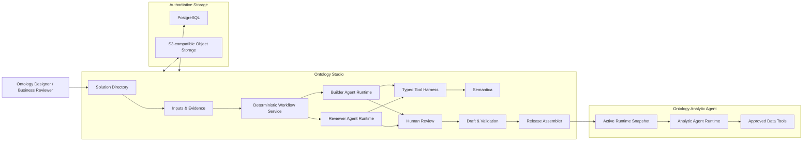

# Ontology Product Group 通用产品重置方案 v3

状态：候选方案，待 Product Owner 确认  
日期：2026-08-22  
范围：Ontology Studio、Ontology Analytic Agent，以及二者之间的 Solution Package 合同  
上一版：`ontology-studio-product-reset-v2.md`

## 1. 一句话结论

我们要建设的不是 ADT 和 Cash Trading 的配置后台，也不是一个展示 Ontology 图的 AI Demo。

我们要建设一个通用的企业分析 Ontology 产品组：

- **Ontology Studio** 把用户提供的需求、指标、数据模型、数据字典、样例数据和 SQL，加工成一套经过复核、可验证、可发布的 Ontology Solution。
- **Ontology Analytic Agent** 只消费已发布并激活的 Solution，完成查询、分析、归因、探索和证据回溯。

ADT 和 Cash Trading 只是两个可安装的 Reference Solution 和回归用例，不得成为产品内核的前提。

## 2. 产品范围

### 2.1 本阶段所谓“通用”

本阶段的目标是“**通用企业分析 Ontology**”，而不是试图覆盖世界上所有类型的知识图谱。

它需要支持：

- 业务对象、属性、关系和业务术语；
- 业务过程、分析问题和期望输出；
- 指标、规则、维度、时间口径和计算逻辑；
- 数据源、Schema、字段、映射、Join 和 SQL 合同；
- Agent 可支持的问题类型、工具能力和不支持边界。

首批场景是交易所业务分析，但上述内容必须能不修改产品主链地支持新的企业分析场景。

### 2.2 本阶段不做什么

- 不做“上传任意文件，AI 自动得到永远正确的 Ontology”的虚假承诺。
- 不让 LLM、Semantica 或图推理结果直接成为业务事实。
- 不把 RDF、OWL、SPARQL、SHACL 当成产品目标；它们是可选存储、投影、查询和验证能力。
- 不在本阶段设计企业 Knowledge Center 总体蓝图。它是未来的扩展话题。
- 不建设 Skill Marketplace、动态插件市场或跨 Solution 自动共享中心。
- 不因为 ADT/Cash Trading 需要某个字段或功能，就把它硬编码进通用内核。

## 3. 两个产品的边界

### 3.1 Ontology Studio

Studio 是 Ontology Solution 的生产和治理工具，负责：

- 创建、切换、复制、导入、归档 Solution；
- 登记原始材料和不可变版本；
- 使用 AI 和工具构建候选 Ontology；
- 复核、修改、接受、拒绝或暂缓候选内容；
- 管理 Draft，执行验证，创建不可变 Release；
- 准备并激活可被 Agent 消费的 Runtime Snapshot。

### 3.2 Ontology Analytic Agent

Agent 是 Ontology Solution 的运行时消费者，负责：

- 理解用户问题；
- 选择 Solution 允许的分析能力和工具；
- 使用已确认的口径、映射和规则计算；
- 对结果进行解释、比较、归因和证据展示；
- 对缺失、超出权限或不支持的问题澄清或拒答；
- 将运行中发现的语义问题提交为 Studio Change Request，而不是直接修改 Ontology。

### 3.3 产品级边界

- Agent 只读取已激活的 Runtime Snapshot。
- Agent 不读取 Studio Draft、未复核 Candidate、Builder 中间过程或人工复核备注。
- Studio 保存 Draft 不影响 Agent；创建 Release 也不自动切换 Agent 的 Active Snapshot。
- 两个产品可以相互链接，但不共享页面状态和写入权限。

## 4. 关键产品概念

| 概念 | 定义 |
|---|---|
| Solution | 一个具有独立身份、业务边界、版本和生命周期的 Ontology 分析方案。 |
| Blank Solution | 只包含 Solution 身份和空 Draft，不预置任何 ADT/Cash 或假造业务内容。 |
| Reference Solution | 已安装、只读、可演示和复制的参考方案。ADT 和 Cash Trading 属于此类。 |
| Template | 经过多个案例证明可复用、已去除特定业务事实的参数化结构。当前暂不把 ADT/Cash 冒充为 Template。 |
| Source Version | 用户每次登记或转写材料形成的不可变精确版本。 |
| Evidence Fragment | 从允许的文本、表格单元格、Schema 或 SQL 结构中提取的可引用片段。 |
| Candidate | Builder 或 Semantica 生成的未授权候选语义内容。 |
| Draft | 已经人工处置、允许不完整、可继续编辑的工作版本。 |
| Release | 通过发布门禁的不可变 Ontology Solution 版本。 |
| Runtime Snapshot | 从某个 Release 准备的、仅供 Agent 运行时消费的最小安全投影。 |

## 5. 产品总体架构



这张图中最重要的不是组件数量，而是两条边界：

1. **Workflow Service 与 LLM Agent Runtime 分开**：任务状态、重试、版本、并发控制、人工复核和发布由确定性代码管理；LLM 只负责在受控工具内构建和复核 Candidate。
2. **Studio 权威数据与 Agent Runtime 分开**：Agent 只消费 Runtime Snapshot，不能穿透到 Studio 的编辑和构建过程。

## 6. Studio 的端到端用户流程

### 6.1 创建 Solution

Studio 首页默认提供三种入口：

1. **新建空白 Solution**：主入口。
2. **复制 Reference Solution**：从 ADT、Cash Trading 等只读参考方案创建新 Solution，并保留参考来源。
3. **导入已发布 Package**：用于现有资产迁移或产品间交换。

“从 Template 创建”暂不作为主入口。等至少第三个真实场景验证出稳定共性后，再决定是否存在值得产品化的 Template。

### 6.2 登记输入和证据

用户可登记或上传：

- 需求文档和端到端业务过程；
- 指标逻辑；
- 数据模型；
- 数据字典、枚举和样例数据；
- 现有 SQL；
- 其他说明、报告或补充材料。

针对 Deloitte HK 只能人工转写的现实，Studio 要同时支持：

- 按我们的 Excel 模板转写的需求和指标逻辑；
- 直接提供的数据模型、数字字典和 SQL 文件；
- 人工描述、邮件截图和不完整材料；
- 明确记录我们自己补齐、纠正或合成的假设。

材料必须先转换成可引用的规范化 Evidence Fragment，再提供给 LLM。不支持的文件可登记，但不能假装已解析。

### 6.3 启动 Builder

用户选择本次构建要使用的材料版本，然后启动一次 Build Run。

Builder 完成：

1. 理解场景边界和期望产出；
2. 生成构建计划；
3. 读取受控证据片段；
4. 识别业务对象、关系、指标、规则、数据契约和问题类型；
5. 按构建计划需要使用 Semantica 完成实体归一、关系图提案和重复概念建议；
6. 把结果编译为类型化 Candidate；
7. 对无法从材料确认的内容生成 Gap 或 Clarification Question。

用户在这一阶段看到的是任务进度、已使用的材料、产出数量、缺口和下一步，而不是 Deep Agents、Qwen 或 Semantica 的工程 telemetry。

### 6.4 机器复核

Reviewer 使用独立的 Review Skill 和新的上下文，复查 Candidate、证据和确定性检查结果。

它的输出是“机器复核发现”，不是自动批准。它需要关注：

- 声明是否有证据；
- 不同材料是否冲突；
- 是否有明显遗漏、重复或引用断裂；
- 指标、规则、映射、Join 和 SQL 是否前后自洽；
- 哪些问题会阻断发布，哪些需要人工确认。

本阶段可以使用同一个 Qwen 模型的独立调用，但产品上不宣传成“独立 AI 审计”或“机器已验证业务正确”。

### 6.5 人工复核和 Draft

用户以 Candidate 为单位进行：

- 接受；
- 修改后接受；
- 拒绝；
- 暂缓并记录待确认问题。

复核页面同时展示：

- Candidate 的结构化内容；
- 与当前 Draft 的差异；
- 对应的精确证据；
- 机器复核发现；
- 上下游影响；
- 关系图视图。

只有经过人工处置并通过必要检查的内容才进入 Draft。Builder、Reviewer 和 Semantica 都没有直接写入 Draft 的权限。

### 6.6 验证、发布和激活

- **验证**检查某个精确 Draft 版本是否可发布。
- **发布**形成不可变 Release，但不自动影响当前 Agent。
- **准备 Runtime** 将 Release 转换为 Agent 可使用的 Runtime Snapshot，并检查运行时兼容性。
- **激活**将 Agent 切换到新 Runtime Snapshot；激活失败时旧版本保持可用。

因此产品不应用一根简单的线把所有状态表达为“Draft → Validated → Released → Active”。用户可以同时拥有新的 Draft、旧的 Release 和当前正在运行的 Active Snapshot。

## 7. AI 构建内核

### 7.1 Deterministic Workflow Service

它是普通后端代码，不是一个可以随意改变产品流程的 LLM Agent。

它负责：

- 启动、取消、重试和恢复构建任务；
- 锁定本次任务的材料版本、Skill 版本和工具权限；
- 把工具结果和 Agent 结果保存为可追溯产物；
- 管理 Candidate、Review、Draft、Validation、Release 和 Activation 之间的边界；
- 保证重试、重复提交或过期任务不会覆盖新版 Draft。

### 7.2 Builder/Reviewer Agent Runtime

Agent Runtime 提供有界的 ReAct 能力：读取证据、制定计划、调用工具、检查结果、继续或停止。

架构上先稳定四个接口：

- `BuilderAgentRuntime`；
- `ReviewerAgentRuntime`；
- `ModelExecutionGateway`；
- `ToolHarness`。

Deep Agents 作为 Builder Runtime 的首个候选实现进行有边界的技术验证。如果它不能比简化的工具调用循环显著提高构建质量和任务恢复能力，就不应为了使用框架而影响产品进度。

我们不自建一套通用 ReAct 框架，也不让 Deep Agents/LangGraph 成为业务状态的权威存储。

### 7.3 Build Skill 和 Review Skill

Skill 是产品版本化资产，不是某个 Case 目录下的临时 Prompt。

每个 Skill Package 建议包含：

```text
ontology-build/
├── manifest.json
├── SKILL.md
├── schemas/
├── references/
└── evals/
```

- `SKILL.md` 定义角色、方法、停止条件、禁止事项和工具使用策略。
- `schemas/` 定义输入输出结构。
- `references/` 存放通用 Ontology 建模规则和领域无关示例。
- `evals/` 保存不同缺陷、冲突和遗漏的评测样例。

Python 代码属于 Tool Harness，不塞进 Skill 文档。Skill 的优化通过发布新版本和运行评测完成，不需要改变产品总体架构。

### 7.4 Typed Tool Harness

第一批工具需要覆盖：

- 列出和读取本次选中的规范化证据；
- 检索术语、指标、字段和条件；
- 解析文本、XLSX、CSV、Schema 和受支持的 SQL；
- 提议对象、属性、关系、指标、规则和数据契约；
- 调用 Semantica 进行概念归一、图提案和重复检查；
- 将候选结果编译为类型化变更；
- 检查引用、类型、单位、粒度、映射和 Join 关系；
- 记录 Gap、冲突和待确认问题。

模型不获得 shell、任意文件系统、数据库、对象存储、发布、激活或运行时工具。权限由 Harness 强制执行，不靠 Prompt 口头约束。

### 7.5 Semantica 的定位

Semantica 是 Builder 可调用的图语义工具，不是 Studio 的主控框架，也不是发布权威。

它适合负责：

- 概念归一和聚类；
- 对象/属性/关系图提案；
- 同义词、重复概念和可能合并的建议；
- 图浏览、影响分析和可选 RDF/OWL 投影。

它不负责：

- 决定指标计算是否正确；
- 认证 SQL 与业务口径等价；
- 确定候选内容是业务事实；
- 直接修改 Draft 或发布 Package。

Semantica 是可降级能力。不可用时，Builder 仍可生成其他 Candidate 和 Gap，只是失去部分图增强能力。

## 8. Ontology Solution 的内容模型

### 8.1 不再把当前交易分析模型冒充为通用模型

当前 Package 中的 `market_id`、交易时间段、固定 Analysis Pattern 和部分查询字段明显属于交易分析场景。它们不应继续作为所有 Solution 必须填写的顶层字段。

新的产品模型分为两层：

### 8.2 通用语义核心

通用核心只包含跨场景稳定的内容：

- Solution 身份和业务边界；
- 术语、别名和多语言名称；
- 对象、属性和关系；
- 资产身份、依赖、负责人和治理状态；
- 经批准的来源、假设和决策引用。

### 8.3 版本化能力模块

本阶段至少需要：

| 能力模块 | 承载内容 |
|---|---|
| Business Process | Actor、Process、Step、Exception Path |
| Analytics | Dimension、Metric、Formula、Rule、Analysis Contract、Question Family |
| Tabular Data Contract | Data Source、Table、Field、Binding、Join、SQL Contract |
| Policy | Role、Scope、Field/Grain Restriction、Refusal Rule |
| Analytic Agent Contract | 可用分析能力、工具、输入要求、输出和不支持边界 |
| Exchange Analytics Extension | Market、Trading Calendar、Trading Period 和交易所特有分析语义 |

能力模块必须是版本化、可验证、可被 Runtime 识别的强类型合同，不使用一个无约束的 `extensions: {}` 容器解决所有问题。

### 8.4 不完整 Draft 和严格 Release 分开

- Draft 可以为空，可以存在 Gap、冲突和待确认问题，不需要填造假字段。
- Release 只包含通过发布门禁的已确认内容。
- 从 Draft 到 Release 的物化由确定性 Compiler 完成，不由 LLM 在发布时临时补字段。

### 8.5 Governance Release 与 Runtime Snapshot 分开

- **Governance Release** 保留已批准语义、来源、假设、复核和验证关系，用于 Studio 治理和审计。
- **Runtime Snapshot** 只包含 Agent 运行必需的语义、数据契约、工具策略和受控证据引用。

两者属于同一次发布权威，但是不同产物。Agent 只能访问 Runtime Snapshot。

## 9. Studio 信息架构

### 9.1 Studio 默认主页

`/ontology-studio/solutions`

这是进入 Studio 后的默认主页，并在主导航中使用明确的“Solutions”入口。

主页提供：

- Solution 列表、搜索和状态筛选；
- 新建空白 Solution；
- 复制 Reference Solution；
- 导入 Package；
- 打开、归档和管理 Solution；
- 展示工作版本、最新发布版本、当前运行版本和最近活动。

### 9.2 Solution 内六个一级模块

| 一级模块 | 用户要完成的事情 | 关键子页 |
|---|---|---|
| 概览 | 理解当前状态、阻断项、待复核数量和下一步 | 状态、最近活动、下一步 |
| 输入与证据 | 登记、预览、更新并选择材料版本 | 来源材料、证据片段、解析状态 |
| 构建与复核 | 启动 Build Run、查看进度和缺口、处置 Candidate | 构建任务、复核队列、差异、证据和影响 |
| 语义模型 | 查看和编辑已进入 Draft 的业务语义 | 对象与关系、指标与规则、问题与分析、知识图 |
| 数据契约 | 管理数据源、Schema、字段映射、Join 和 SQL | 数据源、映射、Join/SQL |
| 质量与发布 | 验证某个 Draft、创建 Release、准备/激活/回滚 Runtime | 验证与问题、Releases、Runtime |

“AI 辅助”、“Semantica”、“Observation”和“LLM Profile”都不是一级菜单。它们是构建与复核流程的内部实现。

### 9.3 编辑入口原则

- 每个可管理资产列表都有清晰的“新建”和“编辑”入口。
- 常见业务任务使用结构化表单，JSON/YAML 仅存在于专家模式。
- 图、列表、表单和影响分析是同一份资产的不同视图，使用同一编辑服务。
- 来源材料每行整体可点击，进入独立详情/预览页；不使用窄小的“查看详情”按钮列。
- 重要写操作明确显示保存结果、工作版本变化和未保存状态。
- 发布和激活只在对应任务页出现，不作为全局顶部常驻按钮。

### 9.4 EIX Design System

Studio 和 Agent 共享 EIX 的 Design Token、Typography、Spacing、Color、Elevation、Form、Status 和 Feedback 组件。

Studio 不直接复制 EIX 的 Chatbot 页面结构，而是在同一 Design System 下建设适合企业配置产品的导航、目录、表格、编辑器、任务、复核和发布界面。

硬性要求：

- 全局字号、行高和字重只使用统一 Typography Token；
- 不使用巨型 Hero、大段工程解释和浮夸 AI 文案；
- 不在用户界面显示 PoC/Demo 标记、模型内部状态和框架术语；
- 不用随意的蓝色左边、色块或阴影表示选中；
- 100% 、125% 和 150% 缩放下保持可读性和对齐；
- 页面首先回答“我在哪里、现在是什么状态、下一步能做什么”。

## 10. 技术方案

### 10.1 技术栈

| 层 | 选型 |
|---|---|
| Studio / Agent 前端 | React + TypeScript + EIX Design System |
| 产品 API | Python + FastAPI + Pydantic |
| 任务编排 | 现有持久化 Job/Worker + 确定性 Workflow Service |
| LLM Agent Runtime | 可替换接口；Deep Agents 作为首个候选验证 |
| 模型接入 | 统一 Model Gateway；当前使用用户提供的 Qwen 3.8 Max 配置，不让 API Key 进入 Skill 或案例包，产品合同不绑定模型厂商 |
| 权威元数据 | PostgreSQL |
| 原文件与不可变产物 | S3-compatible Object Storage |
| 图语义工具 | 独立 Semantica Worker，作为可降级内部工具 |
| 发布与运行 | Governance Release + Runtime Snapshot + Activation Pointer |
| 部署 | Docker + K8s，支持 ARM64 EC2/VM |

### 10.2 组件职责

- **Studio API**：Solution、Source、Draft、Review、Validation、Release 和 Activation 的权威接口。
- **Construction Worker**：执行可持久化构建任务，调用 Builder/Reviewer Runtime 和 Tool Harness。
- **Model Gateway**：统一管理模型、凭证、超时、限额和模型调用记录。
- **Parser/Evidence Service**：将允许的材料转换为规范化、可引用的证据片段。
- **Tool Harness**：为 LLM 提供受限的领域工具，验证参数、权限和输出结构。
- **Semantica Worker**：执行图构建、概念归一和图投影，不持有发布权限。
- **Compiler/Validator**：把已处置 Draft 编译成严格 Release，并检查引用、类型、指标、单位、粒度、数据契约和运行能力。
- **Analytic Agent Runtime**：加载已激活 Runtime Snapshot，将问题规划为可支持的确定性工具和分析步骤。

### 10.3 数据存储分工

PostgreSQL 存储：

- Solution 目录和生命周期；
- Source/Build/Review 任务状态；
- Draft revision 和并发控制；
- Validation、Release 和 Activation 元数据；
- 可检索的资产与任务索引。

S3 存储：

- 原始文件和精确版本；
- 规范化解析产物；
- Candidate、Review 和验证产物；
- 不可变 Governance Release；
- 不可变 Runtime Snapshot。

## 11. 现有工程的处置

### 11.1 保留并继续使用

| 能力 | 处置 |
|---|---|
| Solution Directory | 保留目录、搜索、版本和生命周期基础，改为 Blank-first。 |
| Source Library | 保留不可变版本、checksum、预览和证据锚点基础。 |
| Durable Job/Worker | 保留 queue、lease、retry、cancel 和过期任务保护。 |
| Candidate/Human Disposition | 保留候选处置、修改和审计基础。 |
| CAS Draft Store | 保留 revision/digest 并发控制。 |
| Validation/Release/Activation/Rollback | 保留它们的权威边界和旧版兼容能力。 |
| PostgreSQL/S3 | 保留为权威存储。 |
| Semantica Worker 隔离 | 保留独立 Worker 边界，改造输入输出。 |
| EIX Token 和已成熟的 UI 组件 | 保留，不再进行无目的换肤。 |

### 11.2 需要重构

| 当前能力 | 重构目标 |
|---|---|
| ADT/Cash 分叉 Workspace | 一个通用 Draft 和资产管理服务。 |
| Template-only Solution Creation | 空白创建为主，Reference Copy/Import 为辅。 |
| 案例固定 Source Projection | 通用 Parser/Evidence Registry。 |
| Deterministic Demo Construction | Builder Agent + Skill + Tool Harness 主链。 |
| ADT Observation LLM Workbench | 产品级 Builder/Reviewer Runtime。 |
| Canonical-context Semantica | 改为消费来源支持的语义候选。 |
| 只能处理部分类型的 Candidate Compiler | 支持本阶段能力模块的强类型编译和明确 Gap。 |
| 交易分析顶层 Package | 通用核心 + 能力模块 + 旧版兼容 Adapter。 |
| 分散编辑入口和 AI 工程页 | 六模块任务导向 Studio 和统一 Editor。 |

### 11.3 移出新产品主链

- `canonical fallback`；
- 使用已存在 reviewed baseline 反向生成“Candidate”；
- ADT 五槽位 Observation 工作台；
- 没有案例 profile 就显示 `Not installed` 的 AI 主流程；
- 在通用代码中判断 ADT/Cash workspace ID、指标 ID 或字段名；
- 模板复制作为唯一创建方式；
- 巨型 Hero、PoC/Demo 标记、AI 浮夸文案和框架术语。

这些能力可为了老版兼容短期保留，但不得继续出现在新 Solution 的产品流程中。

## 12. 纵向迭代路线

不再按“先做全部后端框架、再做全部前端、最后才看能不能用”的方式开发。

每个 Slice 都必须同时包含：用户操作、API、PostgreSQL/S3 持久化、错误恢复、自动化测试和可部署结果。

### Slice 1：真正的空白 Solution 和最小权威链

用户可以：

- 创建零业务资产的 Blank Solution；
- 登记一份材料；
- 手工创建一个对象或指标并关联证据；
- 验证、发布、准备 Runtime 并由 Agent 读取；
- 保证当前 ADT/Cash 运行版本不受影响。

这一步证明新产品的数据边界和两产品交付合同成立。

### Slice 2：材料到 Builder Candidate

用户可以：

- 选择精确材料版本；
- 启动一次持久化 Build Run；
- 由 Builder 读取证据并产出对象、属性、关系和一个指标的 Candidate；
- 看到证据、推断、Gap 和不支持内容；
- 在模型或 Semantica 不可用时获得可恢复错误或降级结果。

这一步证明 Builder 确实在从用户材料构建，而不是重放已知案例。

### Slice 3：Reviewer 和结构化 HITL

用户可以：

- 查看机器复核发现；
- 在结构化界面中比较 Candidate 与 Draft；
- 接受、修改后接受、拒绝或暂缓；
- 把已接受内容安全写入 Draft；
- 重新构建后看到新建、更新、重复、合并建议和废弃建议。

这一步证明 AI Candidate 与人工权威之间的产品边界。

### Slice 4：完整的分析语义和图工作台

扩展到：

- 指标、规则、维度、时间口径和分析问题；
- 数据源、Schema、映射、Join 和 SQL 合同；
- Semantica 概念归一、图提案、重复建议和影响分析；
- 列表、结构化表单、图和影响视图的统一编辑；
- 必要的指标、粒度、单位、Join 和数据契约检查。

这一步形成可完整演示的 Studio 产品主链。

### Slice 5：ADT/Cash Trading Reference Solution 迁移

- 将 ADT 和 Cash Trading 作为 Reference Solution 安装；
- 使用通用导航、构建、复核、编辑和发布路由；
- 保持已发布版本和当前 Active Snapshot 的兼容性；
- 移除通用代码中的案例分支和案例专属页面；
- 完成 EIX Design System 全局审计。

这一步证明参考案例已经回到产品之上，而不是产品围绕案例生长。

### Slice 6：盲测第三案例与 Agent 闭环

选择一个代码中没有出现过名称、字段和指标的新企业分析案例，从空白 Solution 开始，仅使用公开产品功能完成：

`Material → Build → Review → Draft → Validate → Release → Activate → Ask`

案例材料揭示后，不允许修改产品主链代码、增加案例 adapter 或为通过评测临时补专属逻辑。

这一步才是“通用产品”的关键证据。

## 13. 产品验收标准

### 13.1 通用性

- Blank Solution 初始业务资产数量为 0，不包含任何交易或案例假值。
- ADT、Cash Trading 和第三案例使用同一套 UI 路由、API、Build/Review Skill 和 Tool Harness。
- 第三案例揭示后，不需要修改通用产品代码或增加 case-specific profile。
- 产品主链不根据 ADT/Cash workspace ID、指标 ID 或字段名分支。

### 13.2 构建和复核

- Builder 必须从本次选定的 Source Version 和 Evidence Fragment 生成 Candidate，不得使用案例 baseline 补全。
- Candidate 必须具有证据、明确推断标记或 Gap，不得静默补齐。
- 不支持或无法编译的内容必须对用户可见，不得丢弃后宣称构建完成。
- Reviewer 不共享 Builder 的私有上下文，且只能输出复核发现。
- 未经人工处置的 Candidate 进入 Draft 的数量为 0。

### 13.3 发布与运行

- Draft 修改不影响已运行 Agent。
- 发布失败不会产生 Release，激活失败不会破坏当前 Active Snapshot。
- Agent 不能读取 Studio Draft、未复核 Candidate 和构建过程材料。
- 第三案例必须同时验证支持问题、需澄清问题和应拒答问题。
- Agent 的正确率、可覆盖问题范围和拒答/澄清能力分开评估。

### 13.4 产品体验

- Studio 进入默认落在 Solutions 首页。
- 用户可以从界面完成新建、构建、复核、编辑、验证、发布和进入 Agent，常规流程不需要直接编辑 JSON。
- 所有页面使用 EIX Typography、Spacing、Color、Elevation 和交互 Token。
- 在常用桌面分辨率及 100%、125%、150% 缩放下无页面级横向滚动和严重错位。
- 界面不出现 PoC/Demo 标识、案例专属 AI profile、框架术语或无操作价值的解释卡片。

## 14. 已确定和尚未确定的决策

### 14.1 已确定

- Studio 和 Analytic Agent 是产品组下的两个独立产品。
- 目标是通用产品 + 可安装 Reference Solution，不是两个定制 Demo。
- LLM 是 Ontology 构建和复核的核心生产力，不是可有可无的 Observation 助手。
- 产品流程和权威状态由确定性 Workflow Service 控制。
- Build Skill、Review Skill 和 Tool Harness 是通用构建内核。
- Semantica 是可降级的图语义工具，不是事实或发布权威。
- AI 产出只能是 Candidate，最终进入 Draft 和发布必须经过 HITL 和确定性验证。
- PostgreSQL、S3、React、K8s 作为产品技术栈。
- Studio 和 Agent 使用同一套 EIX Design System，但不共用相同页面形态。

### 14.2 建议按验证结果决定

- Builder Agent Runtime 最终使用 Deep Agents、LangGraph 还是更轻量的工具调用框架。
- 同一 Qwen 模型的 Reviewer 是否在评测中显著提高缺陷发现率。
- 真正 Template 能力是否值得在完成第三案例后产品化。
- Runtime Snapshot 中证据引用的精确粒度，以及 Agent 回溯证据的访问方式。

## 15. 本方案批准后的下一步

1. 将本文档标记为产品与技术候选基线，保留 v2 作为历史版本。
2. 把现有开发工作按 Slice 1–6 重新归类：保留、重构、移除或延后。
3. 为 Slice 1 生成可执行的产品需求、技术合同、任务拆分和验收测试。
4. 同时开展一个严格限界的 Builder Runtime 技术验证，对比 Deep Agents 与轻量方案，不阻塞 Slice 1 的产品主链。
5. 从 Slice 1 开始，每个切片必须形成可在 ARM64 K8s 环境部署、可通过 UI 验收的结果。

本文档在 Product Owner 明确批准前仍为 Candidate，不自动变成开发授权。
